这篇文章由 ROS 学习笔记合并整理而来，按基础概念、常用命令、工作空间、节点通信机制、DDS、Launch、坐标系管理和 URDF 的顺序组织。

---

## 1. 什么是ROS

机器人界的 Android

### 1 和 2 的区别

#### 架构

ROS 1 的架构下，所有节点需要使用 Master 进行管理
ROS 2 使用基于 DDS 的 Discovery 机制，和 Master 说拜拜

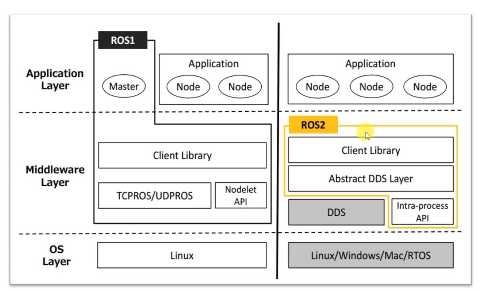

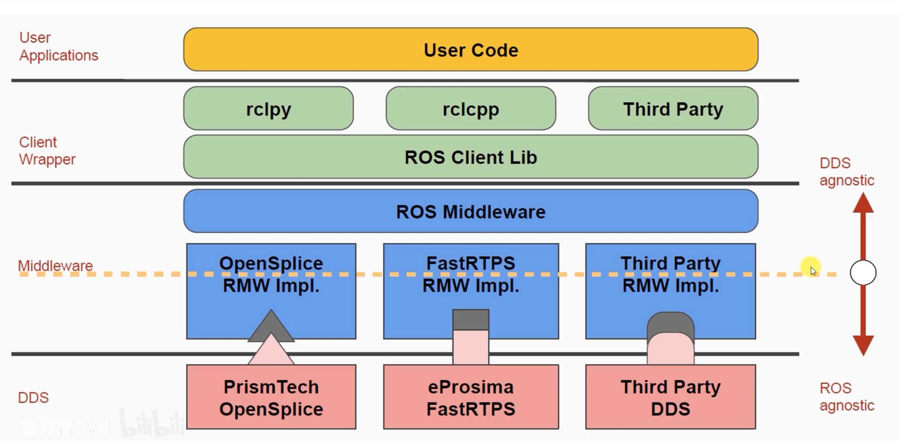

DDS 协议：数据分发服务

以数据为中心
#### 接口

重设 api
#### 编译器

新的编译系统 ament colcon

---

## 2. ROS CMD

#### 1. 核心概念与帮助

在任何命令后加上 `-h` 或 `--help` 可以查看详细帮助。
```bash
ros2 -h
ros2 run -h
ros2 node list -h
```

#### 2. 节点 (Node) 相关命令

节点是 ros2 中可执行的进程。

| 命令 | 描述 | 常用选项 |
| :--- | :--- | :--- |
| `ros2 node list` | **列出**当前所有活跃节点 | `--include-hidden` (显示隐藏节点) |
| `ros2 node info <node_name>` | 查看某个节点的**详细信息**（发布/订阅的主题、服务等） | |
| `ros2 node status` | (Galactic+) 显示节点的状态统计信息 | |

#### 3. 话题 (Topic) 相关命令

话题是节点间发布/订阅的异步通信机制。

| 命令 | 描述 | 常用选项 |
| :--- | :--- | :--- |
| `ros2 topic list` | **列出**所有活跃话题 | `-t` (显示话题类型), `--include-hidden` |
| `ros2 topic echo <topic_name>` | **显示**指定话题上发布的消息 | `-w <num>` (固定长度历史消息) |
| `ros2 topic info <topic_name>` | 查看话题的**信息**（类型、发布/订阅者数量） | |
| `ros2 topic type <topic_name>` | 查看话题的**消息类型** | |
| `ros2 topic pub <topic_name> <msg_type> <data>` | **向**指定话题**发布消息** | `-1` (发布一次后退出), `-r <rate>` (以固定频率发布) |
| `ros2 topic hz <topic_name>` | **统计**话题消息的**发布频率** | |
| `ros2 topic bw <topic_name>` | **统计**话题消息的**带宽** | |
| `ros2 topic delay <topic_name>` | (Galactic+) 显示话题消息的**延迟** | |

#### 4. 服务 (Service) 相关命令

服务是节点间请求/响应的同步通信机制。

| 命令 | 描述 | 常用选项 |
| :--- | :--- | :--- |
| `ros2 service list` | **列出**所有活跃服务 | `-t` (显示服务类型), `--include-hidden` |
| `ros2 service type <service_name>` | 查看服务的**类型** | |
| `ros2 service find <srv_type>` | 查找提供指定类型服务的**所有服务名** | |
| `ros2 service call <service_name> <srv_type> <arguments>` | **调用**一个服务 | `--wait` (等待服务可用) |

**示例：调用服务**
```bash
# 调用 /spawn 服务，生成第二个乌龟
ros2 service call /spawn turtlesim/srv/Spawn '{x: 5.5, y: 9.0, theta: 1.57, name: "turtle2"}'
```

#### 5. 参数 (Parameter) 相关命令

参数是节点的配置值，可以在运行时动态修改。

| 命令 | 描述 | 常用选项 |
| :--- | :--- | :--- |
| `ros2 param list` | **列出**某个节点的所有参数 | `--param-type` (显示参数类型) |
| `ros2 param get <node_name> <param_name>` | **获取**某个节点的参数**值** | |
| `ros2 param set <node_name> <param_name> <value>` | **设置**某个节点的参数**值** | |
| `ros2 param dump <node_name>` | 将节点的**所有参数导出**到 YAML 文件 | `--output-dir <dir>` (指定输出目录) |
| `ros2 param load <node_name> <parameter_file>` | 从 YAML 文件**加载参数**到节点 | |
| `ros2 param delete <node_name> <param_name>` | **删除**节点的某个参数 | |

**示例：参数操作**
```bash
# 列出 /turtlesim 节点的所有参数
ros2 param list /turtlesim

# 设置背景颜色的红色通道值
ros2 param set /turtlesim background_r 150

# 将所有参数导出到当前目录的 turtlesim. Yaml 文件
ros2 param dump /turtlesim > turtlesim. Yaml
```

#### 6. 动作 (Action) 相关命令

动作是长时间运行、可抢占、带有反馈的任务通信机制。

| 命令 | 描述 | 常用选项 |
| :--- | :--- | :--- |
| `ros2 action list` | **列出**所有活跃动作 | `-t` (显示动作类型) |
| `ros2 action info <action_name>` | 查看动作的**信息**（客户端/服务器） | |
| `ros2 action type <action_name>` | 查看动作的**类型** | |
| `ros2 action send_goal <action_name> <action_type> <goal_value>` | **发送**一个动作目标 | `--feedback` (显示反馈), `--cancel-after <sec>` (N 秒后取消) |

**示例：发送动作目标**
```bash
# 让乌龟旋转 360 度，并显示反馈信息
ros2 action send_goal /turtle 1/rotate_absolute turtlesim/action/RotateAbsolute "theta: 6.28" --feedback
```

#### 7. 功能包 (Package) 和构建 (Build) 相关命令

| 命令 | 描述 | 常用选项 |
| :--- | :--- | :--- |
| `ros2 pkg list` | **列出**所有已安装的功能包 | |
| `ros2 pkg create <pkg_name>` | **创建一个新的**功能包 | `--build-type {ament_cmake, ament_python}`, `--dependencies <deps>`, `--node-name <node_name>` |
| `ros2 pkg prefix <pkg_name>` | 查看功能包的**安装路径** | |
| `ros2 pkg executables <pkg_name>` | **列出**功能包中的**可执行文件** | |
| `ros2 pkg xml <pkg_name>` | 输出功能包的 **`package. Xml`** 内容 | |
| `colcon build` | **编译**工作空间中的功能包 | `--packages-select <pkg_name>` (只编译指定包), `--symlink-install` (符号链接安装，便于 Python 开发) |
| `colcon list` | 列出工作空间中所有功能包 | |

#### 8. 运行 (Run) 和启动 (Launch) 相关命令

| 命令 | 描述 | 常用选项 |
| :--- | :--- | :--- |
| `ros2 run <pkg_name> <executable_name>` | **直接运行**功能包中的某个**可执行节点** | `--ros-args` (传递 ROS 参数), `--param <name>:=<value>` |
| `ros2 launch <pkg_name> <launch_file.py>` | **通过启动文件运行**一组节点 | `--arguments <args>`, `--params-file <file>` |

**示例：运行节点**
```bash
# 运行 turtlesim 包中的 turtlesim_node 节点，并设置节点名和参数
ros2 run turtlesim turtlesim_node --ros-args --remap __node:=my_turtle --param background_r:=100
```

#### 9. 接口 (Interface) 相关命令

接口是消息 (. Msg)、服务 (. Srv) 和动作 (. Action) 的定义。

| 命令 | 描述 |
| :--- | :--- |
| `ros2 interface list` | **列出**所有可用的接口 |
| `ros2 interface show <interface_name>` | **显示**某个接口的**详细定义**（字段和类型） |
| `ros2 interface package <pkg_name>` | 列出某个功能包定义的**所有接口** |
| `ros2 interface packages` | 列出所有**包含接口定义**的功能包 |

#### 10. 分布式通信设置

在多机系统中至关重要。

| 命令 | 描述 |
| :--- | :--- |
| `export ROS_DOMAIN_ID=<ID>` | (Linux/macOS) **设置域 ID**，只有相同 ID 的节点才能通信 |
| `set ROS_DOMAIN_ID=<ID>` | (Windows) 设置域 ID |
| `export ROS_MASTER_URI=http://<host>:11311` | 设置主节点 URI (ROS 1 兼容性/某些桥接场景) |

#### 11. 数据录制与回放 (Bag)

| 命令                                      | 描述                      | 常用选项                          |
| :-------------------------------------- | :---------------------- | :---------------------------- |
| `ros2 bag record <topic1> <topic2> ...` | **录制**指定话题的数据           | `-o <name>` (设置输出文件名)         |
| `ros2 bag play <bag_file>`              | **回放**录制的数据包            | `-r <rate>` (回放速率 multiplier) |
| `ros2 bag info <bag_file>`              | 查看数据包的**信息**（包含的话题、时长等） |                               |
| `ros2 bag reindex <bag_file>`           | **修复**损坏的数据包            |                               |

#### 12. 守护进程管理

ros2 CLI 使用一个守护进程来缓存节点、话题等信息，加速查询。

| 命令 | 描述 |
| :--- | :--- |
| `ros2 daemon status` | 检查守护进程**状态** |
| `ros2 daemon stop` | **停止**守护进程 |
| `ros2 daemon start` | **启动**守护进程 |
| `ros2 daemon restart` | **重启**守护进程（在发现命令响应异常时首先尝试） |

---

#### 🚀 综合实战示例：Turtlesim

这是一个综合使用多种命令的经典示例：

1.  **启动模拟器：**
    ```bash
    ros2 run turtlesim turtlesim_node
    ```

2.  **查看节点和话题：**
    ```bash
    ros2 node list        # 应看到 /turtlesim
    ros2 topic list -t    # 应看到 /turtle 1/cmd_vel, /turtle 1/pose 等
    ```

3.  **控制乌龟运动（新开终端）：**
    ```bash
    ros2 run turtlesim turtle_teleop_key
    # 此时可以用键盘方向键控制乌龟移动
    ```

4.  **查看节点信息：**
    ```bash
    ros2 node info /turtlesim # 查看 turtlesim 节点发布了/订阅了哪些话题和服务
    ```

5.  **录制数据（新开终端）：**
    ```bash
    ros2 bag record /turtle 1/cmd_vel /turtle 1/pose
    ```
    控制乌龟运动一会儿，然后 `Ctrl+C` 停止录制。

6.  **回放数据（停止其他所有节点）：**
    ```bash
    ros2 bag play <生成的bag文件名>`
    ```
    你会看到乌龟按照刚才的路径自动运动，即使没有运行 `teleop` 节点。

希望这份超全的指南能成为你学习和开发 ros2 的得力助手！

---

## 3. workspace & pkg

### ROS 2 工作空间管理

#### 概述

存放项目开发相关文件的文件夹

Src: 代码空间 (Source Space)
Install: 安装空间 (Install Space)
Build：编译空间 (Build Space)
Log: 日志空间 (Log Space)

#### 1. Rosdepc - ROS 依赖管理工具 (中国用户推荐)

`rosdepc` 是 `rosdep` 的国内镜像版，解决了直接使用官方 `rosdep` 更新慢、失败率高的问题。

##### 安装 rosdepc

```bash
# 通过 pip 安装（推荐）
sudo pip install rosdepc

# 如果系统默认 python 是 python3，也可以使用 pip3
# sudo pip3 install rosdepc
```

##### 初始化 rosdepc

**只需在每台电脑上执行一次**：

```bash
# 初始化 rosdepc
sudo rosdepc init

# 更新 rosdepc 的数据库（从国内源，速度很快）
rosdepc update
```

##### 核心使用方法

在**工作空间的 `src` 目录同级**（即 `ros2_ws` 目录下）执行：

```bash
# 安装工作空间中所有功能包所需的系统依赖
rosdepc install -i --from-path src --rosdistro $ROS_DISTRO -y

# 分解说明：
# -i: --ignore-packages-from-source, 忽略源中的包（通常不需要，可省略）
# --from-path src: 从指定的 src 路径查找 package.xml
# --rosdistro $ROS_DISTRO: 指定你的 ROS 发行版（如 humble, iron 等）
# -y: 对所有提示自动回答 yes
```

**实际例子**（假设你的 ROS 版本是 humble）：
```bash
cd ~/ros2_ws
rosdepc install --from-path src --rosdistro humble -y
```

##### 检查依赖

```bash
# 检查但不安装依赖（用于查看缺少哪些依赖）
rosdepc check --from-path src --rosdistro $ROS_DISTRO
```

#### 2. Colcon - ROS 2 构建工具

`colcon` 是 ROS 2 的构建系统工具，替代了 ROS 1 中的 `catkin_make`。

##### 安装 colcon

```bash
# Ubuntu/Debian
sudo apt install python3-colcon-common-extensions

# 或者通过 pip
sudo pip install colcon-common-extensions
```

##### 核心构建命令

在**工作空间根目录**（`~/ros2_ws`）下执行：

```bash
# 基本构建：编译所有包
colcon build

# 编译特定包（最常用！）
colcon build --packages-select <your_package_name>

# 编译时跳过某些包
colcon build --packages-skip <package_to_skip>

# 并行编译以加快速度（使用所有CPU核心）
colcon build --parallel-workers $(nproc)

# 编译并创建符号链接（Python开发推荐）
colcon build --symlink-install

# 编译时跳过测试
colcon build --cmake-args -DBUILD_TESTING=0
```

##### 常用组合命令

```bash
# 开发中最常用的组合：只编译一个包，使用符号链接，并行编译
colcon build --packages-select my_package --symlink-install --parallel-workers $(nproc)

# 编译并忽略依赖错误（谨慎使用）
colcon build --packages-select my_package --allow-overriding my_package
```

##### 清理和重建

```bash
# 清理特定包的构建文件
colcon build --packages-select my_package --cmake-clean-first

# 彻底删除构建产物（需要重新编译）
rm -rf build install log

# 或者只删除特定包的构建产物
rm -rf build/my_package install/my_package
```

##### 信息查询命令

```bash
# 列出工作空间中的所有包
colcon list

# 显示包的详细信息
colcon info <package_name>

# 列出包中的可执行文件
colcon list --packages-select <package_name> --executables
```

#### 3. 完整工作流程示例

假设你要创建一个名为 `my_robot` 的新包：

```bash
# 1. 创建并进入工作空间
mkdir -p ~/ros2_ws/src
cd ~/ros2_ws

# 2. 创建Python包（假设依赖 rclpy 和 std_msgs）
ros2 pkg create my_robot --build-type ament_python --dependencies rclpy std_msgs

# 3. 安装系统依赖（关键步骤！）
rosdepc install -i --from-path src --rosdistro humble -y

# 4. 编写你的代码（编辑 src/my_robot/my_robot/my_robot_node.py 等文件）

# 5. 编译包（使用符号链接便于Python开发）
colcon build --packages-select my_robot --symlink-install

# 6. 激活工作空间
source install/setup.bash

# 7. 运行你的节点
ros2 run my_robot my_robot_node
```

#### 4. 故障排除技巧

##### Rosdepc 常见问题

```bash
# 如果初始化失败，可以尝试删除后重新初始化
sudo rm -rf /etc/ros/rosdepc
sudo rosdepc init
rosdepc update

# 如果某个依赖安装失败，可以手动安装
# 先查看需要什么依赖
rosdepc check --from-path src --rosdistro humble
```

##### Colcon 常见问题

```bash
# 如果编译失败，查看详细错误信息
colcon build --packages-select my_package --event-handlers console_direct+

# 如果Python包修改后没生效，检查是否使用了 --symlink-install
# 如果没有，需要重新编译或者使用符号链接重新构建
```

#### 5. 高级用法

```bash
# 运行测试
colcon test --packages-select my_package

# 生成编译数据库（用于IDE代码补全）
colcon build --cmake-args -DCMAKE_EXPORT_COMPILE_COMMANDS=ON

# 使用特定CMake配置
colcon build --cmake-args -DCMAKE_BUILD_TYPE=Release

# 编译后运行所有测试并显示结果
colcon test
colcon test-result --verbose
```

记住这个开发循环：**修改代码 → 编译 (`colcon build`) → 运行测试**。使用 `--packages-select` 可以显著提高开发效率，特别是大型项目中


好的，我们来详细梳理在工作空间（Workspace）中，功能包（Package）从创建、编写、构建到测试的完整流程和命令。

### ROS 2 工作空间内功能包 (Package) 完整管理指南

#### 1. 准备工作：创建与初始化工作空间

```bash
# 1. 创建工作空间目录结构
mkdir -p ~/ros2_ws/src
cd ~/ros2_ws

# 2. （可选但推荐）安装工作空间内所有包所需的系统依赖
# 注意：先确保已安装并初始化 rosdepc（如前所述）
rosdepc install -i --from-path src --rosdistro $ROS_DISTRO -y
# 示例（如果您的ROS2版本是Humble）：
# rosdepc install -i --from-path src --rosdistro humble -y
```

#### 2. 功能包创建 (Package Creation)

##### 创建新包的基本命令格式
```bash
cd ~/ros2_ws/src
ros2 pkg create <package_name> --build-type <build_type> --dependencies <dependencies>
```

##### 具体示例

**创建 C++ 包：**
```bash
ros2 pkg create my_cpp_pkg --build-type ament_cmake --dependencies rclcpp std_msgs
```

**创建 Python 包：**
```bash
ros2 pkg create my_py_pkg --build-type ament_python --dependencies rclpy std_msgs
```

**创建包含特定节点的包：**
```bash
# 创建时直接指定节点名
ros2 pkg create my_robot --build-type ament_cmake --node-name my_robot_node --dependencies rclcpp
```

**创建包含特定 launch 文件的包：**
```bash
# 创建时直接指定launch文件名
ros2 pkg create my_launch_pkg --build-type ament_cmake --dependencies rclcpp --launch-file my_launch.launch.py
```

##### 创建命令的常用选项
| 选项 | 说明 | 示例 |
|------|------|------|
| `--build-type` | 指定构建类型 | `ament_cmake`, `ament_python` |
| `--dependencies` | 指定 ROS 2 依赖 | `rclcpp rclpy std_msgs sensor_msgs` |
| `--node-name` | 创建时同时生成节点模板 | `my_node` |
| `--license` | 指定许可证 | `Apache-2.0`, `MIT` |
| `--description` | 包描述 | `"My awesome ROS2 package"` |

#### 3. 功能包构建 (Package Building)

##### 基本构建命令
在**工作空间根目录** (`~/ros2_ws`) 下执行：

```bash
# 构建所有包
colcon build

# 构建特定包（最常用！）
colcon build --packages-select <package_name>

# 构建时跳过某些包
colcon build --packages-skip <package_to_skip>
```

##### 高级构建选项
```bash
# 构建并使用符号链接（Python开发推荐）
colcon build --packages-select my_py_pkg --symlink-install

# 并行构建加速
colcon build --packages-select my_pkg --parallel-workers $(nproc)

# 构建并显示详细输出
colcon build --packages-select my_pkg --event-handlers console_direct+

# 构建时传递CMake参数（C++包）
colcon build --packages-select my_cpp_pkg --cmake-args -DCMAKE_BUILD_TYPE=Release

# 构建但不运行测试
colcon build --packages-select my_pkg --cmake-args -DBUILD_TESTING=0
```

##### 清理和重建
```bash
# 清理特定包的构建文件
colcon build --packages-select my_pkg --cmake-clean-first

# 彻底删除构建产物
rm -rf build/ install/ log/

# 只删除特定包的产物
rm -rf build/my_pkg/ install/my_pkg/
```

#### 4. 功能包测试 (Package Testing)

```bash
# 运行所有测试
colcon test

# 运行特定包的测试
colcon test --packages-select my_pkg

# 显示测试结果
colcon test-result --all

# 显示详细的测试结果（包括失败信息）
colcon test-result --verbose
```

#### 5. 功能包信息查询 (Package Inspection)

```bash
# 列出工作空间中所有包
colcon list

# 列出已安装的所有包（包括系统包）
ros2 pkg list

# 查看包的详细信息
ros2 pkg prefix my_pkg  # 查看安装路径
ros2 pkg xml my_pkg     # 查看package.xml内容

# 列出包中的可执行文件
ros2 pkg executables my_pkg

# 查看包的依赖关系
rosdep keys my_pkg      # 查看系统依赖
```

#### 6. 功能包运行 (Package Execution)

```bash
# 首先激活工作空间环境
source ~/ros2_ws/install/setup.bash

# 运行包中的节点
ros2 run my_pkg my_node

# 运行launch文件
ros2 launch my_pkg my_launch.launch.py

# 查看节点列表，确认节点已运行
ros2 node list
```

#### 7. 完整开发工作流示例

##### 示例：创建并开发一个 Python 包
```bash
# 1. 进入工作空间src目录
cd ~/ros2_ws/src

# 2. 创建Python包
ros2 pkg create my_py_package --build-type ament_python --dependencies rclpy --node-name my_py_node

# 3. 编辑节点代码
nano my_py_package/my_py_package/my_py_node.py
# （这里编写你的Python代码）

# 4. 编辑package.xml（如果需要添加更多依赖）
nano my_py_package/package.xml

# 5. 编辑setup.py（如果需要修改入口点）
nano my_py_package/setup.py

# 6. 返回工作空间根目录并安装依赖
cd ~/ros2_ws
rosdepc install -i --from-path src --rosdistro humble -y

# 7. 构建包（使用符号链接便于开发）
colcon build --packages-select my_py_package --symlink-install

# 8. 激活环境并运行
source install/setup.bash
ros2 run my_py_package my_py_node
```

##### 示例：创建并开发一个 C++包
```bash
# 1. 创建C++包
cd ~/ros2_ws/src
ros2 pkg create my_cpp_package --build-type ament_cmake --dependencies rclcpp --node-name my_cpp_node

# 2. 编辑CMakeLists.txt（如果需要修改编译选项）
nano my_cpp_package/CMakeLists.txt

# 3. 编辑源代码
nano my_cpp_package/src/my_cpp_node.cpp

# 4. 构建并运行
cd ~/ros2_ws
colcon build --packages-select my_cpp_package
source install/setup.bash
ros2 run my_cpp_package my_cpp_node
```

#### 8. 常用文件结构说明

##### C++ 包典型结构
```
my_cpp_package/
├── CMakeLists.txt          # 构建配置
├── include/               # 头文件
│   └── my_cpp_package/
├── package.xml            # 包元数据
├── src/                   # 源代码
│   └── my_cpp_node.cpp
└── test/                  # 测试代码
```

##### Python 包典型结构
```
my_py_package/
├── package.xml            # 包元数据
├── resource/             # 资源文件
├── setup.cfg             # Python安装配置
├── setup.py              # Python构建配置
├── test/                 # 测试代码
└── my_py_package/        # Python模块
    ├── __init__.py
    └── my_py_node.py     # 节点代码
```

#### 9. 故障排除技巧

```bash
# 如果找不到包，检查是否正确source了工作空间
echo $ROS_PACKAGE_PATH

# 如果编译失败，查看详细错误信息
colcon build --packages-select my_pkg --event-handlers console_direct+

# 如果依赖问题，检查package.xml中的依赖声明
# 并确保运行了rosdepc install
```

这个完整的流程涵盖了从包创建到运行的所有关键步骤。记住核心循环：**创建 → 编写 → 构建 → 测试 → 运行**。使用 `--packages-select` 可以大大提高开发效率！

---

## 4. Node

#### 1. Node 是什么？🤖

**Node = 一个做特定事的程序**
- 比如：一个控制电机的程序、一个读取相机数据的程序、一个处理图像的算法程序
- 每个 Node 只管好自己的事，通过 ROS 2 与其他 Node 聊天协作

#### 2. 最简单的理解方式 🎯

```bash
# 你的机器人系统里可能有这些 Node：
/camera_node     # 专门处理相机
/lidar_node      # 专门处理雷达  
/move_node       # 专门控制移动
/decision_node   # 专门做决策

# 它们这样聊天：
相机Node："我看到前面有障碍物" → (通过话题) → 决策Node
决策Node："请向右转" → (通过服务) → 移动Node
移动Node："正在转弯，已完成50%" → (通过动作) → 决策Node
```

#### 3. 简单代码示例

##### 1. Python 节点代码示例 🐍

###### 简单的发布者节点 (`my_publisher.py`)
```python
#!/usr/bin/env python3
import rclpy
from rclpy.node import Node
from std_msgs.msg import String
import time

class MyPublisher(Node):
    def __init__(self):
        super().__init__('my_publisher_node')
        self.publisher_ = self.create_publisher(String, 'chatter', 10)
        self.timer = self.create_timer(1.0, self.timer_callback)
        self.counter = 0
        self.get_logger().info('Publisher node started!')

    def timer_callback(self):
        msg = String()
        msg.data = f'Hello ROS2! Count: {self.counter}'
        self.publisher_.publish(msg)
        self.get_logger().info(f'Publishing: "{msg.data}"')
        self.counter += 1

def main(args=None):
    rclpy.init(args=args)
    node = MyPublisher()
    
    try:
        rclpy.spin(node)
    except KeyboardInterrupt:
        pass
    finally:
        node.destroy_node()
        rclpy.shutdown()

if __name__  '__main__':
    main()
```

###### 简单的订阅者节点 (`my_subscriber.py`)
```python
#!/usr/bin/env python3
import rclpy
from rclpy.node import Node
from std_msgs.msg import String

class MySubscriber(Node):
    def __init__(self):
        super().__init__('my_subscriber_node')
        self.subscription = self.create_subscription(
            String,
            'chatter',
            self.listener_callback,
            10)
        self.get_logger().info('Subscriber node started!')

    def listener_callback(self, msg):
        self.get_logger().info(f'I heard: "{msg.data}"')

def main(args=None):
    rclpy.init(args=args)
    node = MySubscriber()
    
    try:
        rclpy.spin(node)
    except KeyboardInterrupt:
        pass
    finally:
        node.destroy_node()
        rclpy.shutdown()

if __name__  '__main__':
    main()
```

##### 2. C++ 节点代码示例 ⚙️

###### 简单的发布者节点 (`my_publisher.cpp`)
```cpp
#include "rclcpp/rclcpp.hpp"
#include "std_msgs/msg/string.hpp"
#include <chrono>

using namespace std::chrono_literals;

class MyPublisher : public rclcpp::Node {
public:
    MyPublisher() : Node("my_publisher_node"), count_(0) {
        publisher_ = this->create_publisher<std_msgs::msg::String>("chatter", 10);
        timer_ = this->create_wall_timer(
            1s,
            std::bind(&MyPublisher::timer_callback, this));
        RCLCPP_INFO(this->get_logger(), "Publisher node started!");
    }

private:
    void timer_callback() {
        auto message = std_msgs::msg::String();
        message.data = "Hello ROS2! Count: " + std::to_string(count_++);
        publisher_->publish(message);
        RCLCPP_INFO(this->get_logger(), "Publishing: '%s'", message.data.c_str());
    }
    
    rclcpp::TimerBase::SharedPtr timer_;
    rclcpp::Publisher<std_msgs::msg::String>::SharedPtr publisher_;
    size_t count_;
};

int main(int argc, char * argv[]) {
    rclcpp::init(argc, argv);
    auto node = std::make_shared<MyPublisher>();
    rclcpp::spin(node);
    rclcpp::shutdown();
    return 0;
}
```

###### 简单的订阅者节点 (`my_subscriber.cpp`)
```cpp
#include "rclcpp/rclcpp.hpp"
#include "std_msgs/msg/string.hpp"

class MySubscriber : public rclcpp::Node {
public:
    MySubscriber() : Node("my_subscriber_node") {
        subscription_ = this->create_subscription<std_msgs::msg::String>(
            "chatter",
            10,
            std::bind(&MySubscriber::listener_callback, this, std::placeholders::_1));
        RCLCPP_INFO(this->get_logger(), "Subscriber node started!");
    }

private:
    void listener_callback(const std_msgs::msg::String::SharedPtr msg) const {
        RCLCPP_INFO(this->get_logger(), "I heard: '%s'", msg->data.c_str());
    }
    
    rclcpp::Subscription<std_msgs::msg::String>::SharedPtr subscription_;
};

int main(int argc, char * argv[]) {
    rclcpp::init(argc, argv);
    auto node = std::make_shared<MySubscriber>();
    rclcpp::spin(node);
    rclcpp::shutdown();
    return 0;
}
```


#### 4. 入口点 (Entry Point) 配置说明 🚪

**入口点 = 告诉系统："这个包里的这个文件是启动入口"**

##### 对于 Python 包 (`ament_python`)

**文件：`setup.py`**

```python
from setuptools import setup
import os
from glob import glob

package_name = 'my_py_pkg'

setup(
    name=package_name,
    version='0.0.0',
    packages=[package_name],
    data_files=[
        ('share/ament_index/resource_index/packages',
            ['resource/' + package_name]),
        ('share/' + package_name, ['package.xml']),
    ],
    install_requires=['setuptools'],
    zip_safe=True,
    maintainer='your_name',
    maintainer_email='your_email@example.com',
    description='TODO: Package description',
    license='TODO: License declaration',
    tests_require=['pytest'],
    
    # 🔥 最重要的入口点配置 🔥
    entry_points={
        'console_scripts': [
            # 格式：'节点名 = 包名.文件名:函数名'
            'my_node = my_py_pkg.my_node:main',
            'camera_driver = my_py_pkg.camera_node:main',
            'simple_publisher = my_py_pkg.simple_pub:main',
        ],
    },
)
```

**对应文件结构：**
```
my_py_pkg/
├── setup.py          # 在这里配置入口点
├── package.xml
└── my_py_pkg/        # Python包目录
    ├── __init__.py
    ├── my_node.py    # 包含 main() 函数
    ├── camera_node.py
    └── simple_pub.py
```

##### 对于 C++ 包 (`ament_cmake`)

**文件：`CMakeLists.txt`**

```cmake
# 添加可执行文件
add_executable(my_cpp_node src/my_cpp_node.cpp)

# 链接ROS2库
ament_target_dependencies(my_cpp_node
  "rclcpp"
  "std_msgs"
)

# 🔥 最重要的入口点配置 🔥
# 安装可执行文件到 lib/<包名>
install(TARGETS
  my_cpp_node
  camera_driver
  simple_publisher
  DESTINATION lib/${PROJECT_NAME}
)

# 安装启动文件等其他资源
install(DIRECTORY
  launch
  DESTINATION share/${PROJECT_NAME}
)
```

**对应文件结构：**
```
my_cpp_pkg/
├── CMakeLists.txt    # 在这里配置编译和安装
├── package.xml
├── include/
└── src/
    ├── my_cpp_node.cpp      # 主函数在这里
    ├── camera_driver.cpp
    └── simple_publisher.cpp
```

#### 5. 如何创建和运行 🏃

##### 创建包时指定入口点

```bash
# 创建Python包并指定节点名（自动配置入口点）
ros2 pkg create my_pkg --build-type ament_python --node-name my_node

# 创建C++包并指定节点名（自动配置入口点）  
ros2 pkg create my_pkg --build-type ament_cmake --node-name my_node
```

##### 手动添加多个入口点

如果已经创建了包，需要添加更多节点：

**对于 Python：**
1. 在 `my_py_pkg/` 目录下创建新的 `.py` 文件
2. 确保文件中有 `def main():` 函数
3. 在 `setup.py` 的 `entry_points` 中添加新行

**对于 C++：**
1. 在 `src/` 目录下创建新的 `.cpp` 文件
2. 在 `CMakeLists.txt` 中添加 `add_executable()` 和 `ament_target_dependencies()`
3. 在 `install(TARGETS ...)` 中添加新的可执行文件名

#### 6. 构建和运行 🏗️

```bash
# 构建包
colcon build --packages-select my_pkg

# 运行节点（系统会自动找到入口点）
ros2 run my_pkg my_node
ros2 run my_pkg camera_driver
ros2 run my_pkg simple_publisher
```

#### 7. 重要提醒 ⚠️

1. **Python 文件需要可执行权限**：
   ```bash
   chmod +x my_py_pkg/my_node.py
   ```

2. **每次修改 `setup.py` 或 `CMakeLists.txt` 后需要重新构建**

3. **入口点名字可以自定义**，不一定要和文件名一样

4. **一个包可以有多个入口点**（多个可执行节点）

#### 8. 简单总结 🎯

| 项目 | Python 包 | C++ 包 |
|------|-----------|--------|
| **配置文件** | `setup.py` | `CMakeLists.txt` |
| **配置位置** | `entry_points` | `add_executable()` + `install()` |
| **文件要求** | 要有 `def main():` 函数 | 要有 `int main()` 函数 |
| **构建后** | 生成在 `install/lib/python3.10/site-packages/` | 生成在 `install/lib/包名/` |

**最简单的理解：入口点就是告诉 ROS 2："当我运行 `ros2 run 包名 XXX` 时，到底应该执行哪个文件！"**

---

## 5. Topic

好的！我们来详细解释 ROS 2 中 Node 间传输数据的重要机制：**Topic（话题）**。

### ROS 2 Topic（话题）详解

#### 1. Topic 是什么？📡

**Topic = Node 之间的聊天频道**
- 就像微信群：一个人发言（发布），多个人收听（订阅）
- **异步通信**：发言者不管有没有人听，都会一直说
- **一对多通信**：一个话题可以有多个发布者和多个订阅者
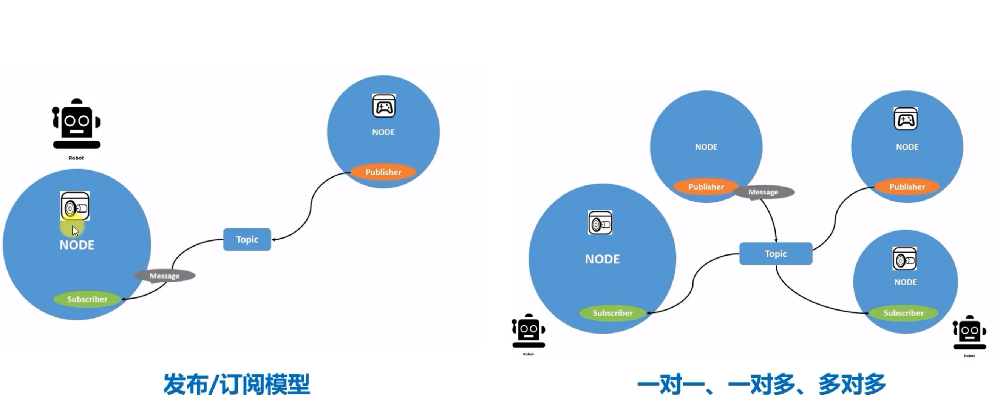
#### 2. 直观比喻 🎯

```bash
# 现实世界的例子：
传感器Node："温度是25°C" → /temperature_topic → 显示Node、控制Node、记录Node

# 就像：
新闻电台 → 广播频率 → 所有收音机听众
```

#### 3. Topic 通信模型 📊

```
[发布者 Node] → (消息) → [/topic_name] → (消息) → [订阅者 Node]
      ↑                          ↑                          ↑
   Publisher                    Topic                    Subscriber
    (说话)                     (聊天频道)                   (听话)
```

#### 4. 核心特性 ✨

| 特性       | 说明                   |
| -------- | -------------------- |
| **异步**   | 发布者不需要等待订阅者响应        |
| **解耦合**  | 发布者和订阅者互相不知道对方存在 |
| **多对多**  | 支持多个发布者和多个订阅者        |
| **类型安全** | 每个 Topic 有固定的消息类型    |
| **实时性**  | 适合连续数据流传输            |

#### 5. 常用命令 🛠️

##### 查看 Topic 信息
```bash
# 列出所有活跃的Topic
ros2 topic list

# 列出Topic并显示消息类型
ros2 topic list -t

# 查看Topic的详细信息
ros2 topic info /chatter

# 查看Topic的消息类型
ros2 topic type /chatter
```

##### 监听和发布数据
```bash
# 监听某个Topic的消息（实时显示）
ros2 topic echo /chatter

# 手动向Topic发布消息
ros2 topic pub /chatter std_msgs/msg/String "{data: 'Hello ROS2'}"

# 以固定频率发布消息
ros2 topic pub /chatter std_msgs/msg/String "{data: 'Hello'}" --rate 1

# 查看Topic的消息频率
ros2 topic hz /chatter

# 查看Topic的数据带宽
ros2 topic bw /chatter
```

#### 安装写好的功能包

```bash 
sudo apt install ros-humble-usb-cam
```
作用：安装摄像头驱动 

- **相机驱动底层代码**：`usb_cam` 包已经处理了USB设备的打开、数据采集、格式转换等复杂工作
    
- **图像消息的序列化/反序列化**：ROS2已经提供了标准的 `sensor_msgs/Image` 消息类型
    
- **通信底层代码**：Topic的发布订阅机制ROS2已经实现好了
##### 场景1：直接使用（最简单）

如果你只是想要显示摄像头画面，确实不用写代码
```shell
ros2 run usb_cam usb_cam_node_exe
ros2 run learning_topic topic_webcam_sub
```

##### 场景2：自定义处理（最常见）
```python
#!/usr/bin/env python3
import rclpy
from rclpy.node import Node
from sensor_msgs.msg import Image
from cv_bridge import CvBridge
import cv2

class MyImageProcessor(Node):
    def __init__(self):
        super().__init__('my_image_processor')
        # 订阅原始图像
        self.subscription = self.create_subscription(
            Image,
            '/image_raw',  # 订阅usb_cam发布的话题
            self.image_callback,
            10)
        self.bridge = CvBridge()
        
    def image_callback(self, msg):
        # 将ROS图像消息转换为OpenCV格式
        cv_image = self.bridge.imgmsg_to_cv2(msg, "bgr8")
        
        # 在这里添加你的处理代码
        # 例如：图像识别、边缘检测、目标跟踪等
        gray_image = cv2.cvtColor(cv_image, cv2.COLOR_BGR2GRAY)
        edges = cv2.Canny(gray_image, 100, 200)
        
        # 显示处理结果
        cv2.imshow('Processed Image', edges)
        cv2.waitKey(1)

def main(args=None):
    rclpy.init(args=args)
    node = MyImageProcessor()
    rclpy.spin(node)
    rclpy.shutdown()

if __name__  '__main__':
    main()
```

### 问题

异步传输数据

发布者一直在对外发布信息，并不知道接收者究竟有没有接收到信息

因此可以用service 来解决

---

## 6. Service

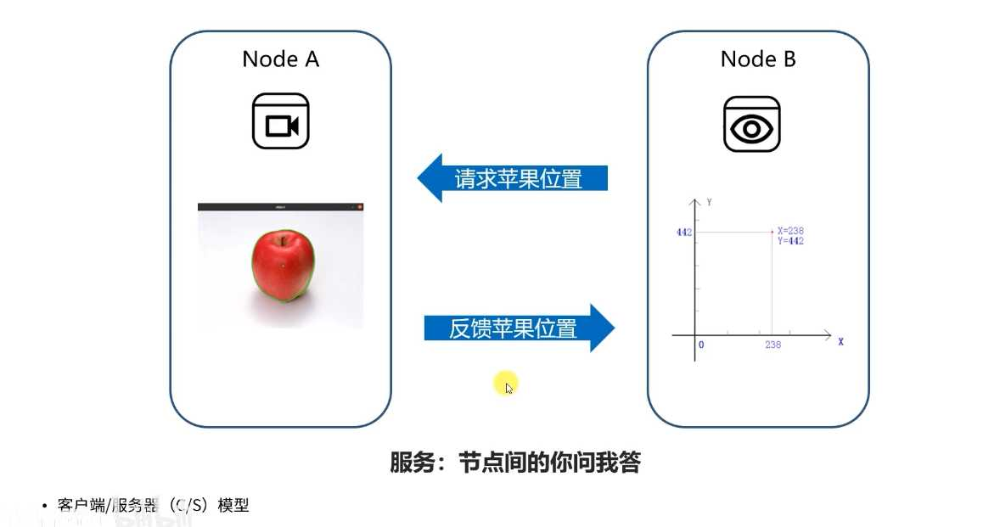
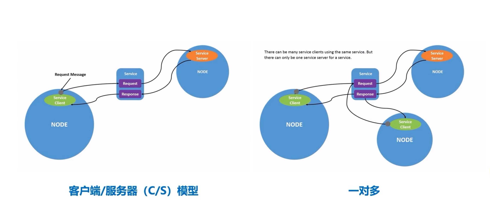

---

## 7. Action

#### 1. Action 是什么？🎯

**Action = 处理长时间、可取消、有进度反馈的任务的机制**

就像点餐后的完整流程：
- 下单（目标） → 厨师开始做菜（执行） → 不时汇报进度（反馈） → 上菜（结果）
- 或者：中途可以取消订单（取消）
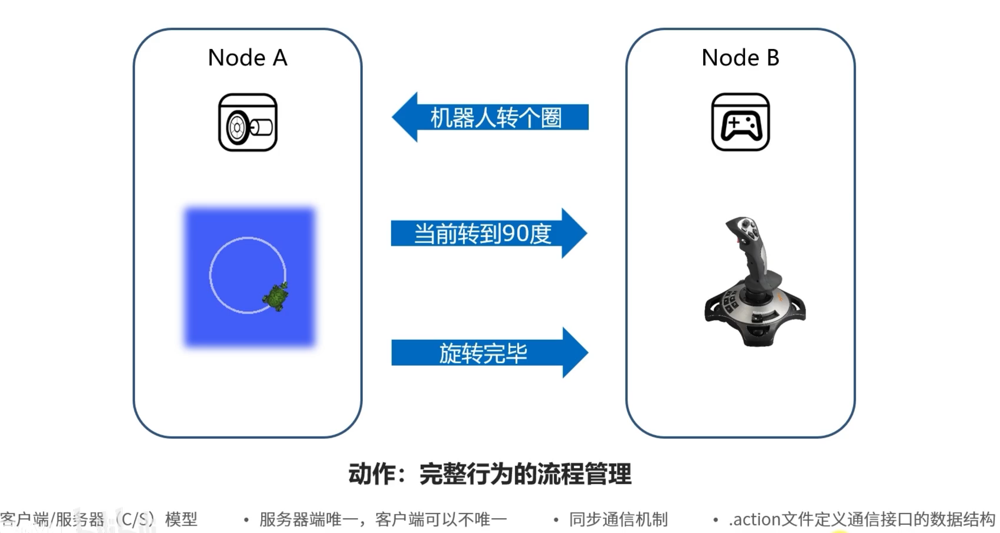

其实是通过 service 和 topic 来实现的
实际上就是一种应用层的通信机制

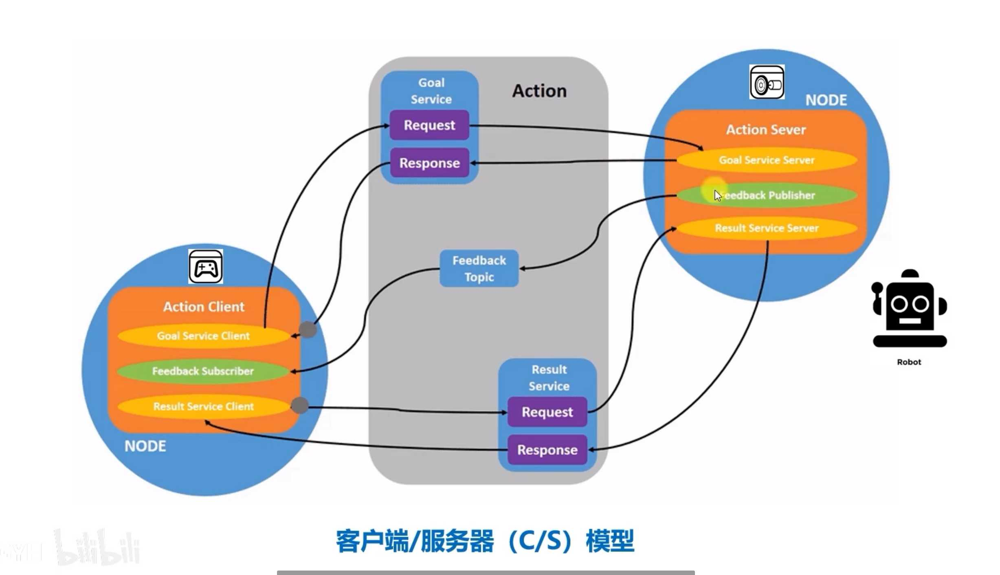
#### 2. 直观比喻 🍳

```bash
# 客户端："请做一份披萨，30分钟内完成"
# 服务端："开始做披萨...20%完成...50%完成...披萨做好了！"

# 或者：
# 客户端："取消做披萨！"
# 服务端："好的，已取消"
```

#### 3. Action 通信模型 📊

```
[客户端 Node] → (目标) → [/action_name] → (目标) → [服务端 Node]
     ↓               ↓               ↓               ↓
  Client          Action           Action         Server
 (顾客)           (订单系统)        (订单系统)       (厨师)
     ↓               ↓               ↓               ↓
[等待结果] ← (结果) ← [反馈] ← (进度) ← [执行任务]
     ↑               ↑               ↑               ↑
  取消指令 → → → → → → → → → → → → → → → 取消处理
```

#### 4. Action 的核心组成 🧩

一个 Action 包含三部分：

1. **Goal**（目标）：要执行的任务（比如"导航到 x, y 位置"）
2. **Feedback**（反馈）：执行过程中的进度更新（比如"已完成 50%"）
3. **Result**（结果）：最终的执行结果（比如"成功到达"或"失败原因"）

#### 5. 与 Service、Topic 的对比 📋

| 方面 | Action | Service | Topic |
|------|---------|---------|-------|
| **通信模式** | 异步，有反馈 | 同步，请求-响应 | 异步，发布-订阅 |
| **持续时间** | 长时间运行 | 瞬时完成 | 持续数据流 |
| **交互性** | 可取消，有进度反馈 | 不可取消，无反馈 | 无交互 |
| **适用场景** | 导航、机械臂控制 | 计算、查询 | 传感器数据 |

#### 6. 常用命令 🛠️

##### 查看 Action 信息
```bash
# 列出所有活跃的Action
ros2 action list

# 列出Action并显示类型
ros2 action list -t

# 查看Action信息
ros2 action info /turtle1/rotate_absolute

# 查看Action类型
ros2 action type /turtle1/rotate_absolute
```

##### 发送 Action 目标
```bash
# 发送Action目标
ros2 action send_goal /turtle1/rotate_absolute turtlesim/action/RotateAbsolute "{theta: 1.57}"

# 发送目标并显示反馈
ros2 action send_goal /turtle1/rotate_absolute turtlesim/action/RotateAbsolute "{theta: 3.14}" --feedback

# 取消Action目标（需要先知道goal_id）
ros2 action cancel_goal <goal_id>
```

#### 7. Action 消息结构 📝

##### Action 定义文件 (`RotateAbsolute.action`)
```
# Goal - 目标
float32 theta
---
# Result - 结果
float32 delta
---
# Feedback - 反馈
float32 remaining
```

---

## 8. Params

##### 1. 核心概念：什么是参数（Params）？

在 ros2 中，**参数是节点在运行时可配置的配置值**。

你可以把它们想象成一个节点的“设置”或“选项”。与通过主题（Topic）和服务（Service）进行的动态、频繁的通信不同，参数通常用于设置那些在节点启动后不经常改变，但又需要灵活配置的变量。

**一个简单的类比：**
将节点比作一个电视，主题和服务就像是遥控器，用于实时切换频道和调整音量。而参数则像是电视**后背的物理旋钮或菜单设置**，用于配置屏幕亮度、色彩、语言等，你通常不会在观看时频繁调整它们，但在初次 setup 或偶尔优化时非常重要。

---

##### 2. 参数的核心特性

1.  **动态配置性**：参数可以在节点运行时（online）通过命令行、API 或图形化工具动态地读取和修改，而无需重启节点。这极大地提高了系统的灵活性和可调试性。
2.  **由节点管理**：每个节点都拥有自己独立的参数空间。一个节点的参数与另一个节点的参数是隔离的，即使参数名相同也不会冲突。
3.  **具有类型**：每个参数都有一个明确的数据类型，例如 `integer`、`double`、`string`、`boolean`、`byte arrays` 以及这些类型的列表（arrays）。
4.  **可被监控**：节点可以设置回调函数，当某个参数的值被外部修改时，该回调函数会被触发，节点可以据此执行相应的操作（例如，应用新的配置）。

---

##### 3. 参数的使用场景

参数非常适合用于以下情况：

*   **配置硬件设置**：例如，配置相机节点的分辨率、帧率。
*   **算法参数调优**：例如，配置机器人导航算法中的最大速度、安全距离、PID 控制器增益等。
*   **设置节点行为模式**：例如，通过一个 `string` 类型的参数选择不同的策略模式（如 "aggressive" 或 "cautious"）。
*   **初始化设置**：例如，设置机器人的名称、模拟模式还是真实模式等。

---

##### 4. 参数的工作机制：服务与动作

参数系统并非基于主题（Pub/Sub），而是基于一套**服务（Services）和动作（Actions）** 的架构。

每个支持参数的节点内部都会自动创建以下几个服务：

1.  `~/describe_parameters`： 获取参数描述。
2.  `~/get_parameter_types`： 获取参数类型。
3.  `~/get_parameters`： **读取**一个或多个参数的值。
4.  `~/set_parameters`： **设置**一个或多个参数的值。
5.  `~/set_parameters_atomically`： 原子性地设置多个参数的值（要么全部成功，要么全部失败，防止出现中间状态）。
6.  `~/list_parameters`： 列出节点中的所有参数。

此外，还有一个**动作（Action）**：
*   `~/parameter_events`： 这是一个发布者，当参数发生变化时，节点会通过这个动作发布一个“参数事件”消息，通知系统其他部分参数发生了更改。

当你使用 `ros2 param set` 这样的命令行工具时，该工具实际上是在幕后调用目标节点的 `~/set_parameters` 服务。

---

##### 5. 如何使用参数（代码层面）

以下是一个在 Python 节点中声明和使用参数的简单示例：

```python
import rclpy
from rclpy.node import Node
from rclpy.parameter import Parameter

class MyNode(Node):
    def __init__(self):
        super().__init__('my_node')
        
        # 1. 声明参数并设置默认值
        self.declare_parameter('my_string_param', 'default_value')
        self.declare_parameter('my_int_param', 10)
        self.declare_parameter('my_bool_param', True)
        
        # 2. 获取参数值
        my_string = self.get_parameter('my_string_param').value
        my_int = self.get_parameter('my_int_param').value
        my_bool = self.get_parameter('my_bool_param').value
        
        self.get_logger().info(f'String param: {my_string}')
        self.get_logger().info(f'Int param: {my_int}')
        self.get_logger().info(f'Bool param: {my_bool}')
        
        # 3. （可选）设置参数变更回调函数
        # 当任何参数被外部修改时，此函数都会被调用
        self.add_on_set_parameters_callback(self.parameter_change_callback)
    
    def parameter_change_callback(self, params):
        """参数变更回调函数"""
        for param in params:
            self.get_logger().info(f'Parameter {param.name} changed to {param.value}')
            
            # 你可以在这里检查特定参数并做出反应
            if param.name  'my_int_param' and param.type_  Parameter.Type.INTEGER:
                self.get_logger().info(f'New int value is: {param.value}')
                # 这里可以触发重新配置算法等操作
        
        # 返回一个成功的状态对象，表示参数接受更改
        # 你也可以在这里验证参数值，如果值非法，可以返回一个不成功的状态来拒绝此次更改。
        return SetParametersResult(successful=True)

def main(args=None):
    rclpy.init(args=args)
    node = MyNode()
    rclpy.spin(node)
    rclpy.shutdown()

if __name__  '__main__':
    main()
```

在 C++ 中也有类似的 API。

---

##### 6. 如何使用参数（命令行工具）

ros2 提供了一系列强大的命令行工具来管理参数：

*   `ros2 param list <node_name>`： 列出某个节点的所有参数。
    ```bash
    ros2 param list /my_node
    # 输出： /my_node:
    #   my_bool_param
    #   my_int_param
    #   my_string_param
    ```

*   `ros2 param get <node_name> <param_name>`： 获取某个参数的当前值和类型。
    ```bash
    ros2 param get /my_node my_int_param
    # 输出： Integer value is: 10
    ```

*   `ros2 param set <node_name> <param_name> <value>`： 设置某个参数的值。
    ```bash
    ros2 param set /my_node my_int_param 42
    # 输出： Set parameter successful
    ```

*   `ros2 param dump <node_name>`： 将节点的所有当前参数值导出到一个 YAML 文件中。
    ```bash
    ros2 param dump /my_node > my_node_params.yaml
    ```
    生成的 YAML 文件内容类似：
    ```yaml
    /my_node:
      ros__parameters:
        my_bool_param: true
        my_int_param: 42
        my_string_param: "default_value"
    ```

*   `ros2 param load <node_name> <parameter_file>`： 从一个 YAML 文件中加载参数值并应用到节点。
    ```bash
    ros2 param load /my_node my_node_params. Yaml
    ```

*   **启动时加载参数**： 更常见的做法是在启动节点时直接通过启动文件（Launch File）加载参数文件。
    ```python
    # 在 Python launch 文件中
    From launch_ros. Actions import Node

    Node = Node (
        Package='my_package',
        Executable='my_node_executable',
        Name='my_node',
        Parameters=['path/to/my_node_params.Yaml'] # 关键在这里
    )
    ```

---

## 9. 分布式通信

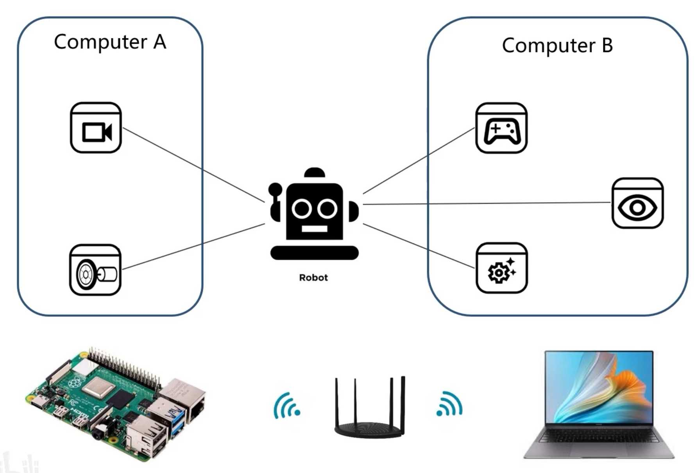

简单的说，如果不设置群组 id，那么所有的节点都会收到消息

如果是设定了群组 id，那么只有相同群组 id 的节点才会收到消息 

设置方法

```bash
# .bashrc
export ROS_DOMAIN_ID=0 # yourid 
```

---

## 10. DDS

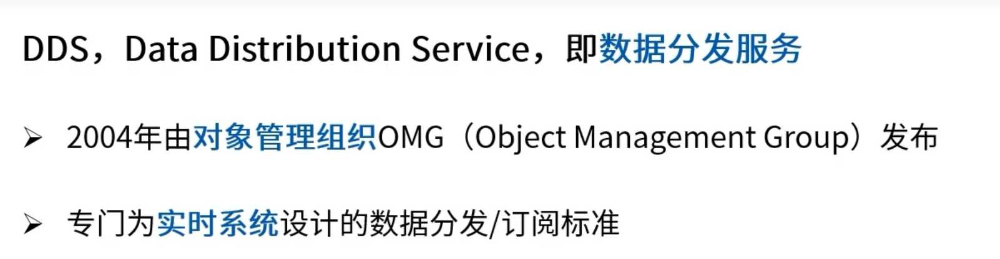

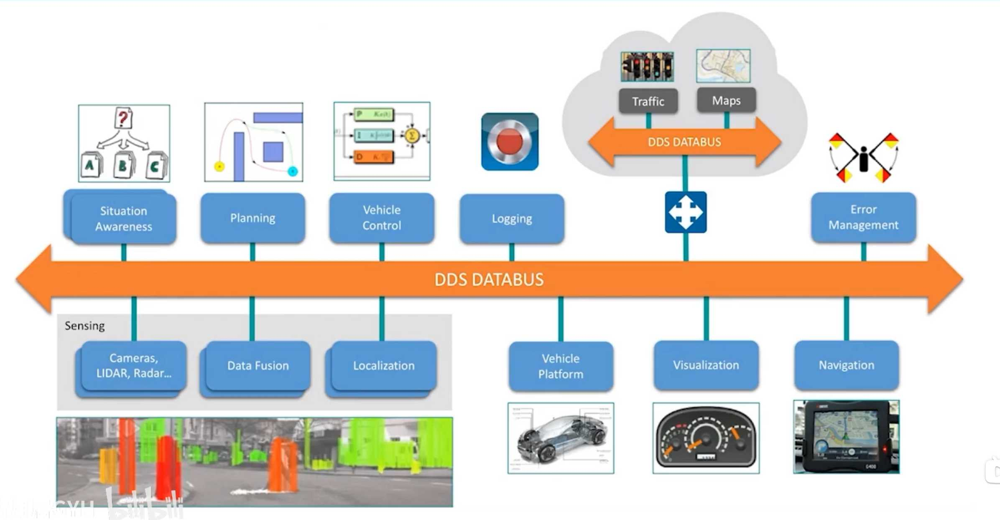

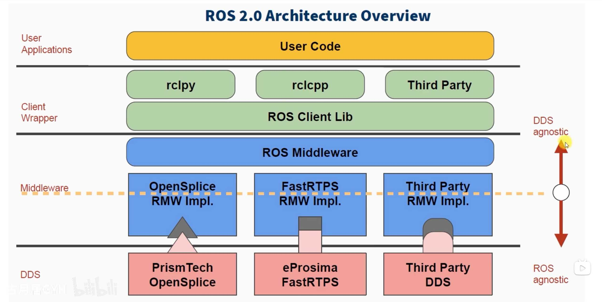

好的，我们来详细阐述 ROS 2 中的 DDS（Data Distribution Service）。这是一个核心且基础的概念，理解了 DDS，就理解了 ROS 2 通信机制的基石。

##### 1. 核心概念：什么是 DDS？

**DDS（数据分发服务）** 是一个由**对象管理组织（OMG）** 发布的国际标准（v 1.4），它是一种**以数据为中心的**、**跨语言的**、**跨平台的**通信中间件协议和 API 标准。

其核心设计理念是：
*   **以数据为中心（Data-Centric）**：传统的通信方式（如 TCP/IP）是以“节点/设备”为中心的（我知道要跟谁说话）。而 DDS 是以“数据”为中心的。应用程序只关心它需要“发布”或“订阅”什么“主题”的数据，而不需要关心数据来自哪里或发送到哪里。DDS 中间件负责自动发现和高效路由数据。
*   **发布-订阅模式（Publish-Subscribe）**：DDS 严格遵循发布-订阅模型，这与 ROS 的 Topic 通信模型天然契合。
*   **实时系统（Real-Time Systems）**：DDS 的设计目标之一就是满足硬实时和软实时系统的需求，提供可预测的性能和低延迟。
*   **可靠性（Reliability）**：DDS 提供了丰富的服务质量（QoS）策略，可以灵活配置通信的可靠性、持久性、寿命、截止时间等，以适应从关键任务控制到非关键监控的各种场景。

---

##### 2. 为什么 ROS 2 要采用 DDS？

ROS 1 的通信层是自定义的，基于 TCPROS/UDPROS 协议。虽然工作良好，但存在一些固有缺陷：
1.  **发现机制**：采用集中式的 Master 节点进行发现，单点故障问题严重。
2.  **跨平台性**：主要支持 Linux，在其他操作系统上支持不佳。
3.  **实时性**：难以满足严格的实时控制需求。
4.  **安全性**：原生缺乏安全通信机制。
5.  **复杂性**：与外部非 ROS 系统集成相对复杂。

**DDS 完美地解决了这些问题：**
1.  **去中心化发现**：DDS 使用基于**广播或组播**的分布式发现协议，无需中心节点，更加健壮。
2.  **原生跨平台**：DDS 是标准，有各种语言和操作系统的商业和开源实现。
3.  **强大的实时性**：许多 DDS 实现专为实时和嵌入式系统设计。
4.  **内置安全模型**：DDS 标准包含一个安全规范（DDS-Security），提供认证、加密和访问控制。
5.  **系统集成**：DDS 是工业界广泛使用的标准（尤其在航空、国防、医疗领域），ROS 2 节点可以直接与其它 DDS 应用程序通信，无缝集成。

因此，ROS 2 选择**不重新发明轮子**，而是将 DDS 作为其默认的**中间件（Middleware）**，在其之上构建 ROS 的抽象层（如 Nodes, Topics, Services, Actions）。

---

##### 3. ROS 2 与 DDS 的架构关系：RCL 和 RMW

ROS 2 的软件栈被设计为可插入中间件的架构，其与 DDS 的关系可以通过以下分层模型来理解：

```
+---------------------+ (Your Code)
|    ROS 2 Client     |    (e.g., rclcpp, rclpy)
|     Library (RCL)   |
+---------------------+
|  ROS 2 Middleware   |  <--- 这是抽象接口层
|   Interface (RMW)   |
+---------------------+
|   DDS Implementation |  <--- 这是具体的实现层 (e.g., Cyclone DDS, Fast DDS)
+---------------------+
```

1.  **ROS 客户端库（RCL - ROS Client Library）**：
    *   这是你编写 ROS 2 代码时直接调用的库，例如 C++ 的 `rclcpp` 或 Python 的 `rclpy`。
    *   它提供了熟悉的 `Node`, `Publisher`, `Subscriber`, `Service`, `Client` 等接口。

2.  **ROS 中间件接口（RMW - ROS Middleware Interface）**：
    *   这是一个**抽象层**，它定义了一套通用的 API（用 C 语言实现），用于所有底层中间件实现的通信功能（如发布消息、订阅主题、请求服务等）。
    *   `RCL` 调用 `RMW` 接口，`RMW` 再将调用转换给具体的 DDS 实现。这实现了**解耦**：ROS 2 的上层代码不依赖于任何特定的 DDS 供应商。

3.  **DDS 实现层（DDS Implementation）**：
    *   这是具体的 DDS 库，它实现了 DDS 标准的所有功能。
    *   ROS 2 通过一个对应的 **RMW 适配器包**（例如 `rmw_cyclonedds_cpp`) 来使用这个库。
    *   你可以通过设置环境变量 `RMW_IMPLEMENTATION=rmw_cyclonedds_cpp` 来轻松切换使用的 DDS 实现。

**总结一下数据流**：你的 C++/Python 代码 -> `rclcpp` / `rclpy` -> `rcl` (C API) -> `rmw` (Middleware Interface) -> 具体的 DDS 库（如 Cyclone DDS） -> 网络传输。

---

##### 5. DDS 带给 ROS 2 的核心特性：QoS（服务质量）

这是 DDS 带给 ROS 2 最强大、最独特的特性。QoS 策略允许你精细地控制通信行为。

| QoS 策略 | 功能描述 | 应用场景示例 |
| :--- | :--- | :--- |
| **可靠性 (Reliability)** | `RELIABLE`：确保所有消息都能送达（可能重传）。`BEST_EFFORT`：尽力送达，不保证成功（可能丢包）。 | **控制指令**必须使用 `RELIABLE`。**传感器数据流**（如视频）可使用 `BEST_EFFORT` 以降低延迟。 |
| **持久性 (Durability)** | `VOLATILE`：不为新订阅者保留历史消息。`TRANSIENT_LOCAL`：为新订阅者保留最后 N 个消息。 | **地图数据**：新加入的导航节点需要获取当前地图（`TRANSIENT_LOCAL`）。**实时状态**：只需最新数据，如当前速度（`VOLATILE`）。 |
| **存活时间 (Liveliness)** | 定义发布者是否“存活”的策略。可以是自动声明，或由某个特定信号触发。 | 用于**故障检测**。如果一个发布者不再“存活”，系统可以知道并触发安全措施。 |
| **生命周期 (Lifespan)** | 消息的有效期。超过此时间的消息即使被收到也会被丢弃。 | 用于**过时数据**，如一个很快会失效的临时目标点。 |
| **截止时间 (Deadline)** | 规定消息发布的**最大期望周期**。如果订阅者发现发布者超过此时间未发消息，会触发回调。 | 监控**数据流频率**。如果激光雷达数据低于 10 Hz，则报警。 |
| **传输优先级 (Transport Priority)** | 为消息指定网络优先级，让高优先级的消息优先被发送。 | 紧急停止信号 (`ESTOP`) 应该比日志信息拥有更高的网络优先级。 |

在 ROS 2 中，你可以在创建 `Publisher` 和 `Subscriber` 时指定它们的 QoS 策略。**只有当发布者和订阅者的 QoS 配置兼容时，它们才能建立连接并进行通信**。


#### 如何指定 QoS

发布 topic 等的时候加入命令行选项即可

如

```shell
ros2 topic echo /chatter --qos-reliability best_effort
```

注意，发送者和接受者需要用相同的 qos

 或者在代码中
```python
class PublisherNode(Node):
    
    def __init__(self, name):
        super().__init__(name)  # ROS2节点父类初始化
        
        qos_profile = QoSProfile(  # 创建一个QoS原则
            # reliability=QoSReliabilityPolicy.BEST_EFFORT,
            reliability=QoSReliabilityPolicy.RELIABLE,
            history=QoSHistoryPolicy.KEEP_LAST,
            depth=1
        )
        # 创建发布者对象（消息类型、话题名、QoS原则）
        self.pub = self.create_publisher(String, "chatter", qos_profile)  
         
        # 创建一个定时器（单位为秒的周期，定时执行的回调函数）
        self.timer = self.create_timer(0.5, self.timer_callback)           
```

---

## 11. launch

##### 核心概念：什么是 Launch？

在 ROS 2 中，**Launch** 系统是一个用于启动和管理多个 ROS 2 节点（Nodes）以及相关进程的框架。一个复杂的机器人系统通常由数十个甚至上百个相互协作的节点组成（例如，传感器驱动、感知、定位、规划、控制等）。手动在每个终端里用 `ros2 run` 命令来启动每一个节点是非常繁琐且容易出错的。

Launch 系统允许你通过一个** launch 文件**，来声明式地配置和启动一整套节点系统，并可以设置参数、重映射（Remapping）、包含其他 launch 文件、响应事件等。

---

##### 为什么需要 Launch 文件？

1.  **自动化复杂系统**：一键启动所有必要的组件。
2.  **配置管理**：集中管理节点的参数、命名空间、重映射规则。
3.  **可维护性和可复用性**：将启动逻辑写成文件，便于版本控制和在不同机器人或场景下复用。
4.  **健壮性**：可以配置规则，在某个节点失败时自动重启或其他节点。

---

##### ROS 2 Launch 的演进：Python 作为一等公民

与 ROS 1 主要使用 XML 格式的 `.launch` 文件不同，**ROS 2 的 Launch 系统是用 Python 编写的**，并且鼓励用户使用 Python 来编写 launch 文件（文件扩展名通常是 `.py`）。

*   **优势**：
    *   **强大灵活**：你可以利用 Python 的全部功能（条件判断、循环、函数、导入模块等）来动态生成复杂的启动逻辑。
    *   **可编程性**：可以轻松地编写逻辑来响应启动过程中发生的事件（例如，一个节点退出时执行某些操作）。
    *   **可读性**：对于熟悉 Python 的开发者来说，Python 代码比 XML 更易读和维护。

当然，ROS 2 也支持通过 XML 和 YAML 来编写 launch 文件，以实现与 ROS 1 的兼容性或满足简单需求，但 Python 方式是官方推荐且功能最强大的方式。

---

##### Launch 文件的核心组成部分

一个典型的 Python launch 文件通常包含以下元素：

###### 1. 导入（Imports）
从 `launch` 和 `launch_ros` 模块中导入所需的类和方法。
```python
from launch import LaunchDescription
from launch_ros.actions import Node
from launch.actions import DeclareLaunchArgument, IncludeLaunchDescription
from launch.substitutions import LaunchConfiguration, PathJoinSubstitution
```

###### 2. 生成 Launch 描述的函数
定义一个函数（通常是 `generate_launch_description()`）来创建并返回一个 `LaunchDescription` 对象。
```python
def generate_launch_description():
    # ... 在这里配置启动内容 ...
    return LaunchDescription([
        # ... 将配置好的动作（Actions）放在这里 ...
    ])
```

###### 3. 动作（Actions）
Actions 是 Launch 系统执行的具体操作，最常见的包括：

*   **`Node`**：启动一个 ROS 2 节点。
    ```python
    talker_node = Node(
        package='demo_nodes_cpp',        # 功能包名
        executable='talker',             # 可执行文件的名字
        name='my_talker',                # 覆盖节点名（可选）
        namespace='my_ns',               # 设置命名空间（可选）
        parameters=[{'rate': 1.0}],      # 设置参数（可选）
        remappings=[('chatter', 'my_chatter')] # 重映射话题（可选）
    )
    ```

*   **`DeclareLaunchArgument`**：声明一个启动参数，允许用户从命令行传入值。
    ```python
    use_sim_time_arg = DeclareLaunchArgument(
        'use_sim_time',
        default_value='false',
        description='Use simulation (Gazebo) clock if true'
    )
    ```

*   **`LaunchConfiguration`**：引用一个已声明的启动参数的值。
    ```python
    # 在Node的parameters中使用启动参数
    parameters=[{'use_sim_time': LaunchConfiguration('use_sim_time')}]
    ```

*   **`IncludeLaunchDescription`**：包含并执行另一个 launch 文件，实现模块化。
    ```python
    include_another_launch = IncludeLaunchDescription(
        PathJoinSubstitution([get_package_share_directory('another_pkg'), 'launch', 'other.launch.py'])
    )
    ```

###### 4.  Substitutions（替换）
允许动态地构建字符串，常用于构建路径或使用启动参数。
```python
from launch.substitutions import PathJoinSubstitution, FindPackageShare

# 动态查找功能包路径并拼接文件路径
config_file = PathJoinSubstitution([
    FindPackageShare('my_robot_bringup'),
    'config',
    'robot_params.yaml'
])
```

---

##### 一个完整的示例

假设我们想启动一个话题发布者（`talker`）和一个话题订阅者（`listener`），并为 `talker` 设置一个参数。

**`my_launch_file.py`**:
```python
from launch import LaunchDescription
from launch_ros.actions import Node
from launch.actions import DeclareLaunchArgument
from launch.substitutions import LaunchConfiguration

def generate_launch_description():

    # 1. 声明一个启动参数
    rate_arg = DeclareLaunchArgument(
        'publish_rate',
        default_value='1.0',
        description='Publishing rate (Hz) for the talker node'
    )
    
    # 当然也可以通过yaml加载
    '''
    config = os.path.join(              # 找到参数文件的完整路径
      get_package_share_directory('learning_launch'),
      'config',
      'turtlesim.yaml'
      )
    '''

    # 2. 配置要启动的节点
    talker_node = Node(
        package='demo_nodes_cpp',
        executable='talker',
        name='my_talker',
        parameters=[{
            'rate': LaunchConfiguration('publish_rate') # 使用启动参数
        }],
        remappings=[('chatter', 'my_chatter_topic')] # 将/chatter重映射为/my_chatter_topic
    )

    listener_node = Node(
        package='demo_nodes_cpp',
        executable='listener',
        name='my_listener',
        remappings=[('chatter', 'my_chatter_topic')] # 也必须重映射，才能听到talker
    )

    # 3. 将所有的Actions加入到LaunchDescription中
    return LaunchDescription([
        rate_arg,
        talker_node,
        listener_node
    ])
```

---

##### Launch 调用 launch

```python
def generate_launch_description():                # 自动生成launch文件的函数
   parameter_yaml = IncludeLaunchDescription(     # 包含指定路径下的另外一个launch文件
      PythonLaunchDescriptionSource([os.path.join(
         get_package_share_directory('learning_launch'), 'launch'),
         '/parameters_nonamespace.launch.py'])
      )
  
   parameter_yaml_with_namespace = GroupAction(   
   # 对指定launch文件中启动的功能加上命名空间
      actions=[
         PushRosNamespace('turtlesim2'), # 防止冲突，主动加ns
         parameter_yaml]
      )

   return LaunchDescription([            # 返回launch文件的描述信息
      parameter_yaml_with_namespace
   ])

```

##### 准备 setup
```python
(os.path.join('share', package_name, 'launch'), glob(os.path.join('launch', '*.launch.py'))),

(os.path.join('share', package_name, 'config'), glob(os.path.join('config', '*.*'))),

(os.path.join('share', package_name, 'rviz'), glob(os.path.join('rviz', '*.*'))),
```

##### 如何运行 Launch 文件

使用 `ros2 launch` 命令：

```bash
# 基本用法
ros2 launch <package_name> <launch_file_name>.py

# 运行上面的示例（假设文件在 my_package 功能包中）
ros2 launch my_package my_launch_file.py

# 在启动时覆盖参数的值
ros2 launch my_package my_launch_file.py publish_rate:=2.0
```


我来详细解释一下这个 `remapping` 的作用，这是 ROS 中一个非常重要且强大的概念。

#### Remapping（重映射）

**重映射**就是**在运行时改变节点的通信资源名称**（话题、服务、参数等）。简单说，就是给通信通道起个别名或者重新定向。

##### 为什么需要重映射？

在这个具体的例子中，有三个节点：
1. `turtlesim1/sim` - 第一个乌龟模拟器
2. `turtlesim2/sim` - 第二个乌龟模拟器  
3. `mimic` - 模仿节点

###### 问题分析：

1. **`mimic` 节点的设计**：
   - 它默认**订阅** `/input/pose` 话题来获取姿势信息
   - 它默认**发布** `/output/cmd_vel` 话题来发送速度指令

2. **实际需求**：
   - 我们希望 `mimic` 读取**第一个乌龟**的姿势（`/turtlesim1/turtle1/pose`）
   - 然后控制**第二个乌龟**运动（向 `/turtlesim2/turtle1/cmd_vel` 发布指令）

3. **名称不匹配**：
   - `mimic` 想订阅的是 `/input/pose`，但数据在 `/turtlesim1/turtle1/pose`
   - `mimic` 想发布到 `/output/cmd_vel`，但需要发布到 `/turtlesim2/turtle1/cmd_vel`

##### 重映射如何解决这个问题？

```python
remappings=[
    ('/input/pose', '/turtlesim1/turtle1/pose'),        # 输入重定向
    ('/output/cmd_vel', '/turtlesim2/turtle1/cmd_vel'), # 输出重定向
]
```

###### 效果相当于：

**对于 `mimic` 节点内部**：
- 当它尝试订阅 `/input/pose` 时，系统自动让它订阅 `/turtlesim1/turtle1/pose`
- 当它尝试发布到 `/output/cmd_vel` 时，系统自动让它发布到 `/turtlesim2/turtle1/cmd_vel`

**对于其他节点**：
- 它们看到的是 `mimic` 在正常地与 `/turtlesim1/turtle1/pose` 和 `/turtlesim2/turtle1/cmd_vel` 通信

##### 可视化理解

```
mimic节点内部             重映射后实际连接
-------------           -------------------
订阅 /input/pose    →   订阅 /turtlesim1/turtle1/pose
发布 /output/cmd_vel →  发布 /turtlesim2/turtle1/cmd_vel
```

##### 重映射的通用语法

```python
remappings=[
    ('原话题名', '新话题名'),      # 话题重映射
    ('原服务名', '新服务名'),      # 服务重映射
    ('__ns', '新的命名空间'),      # 特殊：重映射节点自身命名空间
    ('__node', '新的节点名'),      # 特殊：重映射节点自身名称
]
```

##### 其他常见使用场景

1. **避免名称冲突**：两个相同功能的节点需要同时运行
2. **接口标准化**：让不同节点遵循统一的接口命名规范
3. **测试调试**：在不修改代码的情况下改变通信路径
4. **系统集成**：连接来自不同开发者的节点

---

## 12. 坐标系管理

### 机器人中的坐标系
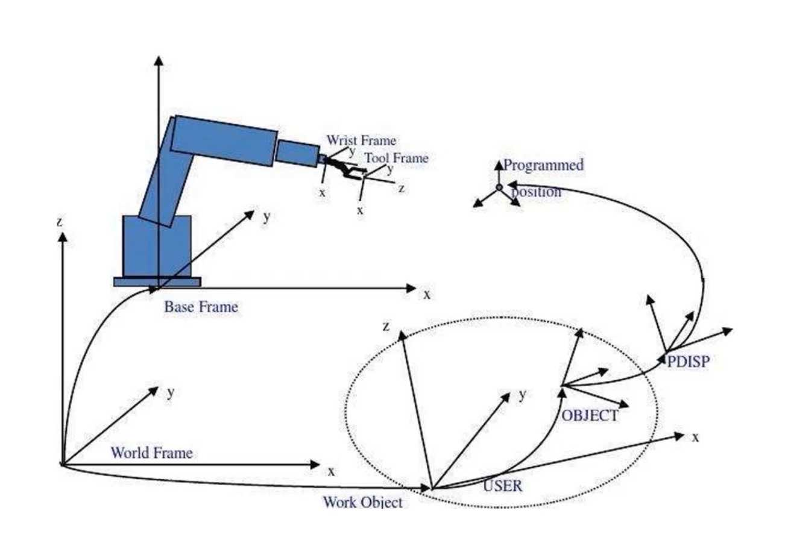

在机器人学中，一切都是相对于某个参考系而言的。

###### 1. 为什么需要多个坐标系？
想象一个简单的移动机器人：
*   它的**激光雷达**检测到正前方 1 米处有一个障碍物。
*   这个“1 米”是相对于谁的？是相对于激光雷达自身的光学中心。
*   如果我们要让机械臂去触碰这个障碍物，或者让底盘绕开它，**机械臂和底盘的控制器需要知道这个障碍物相对于它们自己的位置**。
*   因此，我们需要知道激光雷达坐标系、底盘坐标系、机械臂坐标系之间的变换关系。

###### 2. 常见的坐标系类型
*   **基坐标系 (`base_link`)**：通常固定在机器人的中心（例如，底盘的中心）。它是机器人本体上最核心的参考系，其他所有机器人本体上的坐标系都直接或间接地与它相连。
*   **里程计坐标系 (`odom`)**：一个**世界固定**的坐标系。它的原点通常是机器人启动时的位置。`odom` 坐标系是通过里程计信息（如轮式编码器、视觉里程计）累积得到的，虽然短期内精确，但长期会有漂移，不会跳变。
*   **地图坐标系 (`map`)**：一个**世界固定**的坐标系。它通过传感器（如激光雷达、GPS）融合建图算法（如 SLAM）得到，是全局一致、无漂移的。但可能会发生跳变（例如，当算法修正位姿时）。
*   **传感器坐标系**：如 `laser_frame`, `camera_depth_optical_frame`, `imu_link`。这些坐标系定义了传感器相对于 `base_link` 的安装位置和方向。
*   **工具坐标系**：如机械臂末端的 `tool0` 坐标系。

###### 3. 坐标系变换 (Transform)
坐标系之间的关系由 **变换** 来描述。一个变换包含两部分：
1.  **平移 (Translation)**：一个坐标系的原点在另一个坐标系中的 `(x, y, z)` 坐标。
2.  **旋转 (Rotation)**：一个坐标系的姿态相对于另一个坐标系的旋转，通常用**四元数 (Quaternion)** 来表示（比欧拉角更稳定，无万向锁问题）。

一个变换可以完美地回答：“在 `laser_frame` 中看到的点 `(x, y, z)`，在 `base_link` 坐标系中是多少？”

---

##### TF 2 - 坐标变换管理神器

**TF 2** (Transform Library version 2) 是 ROS 2 中用于跟踪多个坐标系关系的库和工具集。它是 ROS 1 TF 库的升级版，更高效、更安全。

###### 1. TF 2 的核心功能
TF 2 维护着一个**随时间变化的坐标系树**。
*   **树状结构**：所有坐标系通过变换连接成一棵树。每个坐标系只有一个父坐标系，但可以有多个子坐标系。例如：`map` -> `odom` -> `base_link` -> `laser_frame`。
*   **时间旅行**：TF 2 不仅存储最新的变换，还会**缓存一段时间的历史变换**。这意味着你可以查询“**5 秒前**的 `laser_frame` 相对于 `map` 的变换是什么？”，这对于处理不同时间戳的传感器数据至关重要。

###### 2. TF 2 的工作流程：广播与监听
TF 2 采用“发布-订阅”模型：
*   **广播 (Broadcast)**：节点计算出一个坐标系相对于另一个坐标系的变换，然后将其**发布**到 `/tf_static`（对于静态的、不变的变换，如传感器安装位置）或 `/tf`（对于动态的、变化的变换，如移动的底盘）话题上。
*   **监听 (Listen)**：需要用到坐标变换的节点（例如，需要将激光点云数据转换到 `map` 坐标系中进行建图），会向 TF 2 库**查询**特定的变换。

###### 3. 核心工具和命令
ROS 2 提供了一系列强大的命令行工具来调试和可视化 TF：
*   `ros2 run tf2_ros tf2_echo <source_frame> <target_frame>`
    *   **功能**：在终端中实时打印两个坐标系之间的变换（平移和旋转）。
    *   **示例**：`ros2 run tf2_ros tf2_echo map base_link` 查看机器人当前位置。

*   `ros2 run rviz2 rviz2`
    *   **功能**：最强大的可视化工具。添加 `TF` 显示插件，可以看到所有坐标系的相对位置和姿态的 3 D 可视化。

*   `ros2 run tf2_tools view_frames.py`
    *   **功能**：生成一个当前坐标系树的 PDF 图示，清晰地显示所有坐标系之间的连接关系。

*   `ros2 topic echo /tf` 和 `ros2 topic echo /tf_static`
    *   **功能**：直接查看发布到话题上的原始变换消息。

---

##### 在代码中使用 TF 2 (Python 示例)

###### 1. 广播一个静态变换（例如，激光雷达坐标系）
静态变换只需要广播一次。

```python
#!/usr/bin/env python3
import rclpy
from rclpy.node import Node
from tf2_ros import StaticTransformBroadcaster
from geometry_msgs.msg import TransformStamped

class StaticTFBroadcaster(Node):
    def __init__(self):
        super().__init__('static_tf_broadcaster')
        self.tf_broadcaster_ = StaticTransformBroadcaster(self)
        
        transform = TransformStamped()
        
        # 设置头信息
        transform.header.stamp = self.get_clock().now().to_msg()
        transform.header.frame_id = 'base_link'  # 父坐标系
        transform.child_frame_id = 'laser_frame' # 子坐标系
        
        # 设置变换：激光雷达安装在 base_link 前方 0.2m，高 0.1m 的位置
        transform.transform.translation.x = 0.2
        transform.transform.translation.y = 0.0
        transform.transform.translation.z = 0.1
        # 没有旋转，所以使用单位四元数
        transform.transform.rotation.x = 0.0
        transform.transform.rotation.y = 0.0
        transform.transform.rotation.z = 0.0
        transform.transform.rotation.w = 1.0
        
        # 发布静态变换
        self.tf_broadcaster_.sendTransform(transform)
        self.get_logger().info('Published static transform from base_link to laser_frame')

def main(args=None):
    rclpy.init(args=args)
    node = StaticTFBroadcaster()
    rclpy.spin(node)
    rclpy.shutdown()

if __name__  '__main__':
    main()
```

###### 2. 监听/查询一个变换
```python
#!/usr/bin/env python3
import rclpy
from rclpy.node import Node
from tf2_ros import TransformException
from tf2_ros.buffer import Buffer
from tf2_ros.transform_listener import TransformListener

class TFListener(Node):
    def __init__(self):
        super().__init__('tf_listener')
        self.tf_buffer = Buffer()
        self.tf_listener = TransformListener(self.tf_buffer, self)
        
        # 创建一个定时器，定期查询变换
        self.timer = self.create_timer(1.0, self.on_timer)
        
    def on_timer(self):
        try:
            # 查找最新的从 laser_frame 到 base_link 的变换
            # target_frame, source_frame
            transform = self.tf_buffer.lookup_transform(
                'base_link',
                'laser_frame',
                rclpy.time.Time()) # 获取最新时间的变换
            self.get_logger().info(f'Transform is: {transform}')
        except TransformException as ex:
            self.get_logger().error(f'Could not get transform: {ex}')

def main(args=None):
    rclpy.init(args=args)
    node = TFListener()
    rclpy.spin(node)
    rclpy.shutdown()

if __name__  '__main__':
    main()
```

###### 3. 转换一个点
这是最常见的应用：将一个点从一个坐标系转换到另一个坐标系。
```python
from tf2_geometry_msgs import do_transform_point
from geometry_msgs.msg import PointStamped

# 假设我们有一个在 laser_frame 中的点
point_in_laser = PointStamped()
point_in_laser.header.frame_id = 'laser_frame'
point_in_laser.point.x = 1.0
point_in_laser.point.y = 0.5
point_in_laser.point.z = 0.0

try:
    # 先查询变换
    transform = self.tf_buffer.lookup_transform('base_link', 'laser_frame', rclpy.time.Time())
    # 转换点
    point_in_base = do_transform_point(point_in_laser, transform)
    self.get_logger().info(f'Point in base_link: {point_in_base.point}')
except TransformException as ex:
    self.get_logger().error(f'Could not transform point: {ex}')
```

---

## 13. urdf

##### 1. URDF 是什么？

**URDF** 的全称是 **统一机器人描述格式**。它是一种基于 XML 的文件格式，用于在机器人领域中描述一个机器人的**模型**。

您可以把它想象成机器人的“蓝图”或“解剖图”，它定义了：
*   **机器人的物理结构**：有哪些部件（连杆、关节）以及它们如何连接。
*   **机器人的几何属性**：每个部件的大小、形状（长方体、圆柱体、球体等）。
*   **机器人的运动学属性**：关节的类型（旋转、平移、固定等）以及它们如何运动（旋转轴、移动方向）。
*   **机器人的动力学属性**：质量、惯性矩、摩擦系数等。
*   **视觉属性**：每个部件的颜色、纹理。
*   **碰撞属性**：用于碰撞检测的简化几何模型。

##### 2. 为什么需要 URDF？

URDF 文件是许多高级功能的基石：
*   **仿真**：在 Gazebo、PyBullet 等仿真环境中，需要 URDF 来生成和模拟机器人。
*   **可视化**：在 Rviz 等工具中，需要 URDF 来显示机器人模型。
*   **运动规划**：MoveIt! 等规划框架需要知道机器人的运动链结构，这来自于 URDF。
*   **控制**：控制器管理器需要 URDF 来理解关节之间的关系。

简单来说，**没有 URDF，ROS 中的机器人就像没有身体的灵魂，无法被看到、模拟或控制。**

---

##### 3. 核心概念与 XML 标签

一个 URDF 文件总是以 `<robot>` 标签作为根元素，里面包含两种最核心的元素：**`<link>`** 和 **`<joint>`**。

###### 3.1 连杆：`<link>`
连杆代表机器人的一个**刚体部分**，是机器人的基本构成块。例如：机器人底座、轮子、激光雷达、机械臂的每一个臂杆、摄像头顶盖等。

一个典型的 `<link>` 包含以下子元素：

*   **`<visual>`**：定义连杆的**外观**，用于可视化（如在 Rviz 中显示）。
    *   `<geometry>`：形状。可以是 `<box>`（长方体）、`<cylinder>`（圆柱体）、`<sphere>`（球体）或 `<mesh>`（网格文件，如 .dae 或 .stl）。
    *   `<origin>`：几何体的参考坐标系相对于世界坐标系的位姿（xyz 偏移和 rpy 旋转）。
    *   `<material>`：材质。可以指定颜色 (`<color>`) 或纹理 (`<texture>`)。

*   **`<collision>`**：定义连杆的**碰撞属性**，用于物理仿真中的碰撞检测。为了计算效率，碰撞模型通常比视觉模型更简单（例如，用一个长方体近似一个复杂的机械臂连杆）。
    *   包含 `<geometry>` 和 `<origin>`，与 `<visual>` 中的类似。

*   **`<inertial>`**：定义连杆的**动力学属性**，用于物理仿真。
    *   `<mass>`：质量（千克）。
    *   `<origin>`：质心位置。
    *   `<inertia>`：惯性张量（一个 3 x 3 矩阵）。

**示例：定义一个名为 “base_link” 的长方体连杆**
```xml
<link name="base_link">
  <visual>
    <geometry>
      <box size="0.2 0.1 0.05"/> <!-- 长宽高 -->
    </geometry>
    <origin rpy="0 0 0" xyz="0 0 0"/>
    <material name="blue">
      <color rgba="0 0 0.8 1"/> <!-- RGBA，A为透明度 -->
    </material>
  </visual>
  <collision>
    <geometry>
      <box size="0.2 0.1 0.05"/>
    </geometry>
  </collision>
  <inertial>
    <mass value="0.5"/>
    <origin xyz="0 0 0"/>
    <inertia ixx="0.001" ixy="0" ixz="0" iyy="0.001" iyz="0" izz="0.001"/>
  </inertial>
</link>
```

###### 3.2 关节：`<joint>`
关节描述了两个连杆之间的**连接方式**，即一个连杆（子连杆）如何相对于另一个连杆（父连杆）运动。

一个 `<joint>` 的关键属性：
*   **`name`**: 关节的名称（如 “wheel_joint”）。
*   **`type`**: 关节的类型：
    *   `revolute`：旋转关节（绕单一轴旋转，有位置极限，如机械臂关节）
    *   `continuous`：连续旋转关节（绕单一轴无限旋转，如轮子）
    *   `prismatic`：平移关节（沿单一轴移动，有位置极限，如伸缩杆）
    *   `fixed`：固定关节（不允许任何运动，子连杆牢牢固定在父连杆上，如传感器固定在底座上）
    *   `planar`：平面关节（在垂直于轴的平面内运动）
    *   `floating`：浮动关节（完全不受约束的运动，6 自由度）

一个 `<joint>` 包含以下子元素：

*   **`<parent>`**：父连杆的名字 (`<link name=”...”>`)。
*   **`<child>`**：子连杆的名字。
*   **`<origin>`**：从父连杆坐标系到子连杆坐标系的变换。这定义了子连杆在“零位”时的位置和姿态。
*   **`<axis>`**：关节运动所围绕的轴（在子连杆坐标系中）。对于旋转关节，这是旋转轴；对于平移关节，这是移动方向。默认是 (1, 0, 0)。
*   **`<limit>`**（仅用于 `revolute` 和 `prismatic` 关节）：运动极限。
    *   `lower`：下限（弧度或米）
    *   `upper`：上限（弧度或米）
    *   `effort`：最大 effort（力或扭矩）
    *   `velocity`：最大速度（ rad/s 或 m/s）

**示例：定义一个连接 “base_link” 和 “wheel” 的连续旋转关节**
```xml
<joint name="left_wheel_joint" type="continuous">
  <parent link="base_link"/>
  <child link="left_wheel"/>
  <origin xyz="0 0.05 0" rpy="0 0 0"/> <!-- 轮子安装在底座旁边 -->
  <axis xyz="0 1 0"/> <!-- 绕Y轴旋转 -->
</joint>
```

---

##### 4. 一个完整的简单 URDF 示例

下面是一个简单的机器人模型，它有一个底座和两个轮子。

```xml
<?xml version="1.0"?>
<robot name="my_first_robot">

  <!-- 底座 LINK -->
  <link name="base_link">
    <visual>
      <geometry>
        <box size="0.2 0.1 0.05"/>
      </geometry>
      <material name="blue">
        <color rgba="0 0 0.8 1"/>
      </material>
    </visual>
    <collision>
      <geometry>
        <box size="0.2 0.1 0.05"/>
      </geometry>
    </collision>
    <inertial>
      <mass value="0.5"/>
      <inertia ixx="0.001" ixy="0" ixz="0" iyy="0.001" iyz="0" izz="0.001"/>
    </inertial>
  </link>

  <!-- 左轮 LINK -->
  <link name="left_wheel">
    <visual>
      <geometry>
        <cylinder length="0.02" radius="0.05"/>
      </geometry>
      <material name="black">
        <color rgba="0 0 0 1"/>
      </material>
    </visual>
    <collision>
      <geometry>
        <cylinder length="0.02" radius="0.05"/>
      </geometry>
    </collision>
    <inertial>
      <mass value="0.1"/>
      <inertia ixx="0.0001" ixy="0" ixz="0" iyy="0.0001" iyz="0" izz="0.0001"/>
    </inertial>
  </link>

  <!-- 右轮 LINK -->
  <link name="right_wheel">
    <visual>
      <geometry>
        <cylinder length="0.02" radius="0.05"/>
      </geometry>
      <material name="black"/>
      <!-- 复用名为black的material -->
    </visual>
    <collision>
      <geometry>
        <cylinder length="0.02" radius="0.05"/>
      </geometry>
    </collision>
    <inertial>
      <mass value="0.1"/>
      <inertia ixx="0.0001" ixy="0" ixz="0" iyy="0.0001" iyz="0" izz="0.0001"/>
    </inertial>
  </link>

  <!-- 连接底座和左轮的 JOINT -->
  <joint name="left_wheel_joint" type="continuous">
    <parent link="base_link"/>
    <child link="left_wheel"/>
    <origin xyz="0 0.06 -0.03" rpy="1.5707 0 0"/> 
    <!-- 
    xyz: 安装在底座右侧(y方向)和略下方(z方向)
    rpy: 将圆柱体绕X轴旋转90度（π/2≈1.5707），使其立起来
    -->
    <axis xyz="0 1 0"/>
  </joint>

  <!-- 连接底座和右轮的 JOINT -->
  <joint name="right_wheel_joint" type="continuous">
    <parent link="base_link"/>
    <child link="right_wheel"/>
    <origin xyz="0 -0.06 -0.03" rpy="1.5707 0 0"/>
    <axis xyz="0 1 0"/>
  </joint>

</robot>
```

---

##### 5. 超越基础：URDF 的局限性及解决方案

URDF 非常流行，但它也有明显的局限性：
1.  **是单体的**：URDF 只能描述一个完整的、不可分割的机器人。你不能在 URDF 中定义两个独立的机器人并让它们互动。
2.  **是树形结构**：URDF 模型必须是一棵树，每个子连杆只能有一个父连杆。这意味着它不能描述**闭环结构**（例如，一个四杆机构，一个连杆同时被两个关节连接）。
3.  **缺乏可扩展性**：对于复杂的机器人，一个巨大的 URDF 文件难以维护。

为了解决这些问题，ROS 引入了其他工具和格式作为补充：

*   **Xacro (XML Macros)**：**这是最重要的实践！** Xacro 是一种宏语言，允许你编写更短、更可读、更模块化的 URDF 文件。它支持：
    *   **属性（变量）**：`<xacro:property name=”width” value=”0.2”/>`，然后用 `${width}` 引用。
    *   **宏（函数）**：`<xacro:macro name=”create_wheel” params=”name”> ... </xacro:macro>`，然后用 `<xacro:create_wheel name=”left”/>` 调用。
    *   **文件包含**：`<xacro:include filename=”$(find my_robot)/urdf/common.xacro”/>`
    *   **条件判断**：`<xacro:if value=”${use_mesh}"> ... </xacro:if>`
    *   最终，Xacro 文件会被预处理成一个纯粹的、扁平的 URDF 文件。**强烈建议始终使用 Xacro 来编写机器人模型。**

*   **SDF (Simulation Description Format)**：被 Gazebo 原生使用的格式。它比 URDF 更强大，支持多个机器人、闭环、插件、大气效果等。当你把 URDF 放入 Gazebo 时，Gazebo 会将其转换为 SDF。

*   **`<joint>` 标签的巧用**：虽然 URDF 本身是树形结构，但通过巧妙定义虚拟的、零质量的连杆和固定关节，有时可以“模拟”出闭环结构，但这很繁琐。

##### 6. 工具与工作流程

1.  **编写**：使用你喜欢的文本编辑器（如 VSCode）编写 `.urdf` 或 `.xacro` 文件。
2.  **检查语法**：`check_urdf my_robot.urdf`
3.  **可视化**：
    *   `urdf_to_graphiz my_robot.urdf`：生成一个 PDF，显示连杆和关节的树状图。
    *   **Rviz**：启动 Rviz，添加 RobotModel 显示类型，并设置 Description 参数指向你的 URDF 文件路径（例如 `robot_description`）。
4.  **在 Gazebo 中仿真**：需要为你的 URDF 添加 Gazebo 特定的标签（如 `<gazebo>`）来定义仿真属性（颜色、摩擦、传感器插件等）。
