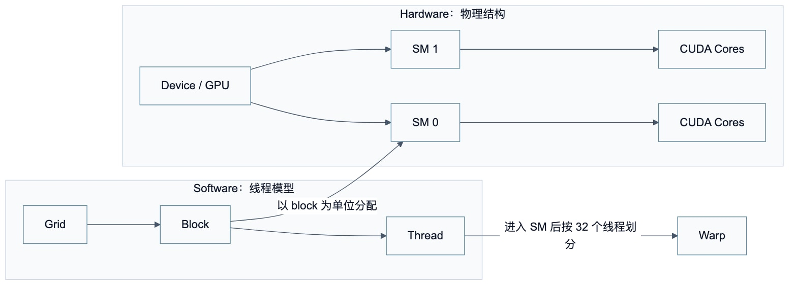
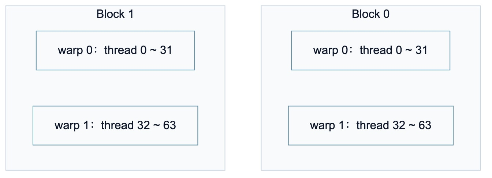
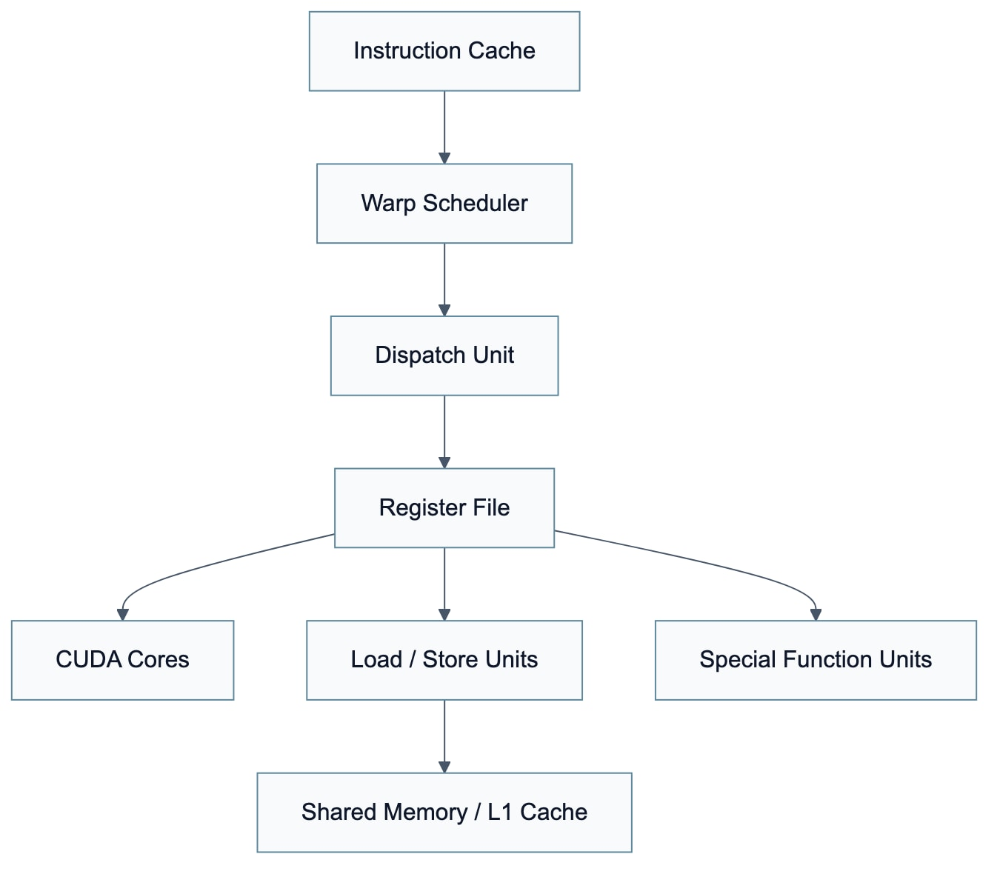
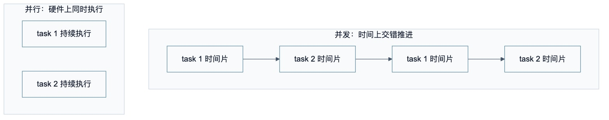
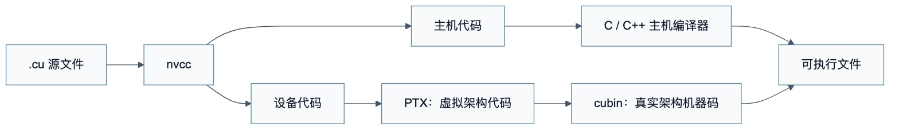
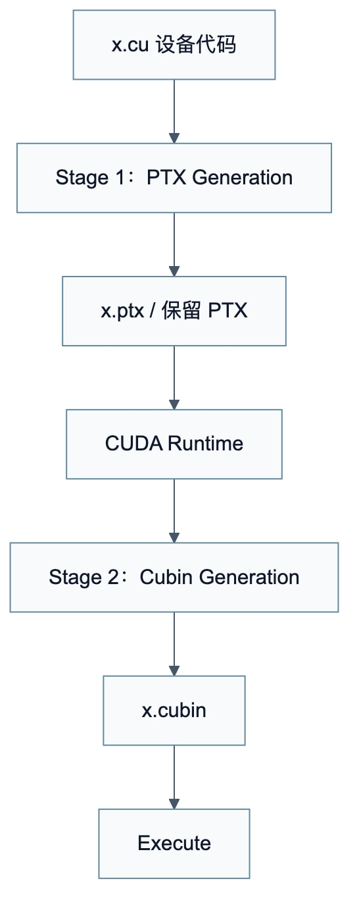
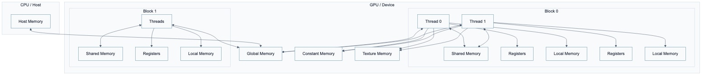

# CUDA 笔记整理

> 按截图顺序整理。能抽象重画的图已经改为流程图、表格或公式；代码和索引规则单独整理，方便之后复习。

## 01. 线程模型与物理结构

CUDA 的线程模型是软件层面的逻辑划分，常见层级为：

```text
Grid -> Block -> Thread
```

GPU 的物理结构是硬件层面的执行资源，常见层级为：

```text
Device / GPU -> SM -> CUDA Core
```

左侧线程模型是在逻辑角度分析程序；右侧物理结构是在硬件角度分析执行资源。线程模型可以定义成千上万个线程，但真正同时活跃的线程数量会受到 SM 资源限制。

线程块是调度到 SM 的基本单位。一个 grid 中的所有线程块都需要被分配到 SM 上执行；同一个线程块中的所有线程会被分配到同一个 SM 中执行。一个 SM 可以同时容纳多个线程块，但一个线程块一旦被分配到某个 SM，就不会再被拆分到其他 SM。

线程块分配到 SM 后，会继续以 `32` 个线程为一组划分成线程束（warp）。



## 02. 一维线程模型

一维线程模型中，只使用 `x` 维度来组织 grid 和 block。例如：

```cpp
kernel_fun<<<2, 4>>>();
```

含义如下：

- `gridDim.x = 2`：一共有 `2` 个线程块。
- `blockDim.x = 4`：每个线程块有 `4` 个线程。
- `blockIdx.x` 的取值范围是 `0 ~ 1`。
- `threadIdx.x` 的取值范围是 `0 ~ 3`。

每个线程在整个 grid 中的全局一维编号可以这样计算：

```cpp
int idx = threadIdx.x + blockIdx.x * blockDim.x;
```

对应关系如下：

| `blockIdx.x` | `threadIdx.x` | 全局编号 `idx` |
|---:|---:|---:|
| 0 | 0 | 0 |
| 0 | 1 | 1 |
| 0 | 2 | 2 |
| 0 | 3 | 3 |
| 1 | 0 | 4 |
| 1 | 1 | 5 |
| 1 | 2 | 6 |
| 1 | 3 | 7 |

## 03. 线程束

CUDA 使用 SIMT（Single Instruction Multiple Threads，单指令多线程）模型管理线程执行。线程进入 SM 后，会以 `32` 个线程为一组组成一个线程束，即 `warp`。

在同一个线程块中，相邻的 `32` 个线程构成一个 warp。例如：

- 第 `0 ~ 31` 个线程属于 `warp 0`。
- 第 `32 ~ 63` 个线程属于 `warp 1`。
- 依此类推。

线程束不会跨线程块组成。也就是说，每个 warp 中只包含同一个 block 中的线程。

常用的线程束内编号计算方式：

```cpp
int thread_id_in_block = threadIdx.x;
int warp_id = thread_id_in_block / 32;
int lane_id = thread_id_in_block % 32;
```



## 04. 流多处理器 SM

GPU 的并行性主要依赖 SM（Streaming Multiprocessor，流多处理器）完成。一个 GPU 通常由多个 SM 构成。

以 Fermi 架构为例，SM 中的关键资源包括：

1. CUDA 核心（CUDA Core）
2. 共享内存 / L1 缓存（Shared Memory / L1 Cache）
3. 寄存器文件（Register File）
4. 加载和存储单元（Load / Store Units）
5. 特殊函数单元（Special Function Unit，SFU）
6. Warp 调度器（Warp Scheduler）


SM 内部资源有限，所以同一时刻能驻留的线程块、线程束和线程数量会受到寄存器、共享内存、最大线程数等资源限制。

## 05. SM 上的并发与并行

GPU 中每个 SM 都可以支持数百个线程并发执行。调度时以线程块 `block` 为单位向 SM 分配任务，多个线程块可以同时分配到一个可用的 SM 上。

需要注意：

- 线程块是分配到 SM 的基本单位。
- 多个线程块可以驻留在同一个 SM。
- 一个线程块一旦分配到某个 SM，就不会再分配到其他 SM。

并发与并行的区别：

- 并发：多个任务在时间上交错推进，不一定同时执行。
- 并行：多个任务在硬件上真正同时执行。



## 06. 线程束与线程块大小

线程束是 GPU 硬件上非常重要的执行单位：

- 每个线程束只包含同一个线程块中的线程。
- 每个线程束包含 `32` 个线程。
- SM 通常以 warp 为单位调度和发射指令。

如果一个线程块的线程数不是 `32` 的整数倍，最后一个 warp 会存在不满 `32` 个有效线程的情况，剩余 lane 会处于非活跃状态。

线程块中 warp 数量的计算方式：

```cpp
int warp_num = (threads_per_block + 31) / 32;
```

示例：

| 线程块大小 | warp 划分 | 说明 |
|---:|---:|---|
| `(128, 1, 1)` | `4` 个 warp | `128 / 32 = 4`，全部为满 warp |
| `(112, 1, 1)` | `4` 个 warp | 前 `3` 个满 warp，最后一个 warp 只有 `16` 个有效线程 |

## 07. 内存分配

主机端内存使用 C / C++ 的内存分配方式，例如 `malloc`：

```cpp
float *fpHost_A;
fpHost_A = (float *)malloc(nBytes);
```

设备端内存使用 CUDA Runtime API 中的 `cudaMalloc`：

```cpp
float *fpDevice_A;
cudaMalloc((void **)&fpDevice_A, nBytes);
```

`cudaMalloc` 的函数原型：

```cpp
cudaError_t cudaMalloc(void **devPtr, size_t size);
```

参数含义：

- `devPtr`：指向设备端已分配内存地址的指针，因此需要传入二级指针。
- `size`：申请的字节数。

返回值类型为 `cudaError_t`。常见返回结果包括：

- `cudaSuccess`
- `cudaErrorInvalidValue`
- `cudaErrorMemoryAllocation`

## 08. 内存管理

CUDA 的内存管理主要包括：

1. 内存分配
2. 数据传递
3. 内存初始化
4. 内存释放

标准 C 语言内存管理函数与 CUDA 内存管理函数的对应关系如下：

| 标准 C 函数 | CUDA C 函数 | 作用 |
|---|---|---|
| `malloc` | `cudaMalloc` | 分配内存 |
| `memcpy` | `cudaMemcpy` | 拷贝数据 |
| `memset` | `cudaMemset` | 初始化内存 |
| `free` | `cudaFree` | 释放内存 |

CPU 和 GPU 通常有不同的内存空间。主机端数组不能直接当作设备端数组使用，通常需要用 `cudaMemcpy` 在 Host 和 Device 之间传递数据。

## 09. 指定真实架构计算能力

PTX 指令最终会被转换为二进制 `cubin` 代码，而 `cubin` 与具体 GPU 架构相关。

指定真实架构计算能力的编译选项：

```bash
-code=sm_XY
```

其中：

- `X`：计算能力主版本号。
- `Y`：计算能力次版本号。
- `sm_XY`：真实 GPU 架构。

注意事项：

1. 二进制 `cubin` 代码与具体架构相关，不同大版本架构之间通常不能直接兼容。
2. 如果同时指定虚拟架构和真实架构，真实架构计算能力必须大于或等于虚拟架构计算能力。
3. 例如 `-arch=compute_61 -code=sm_60` 不合理，因为真实架构 `sm_60` 小于虚拟架构 `compute_61`。

更合理的写法示例：

```bash
nvcc helloworld.cu -o helloworld -arch=compute_61 -code=sm_61
```

或者降低虚拟架构：

```bash
nvcc helloworld.cu -o helloworld -arch=compute_60 -code=sm_60
```

## 10. nvcc 编译流程

`nvcc` 会把 `.cu` 源代码分离成两类代码：

1. 主机代码（Host code）
2. 设备代码（Device code）

主机代码使用普通 C / C++ 语法编写，由主机编译器处理。设备代码使用 CUDA C / C++ 扩展语法编写，由 `nvcc` 处理。

设备代码的编译大致分为两步：

1. 先将设备代码编译为 PTX（Parallel Thread Execution）伪汇编代码。
2. 再将 PTX 编译为二进制 `cubin` 目标代码。


相关选项：

```bash
-arch=compute_XY
-code=sm_ZW
```

含义：

- `-arch=compute_XY`：指定虚拟架构计算能力，用于决定 PTX 中可以使用的 CUDA 功能。
- `-code=sm_ZW`：指定真实架构计算能力，用于决定最终可执行代码能在哪类 GPU 上运行。

## 11. 三维网格与三维线程块

CUDA 可以定义三维 grid 和三维 block：

```cpp
dim3 grid_size(2, 2, 2);
dim3 block_size(4, 4, 2);

kernel_fun<<<grid_size, block_size>>>(...);
```

在这个例子中：

- `blockIdx.x`、`blockIdx.y`、`blockIdx.z` 的取值范围都是 `0 ~ 1`。
- `threadIdx.x`、`threadIdx.y` 的取值范围都是 `0 ~ 3`。
- `threadIdx.z` 的取值范围是 `0 ~ 1`。

三维 block 编号可以线性化为：

```cpp
int blockId = blockIdx.x
            + blockIdx.y * gridDim.x
            + gridDim.x * gridDim.y * blockIdx.z;
```

三维 block 内部的线程编号可以线性化为：

```cpp
int threadId = threadIdx.z * (blockDim.x * blockDim.y)
             + threadIdx.y * blockDim.x
             + threadIdx.x;
```

整个 grid 中的全局线性编号为：

```cpp
int id = blockId * (blockDim.x * blockDim.y * blockDim.z) + threadId;
```

## 12. 推广到多维线程

多维网格和多维线程块本质上仍然是逻辑组织方式。GPU 物理执行时并不会真的把线程按二维或三维空间摆放，而是通过索引计算把多维结构映射成线性编号。

示例：

```cpp
dim3 grid_size(3, 2, 1);
dim3 block_size(5, 3, 1);
```

这个配置表示：

- grid 有 `3 * 2 * 1 = 6` 个线程块。
- 每个 block 有 `5 * 3 * 1 = 15` 个线程。
- 整个 kernel 启动了 `6 * 15 = 90` 个线程。

二维情况下常见的线性化方式：

```cpp
int tid = threadIdx.y * blockDim.x + threadIdx.x;
int bid = blockIdx.y * gridDim.x + blockIdx.x;
int id = bid * (blockDim.x * blockDim.y) + tid;
```

## 13. 内建索引变量 `blockIdx` 和 `threadIdx`

CUDA 可以组织三维网格和三维线程块。对应地，`blockIdx` 和 `threadIdx` 都是三维结构体类型，具有 `x`、`y`、`z` 三个成员。

`blockIdx` 和 `threadIdx` 的类型是 `uint3`：

```cpp
blockIdx.x;
blockIdx.y;
blockIdx.z;

threadIdx.x;
threadIdx.y;
threadIdx.z;
```

三个成员都是无符号整数类型。

## 14. `dim3` 定义多维网格和线程块

多维 grid 和 block 可以用 `dim3` 定义。`dim3` 是 CUDA 中常用的三维尺寸类型，支持 C++ 构造函数语法。

通用写法：

```cpp
dim3 grid_size(Gx, Gy, Gz);
dim3 block_size(Bx, By, Bz);
```

示例：定义一个 `2 x 2 x 1` 的 grid 和一个 `5 x 3 x 1` 的 block：

```cpp
dim3 grid_size(2, 2);   // 等价于 dim3 grid_size(2, 2, 1);
dim3 block_size(5, 3);  // 等价于 dim3 block_size(5, 3, 1);
```

如果省略第三个维度，默认值为 `1`。

## 15. 内建尺寸变量 `gridDim` 和 `blockDim`

`gridDim` 和 `blockDim` 是 `dim3` 类型的内建变量，也具有 `x`、`y`、`z` 三个成员：

```cpp
gridDim.x;
gridDim.y;
gridDim.z;

blockDim.x;
blockDim.y;
blockDim.z;
```

它们对应 kernel 启动配置中的 grid 尺寸和 block 尺寸。

索引变量的取值范围：

| 变量 | 取值范围 |
|---|---|
| `blockIdx.x` | `[0, gridDim.x - 1]` |
| `blockIdx.y` | `[0, gridDim.y - 1]` |
| `blockIdx.z` | `[0, gridDim.z - 1]` |
| `threadIdx.x` | `[0, blockDim.x - 1]` |
| `threadIdx.y` | `[0, blockDim.y - 1]` |
| `threadIdx.z` | `[0, blockDim.z - 1]` |

注意：这些内建变量用于设备端执行上下文，主机端代码不能直接访问它们。

## 16. 一维线程模型中的内建变量

一维情况下，每个线程在 kernel 中都有唯一身份标识。这个唯一标识由 kernel 启动配置决定：

```cpp
kernel<<<grid_size, block_size>>>(...);
```

在设备端，配置值会保存在内建变量中：

- `gridDim.x`：等于启动配置中的 `grid_size`。
- `blockDim.x`：等于启动配置中的 `block_size`。

线程索引也保存在内建变量中：

- `blockIdx.x`：当前线程所在 block 在 grid 中的索引，范围为 `0 ~ gridDim.x - 1`。
- `threadIdx.x`：当前线程在线程块中的索引，范围为 `0 ~ blockDim.x - 1`。

因此，一维全局线程编号为：

```cpp
int idx = blockIdx.x * blockDim.x + threadIdx.x;
```

## 17. 自定义设备函数

CUDA 中常见函数修饰符包括 `__device__`、`__global__` 和 `__host__`。

### 设备函数

设备函数（device function）只能在 GPU 设备上执行，用 `__device__` 修饰。

特点：

- 只能在设备端执行。
- 只能被 kernel 函数或其他设备函数调用。

示例：

```cpp
__device__ float add_device(float a, float b) {
    return a + b;
}
```

### 核函数

核函数（kernel function）用 `__global__` 修饰。它通常由主机端调用，在设备端执行。

特点：

- 调用时需要使用 `<<<grid_size, block_size>>>` 配置执行维度。
- `__global__` 不能和 `__host__` 同时使用，也不能和 `__device__` 同时使用。

示例：

```cpp
__global__ void kernel_fun(float *out) {
    int idx = blockIdx.x * blockDim.x + threadIdx.x;
    out[idx] = add_device(out[idx], 1.0f);
}
```

### 主机函数

主机函数（host function）在 CPU 端执行，可以用 `__host__` 修饰。普通 C++ 函数默认就是主机函数，因此 `__host__` 通常可以省略。

同一个辅助函数也可以同时用 `__host__` 和 `__device__` 修饰，表示编译器分别生成主机端和设备端版本：

```cpp
__host__ __device__ float add_common(float a, float b) {
    return a + b;
}
```

## 18. nvcc 即时编译

即时编译（JIT）指的是：在运行可执行文件时，CUDA Runtime 可以从可执行文件中保留的 PTX 代码临时编译出适配当前 GPU 的 `cubin` 代码。

如果希望在可执行文件中保留 PTX 代码，可以使用：

```bash
-gencode arch=compute_XY,code=compute_XY
```

注意：

1. 这里的两个计算能力都是虚拟架构计算能力。
2. 两个虚拟架构计算能力必须一致。

常见写法示例：

```bash
-gencode arch=compute_35,code=sm_35
-gencode arch=compute_50,code=sm_50
-gencode arch=compute_61,code=sm_61
-gencode arch=compute_61,code=compute_61
```

其中前三行生成指定真实架构的二进制代码，最后一行保留 `compute_61` 的 PTX，供运行时 JIT 编译。

简化写法：

```bash
-arch=sm_XY
```

通常可以理解为同时生成当前 `sm_XY` 的机器码，并保留对应 `compute_XY` 的 PTX，以便运行时进行兼容处理。



## 19. CUDA 事件计时

程序执行时间计时是分析 CUDA 程序性能的重要方式。CUDA 中可以使用 event 进行计时。

基本流程：

1. 创建开始事件和结束事件。
2. 在待计时代码前记录 `start`。
3. 执行待计时代码。
4. 在待计时代码后记录 `stop`。
5. 同步 `stop`，确保 GPU 端工作完成。
6. 使用 `cudaEventElapsedTime` 计算两个事件之间的时间。
7. 销毁事件。

示例代码：

```cpp
cudaEvent_t start, stop;

cudaEventCreate(&start);
cudaEventCreate(&stop);

cudaEventRecord(start);

// 待计时的 CUDA 代码，例如 kernel 调用
// kernel_fun<<<grid_size, block_size>>>(...);

cudaEventRecord(stop);
cudaEventSynchronize(stop);

float elapsed_time = 0.0f;
cudaEventElapsedTime(&elapsed_time, start, stop);

printf("Time = %g ms.\n", elapsed_time);

cudaEventDestroy(start);
cudaEventDestroy(stop);
```

由于 kernel 启动通常是异步的，记录结束事件后需要同步，才能得到可靠的 GPU 执行时间。

## 20. CUDA 内存模型

CUDA 内存模型中常见的内存类型包括：

1. 寄存器（register）
2. 共享内存（shared memory）
3. 本地内存（local memory）
4. 常量内存（constant memory）
5. 纹理内存（texture memory）
6. 全局内存（global memory）

抽象关系如下：


核心理解：

- 寄存器和本地内存属于单个线程。
- 共享内存属于单个线程块。
- 全局内存、常量内存、纹理内存对整个设备上的线程可见。
- 主机端需要通过 CUDA API 与设备端全局内存交换数据。

## 21. CUDA 内存的主要特征

CUDA 内存可以从四个角度理解：

1. 物理位置
2. 访问权限
3. 可见范围
4. 生命周期

| 内存类型 | 物理位置 | 访问权限 | 可见范围 | 生命周期 |
|---|---|---|---|---|
| 全局内存 | 芯片外 | 可读可写 | 所有线程和主机端 | 由主机分配与释放 |
| 常量内存 | 芯片外 | 只读 | 所有线程和主机端 | 由主机分配与释放 |
| 纹理和表面内存 | 芯片外 | 一般只读 | 所有线程和主机端 | 由主机分配与释放 |
| 寄存器内存 | 芯片内 | 可读可写 | 单个线程 | 所在线程 |
| 本地内存 | 芯片外 | 可读可写 | 单个线程 | 所在线程 |
| 共享内存 | 芯片内 | 可读可写 | 单个线程块 | 所在线程块 |

从性能角度看，芯片内资源通常更快，但容量更有限；芯片外内存容量更大，但访问延迟更高。

## 22. 不同 CUDA 内存层次的具体使用方法

CUDA 内存层次的选择，本质上是在三个目标之间做平衡：

1. 让访问尽量靠近计算单元。
2. 让同一份数据被尽量多的线程复用。
3. 让 warp 中相邻线程的访问尽量规则、连续、合并。

### 寄存器

寄存器是每个线程私有的最快存储资源。设备端函数中的普通标量局部变量通常会被编译器放入寄存器。

适合放在寄存器中的数据：

- 当前线程频繁使用的临时变量。
- 循环中的累加器。
- 不需要与其他线程共享的小规模标量。

示例：

```cpp
__global__ void saxpy(float *y, const float *x, float a, int n) {
    int idx = blockIdx.x * blockDim.x + threadIdx.x;
    if (idx < n) {
        float xi = x[idx];        // 通常进入寄存器
        float yi = y[idx];        // 通常进入寄存器
        y[idx] = a * xi + yi;
    }
}
```

使用寄存器时要注意寄存器压力。每个线程使用的寄存器越多，同一个 SM 上能同时驻留的线程束可能越少，进而影响 occupancy 和延迟隐藏能力。

常用检查方式：

```bash
nvcc -Xptxas -v kernel.cu
```

编译输出中可以看到每个 kernel 使用的 register 数量、shared memory 数量和 local memory 数量。

### 本地内存

本地内存（local memory）名字里有“本地”，但它通常位于芯片外的设备内存中，只是访问范围属于单个线程。

本地内存常见来源：

- 单个线程里的大数组。
- 下标无法在编译期确定的数组访问。
- 寄存器不够时发生 register spilling。

示例：

```cpp
__global__ void example(float *out) {
    float tmp[128];  // 可能进入 local memory
    int idx = threadIdx.x;
    tmp[idx] = 1.0f;
    out[idx] = tmp[idx];
}
```

本地内存的使用原则：

- 尽量避免在单个线程中定义过大的局部数组。
- 如果数据会被同一个 block 内多个线程复用，优先考虑共享内存。
- 如果只是少量标量，尽量保持为普通局部变量，让编译器放入寄存器。
- 通过 `nvcc -Xptxas -v` 或 Nsight Compute 观察是否出现较多 local memory 访问。

### 共享内存

共享内存位于 SM 上，由同一个 block 内的线程共享，生命周期为该 block 的执行期间。

适合使用共享内存的场景：

- 同一个 block 内多个线程会重复使用同一批全局内存数据。
- 需要在线程块内部进行协作，例如规约、扫描、矩阵分块计算。
- 需要把非连续的全局内存访问重排为更规则的访问。

静态共享内存声明：

```cpp
__global__ void kernel(float *out, const float *in) {
    __shared__ float tile[256];

    int tid = threadIdx.x;
    int idx = blockIdx.x * blockDim.x + tid;

    tile[tid] = in[idx];
    __syncthreads();

    out[idx] = tile[tid] * 2.0f;
}
```

动态共享内存声明：

```cpp
__global__ void kernel(float *out, const float *in) {
    extern __shared__ float tile[];

    int tid = threadIdx.x;
    int idx = blockIdx.x * blockDim.x + tid;

    tile[tid] = in[idx];
    __syncthreads();

    out[idx] = tile[tid];
}
```

启动动态共享内存 kernel 时，第三个配置参数表示每个 block 动态分配的共享内存字节数：

```cpp
int threads = 256;
int shared_bytes = threads * sizeof(float);
kernel<<<grid_size, threads, shared_bytes>>>(out, in);
```

共享内存使用要点：

- 写入共享内存后，如果其他线程要读取这些数据，需要使用 `__syncthreads()`。
- `__syncthreads()` 是 block 级同步，不能同步不同 block。
- 不要在部分线程进入、部分线程不进入的分支中随意调用 `__syncthreads()`，否则可能死锁。
- 共享内存容量有限，使用过多会降低每个 SM 可驻留的 block 数。

### 共享内存 bank conflict

共享内存被分成多个 bank。一个 warp 中多个线程如果访问落在同一个 bank 的不同地址，就可能产生 bank conflict，访问会被串行化。

常见规避方法：

- 让相邻线程访问相邻地址。
- 对二维 tile 增加 padding。
- 访问转置数据时尤其注意 bank conflict。

二维 tile padding 示例：

```cpp
#define TILE_DIM 32

__shared__ float tile[TILE_DIM][TILE_DIM + 1];
```

这里多出的 `+ 1` 可以改变每一行的起始 bank 分布，常用于减少转置访问时的 bank conflict。

### 全局内存

全局内存位于芯片外，容量大、生命周期由主机端分配和释放，所有线程都可以访问。它是 GPU 上最常用的数据存储位置，但访问延迟也较高。

设备端全局内存分配：

```cpp
float *d_x = nullptr;
cudaMalloc((void **)&d_x, n * sizeof(float));
```

主机和设备之间传输数据：

```cpp
cudaMemcpy(d_x, h_x, n * sizeof(float), cudaMemcpyHostToDevice);
cudaMemcpy(h_x, d_x, n * sizeof(float), cudaMemcpyDeviceToHost);
```

释放设备内存：

```cpp
cudaFree(d_x);
```

全局内存访问最重要的性能原则是合并访问（coalesced access）。理想情况下，一个 warp 中相邻线程访问连续地址：

```cpp
int idx = blockIdx.x * blockDim.x + threadIdx.x;
float v = x[idx];  // 相邻线程读取相邻元素
```

应尽量避免大跨度访问：

```cpp
int idx = (blockIdx.x * blockDim.x + threadIdx.x) * stride;
float v = x[idx];  // stride 较大时，访存效率通常较差
```

### 常量内存

常量内存适合保存所有线程只读的小型数据，例如模型参数、滤波器系数、查找表和配置常量。

声明常量内存：

```cpp
__constant__ float c_coeff[64];
```

主机端写入常量内存：

```cpp
float h_coeff[64];
cudaMemcpyToSymbol(c_coeff, h_coeff, sizeof(h_coeff));
```

设备端读取：

```cpp
__global__ void kernel(float *out, const float *in) {
    int idx = blockIdx.x * blockDim.x + threadIdx.x;
    out[idx] = in[idx] * c_coeff[0];
}
```

常量内存的最佳使用场景是：同一个 warp 中很多线程读取同一个常量地址。此时硬件可以广播读取结果。若 warp 中每个线程读取不同常量地址，效果通常会变差。

### 纹理内存和表面内存

纹理内存和表面内存适合图像、二维数组、空间局部性明显或访问模式不完全连续的数据。

常见用途：

- 图像处理中的二维邻域访问。
- 访问具有空间局部性的只读数据。
- 利用纹理硬件支持的地址模式、过滤模式和缓存行为。

简单的一维数组计算通常优先使用全局内存加合并访问；只有当访问模式、缓存特征或图像语义适合时，再考虑纹理或表面对象。

### 页锁定主机内存

普通主机内存是 pageable memory。CUDA 数据传输时，如果主机内存是页锁定内存（pinned memory），通常可以获得更高的主机和设备传输带宽，也可以配合异步拷贝使用。

分配页锁定主机内存：

```cpp
float *h_x = nullptr;
cudaMallocHost((void **)&h_x, n * sizeof(float));
```

释放：

```cpp
cudaFreeHost(h_x);
```

异步拷贝示例：

```cpp
cudaStream_t stream;
cudaStreamCreate(&stream);

cudaMemcpyAsync(d_x, h_x, n * sizeof(float),
                cudaMemcpyHostToDevice, stream);

kernel<<<grid_size, block_size, 0, stream>>>(d_x);

cudaStreamSynchronize(stream);
cudaStreamDestroy(stream);
```

注意：页锁定内存会减少操作系统可分页内存，分配过多会影响系统整体性能。一般只对频繁传输的大块缓冲区使用。

### 统一内存

统一内存（Unified Memory）用 `cudaMallocManaged` 分配，主机和设备可以通过同一个指针访问。

```cpp
float *x = nullptr;
cudaMallocManaged(&x, n * sizeof(float));

for (int i = 0; i < n; ++i) {
    x[i] = 1.0f;        // Host 访问
}

kernel<<<grid_size, block_size>>>(x);
cudaDeviceSynchronize();

cudaFree(x);
```

统一内存适合：

- 快速原型开发。
- 数据结构复杂、手动管理 Host / Device 副本成本较高的场景。
- 不想显式写大量 `cudaMemcpy` 的场景。

性能敏感代码中，建议配合预取使用：

```cpp
int device = 0;
cudaMemPrefetchAsync(x, n * sizeof(float), device);
kernel<<<grid_size, block_size>>>(x);
cudaDeviceSynchronize();
```

统一内存简化了编程模型，但并不等于没有数据移动成本。页面迁移、缺页和访问位置变化仍然会影响性能。

### 不同内存层次的选择表

| 使用场景 | 优先考虑的内存 |
|---|---|
| 单个线程频繁使用的小标量 | 寄存器 |
| 单个线程私有但较大的临时数组 | 尽量避免，必要时为本地内存 |
| 同一 block 内线程共享和复用数据 | 共享内存 |
| 大数组、输入输出张量、跨 block 可见数据 | 全局内存 |
| 所有线程只读且很多线程读同一地址的小表 | 常量内存 |
| 图像、二维空间局部性强的只读访问 | 纹理内存 |
| 图像或二维数据写入，有专门 surface 语义 | 表面内存 |
| 频繁 Host / Device 传输的大缓冲区 | 页锁定主机内存 |
| 需要简化内存管理或快速原型 | 统一内存 |

## 23. CUDA 内存访问最佳实践

### 优先优化全局内存访问

很多 CUDA kernel 的瓶颈不是计算，而是全局内存带宽。优化时应先检查：

- 相邻线程是否访问相邻地址。
- 是否存在 stride 很大的访问。
- 是否存在重复读取但没有复用。
- 是否有不必要的 Host / Device 数据传输。

好的访问模式：

```cpp
int idx = blockIdx.x * blockDim.x + threadIdx.x;
y[idx] = x[idx] * 2.0f;
```

较差的访问模式：

```cpp
int idx = (blockIdx.x * blockDim.x + threadIdx.x) * stride;
y[idx] = x[idx] * 2.0f;
```

如果算法天然需要跨步访问，可以考虑先用共享内存做 tile 缓存和重排。

### 使用共享内存提高数据复用

共享内存适合把全局内存中会被多次使用的数据搬到 SM 上。典型例子是矩阵乘法中的 tile：

```cpp
#define TILE 16

__global__ void matmul_tiled(const float *A, const float *B, float *C, int N) {
    __shared__ float As[TILE][TILE];
    __shared__ float Bs[TILE][TILE];

    int tx = threadIdx.x;
    int ty = threadIdx.y;
    int row = blockIdx.y * TILE + ty;
    int col = blockIdx.x * TILE + tx;

    float sum = 0.0f;

    for (int t = 0; t < N; t += TILE) {
        As[ty][tx] = A[row * N + (t + tx)];
        Bs[ty][tx] = B[(t + ty) * N + col];
        __syncthreads();

        for (int k = 0; k < TILE; ++k) {
            sum += As[ty][k] * Bs[k][tx];
        }
        __syncthreads();
    }

    C[row * N + col] = sum;
}
```

实际代码还需要处理 `N` 不能整除 `TILE` 的边界情况。这里重点是模式：全局内存加载一次，block 内多个线程在共享内存中重复使用。

### 减少 Host 和 Device 之间的数据传输

PCIe 或 NVLink 传输通常比 GPU 内部带宽慢。实践中应尽量：

- 把多个小传输合并成大传输。
- 数据能留在 GPU 上就不要频繁拷回 CPU。
- 使用页锁定主机内存提升传输带宽。
- 用 `cudaMemcpyAsync` 和 stream 尝试重叠传输与计算。

常见流程：

```text
Host 初始化数据
-> 一次性拷贝到 Device
-> 多个 kernel 在 Device 上连续处理
-> 最后只把必要结果拷回 Host
```

### 区分缓存、复用和同步

共享内存不是越多越好。它真正有价值的前提是：

1. 数据从全局内存读入后会被复用。
2. 复用发生在同一个 block 内。
3. `__syncthreads()` 的同步成本小于减少的全局内存访问成本。

如果每个数据只读一次，且访问本来就是合并的，把它搬进共享内存可能没有收益，甚至会变慢。

### 控制寄存器压力

过多寄存器会降低 SM 上可同时驻留的 warp 数量。优化时需要在“每个线程更快”和“更多 warp 隐藏延迟”之间平衡。

常见方法：

- 拆分过大的 kernel。
- 减少过长的临时变量生命周期。
- 避免单线程维护过多中间结果。
- 查看编译器报告中的 register 和 local memory 使用量。

可以辅助使用：

```bash
nvcc -Xptxas -v kernel.cu
```

必要时也可以尝试 `__launch_bounds__` 或 `-maxrregcount`，但这类手段可能导致 register spilling，需要结合 profiling 判断。

### 使用 `const` 和 `__restrict__`

如果输入指针只读，可以声明为 `const`。如果能保证多个指针不指向同一片内存，可以使用 `__restrict__` 帮助编译器优化访存。

```cpp
__global__ void add_kernel(const float *__restrict__ a,
                           const float *__restrict__ b,
                           float *__restrict__ c,
                           int n) {
    int idx = blockIdx.x * blockDim.x + threadIdx.x;
    if (idx < n) {
        c[idx] = a[idx] + b[idx];
    }
}
```

`__restrict__` 需要程序员保证别名关系正确。如果实际上传入了重叠内存，结果可能不符合预期。

### 注意二维数据的布局

二维数据如果按行主序存储，相邻线程最好沿 `x` 方向访问连续元素：

```cpp
int x = blockIdx.x * blockDim.x + threadIdx.x;
int y = blockIdx.y * blockDim.y + threadIdx.y;
int idx = y * width + x;
```

对于二维数组分配，可以考虑 `cudaMallocPitch`，让每一行满足更合适的对齐：

```cpp
float *d_img = nullptr;
size_t pitch = 0;
cudaMallocPitch((void **)&d_img, &pitch,
                width * sizeof(float), height);
```

访问时要用 `pitch` 计算行起始地址：

```cpp
char *row_ptr = (char *)d_img + y * pitch;
float *row = (float *)row_ptr;
float value = row[x];
```

### 先测量再优化

内存优化不要只凭直觉。建议使用 profiling 工具观察：

- 全局内存 load / store efficiency。
- 是否存在非合并访问。
- shared memory bank conflict。
- register 数量和 occupancy。
- Host / Device memcpy 时间。
- kernel 是否被内存带宽限制。

常用工具：

- Nsight Systems：看 CPU、GPU、数据传输和 kernel 时间线。
- Nsight Compute：看单个 kernel 的访存效率、occupancy、warp stall 原因等细节。

### 内存优化检查清单

写 CUDA kernel 时可以按下面顺序检查：

1. 全局内存访问是否合并。
2. Host / Device 拷贝是否最少化。
3. 数据是否能在 GPU 上连续处理，避免频繁拷回 CPU。
4. block 内重复使用的数据是否适合放入共享内存。
5. 共享内存访问是否存在明显 bank conflict。
6. `__syncthreads()` 是否必要，是否所有线程都会到达。
7. 常量数据是否适合放入 `__constant__`。
8. 单线程局部数组是否导致 local memory 访问。
9. 寄存器数量是否过多，是否影响 occupancy。
10. 是否用 profiling 结果验证优化确实有效。

## 24. 延迟隐藏的概念

指令延迟指一条指令从发出到完成之间经历的时钟周期数。

如果每个时钟周期中，所有 warp 调度器都有一个满足条件、可以发射的线程束，那么计算资源就可以保持较高利用率。

GPU 会通过调度其他线程束的计算来隐藏当前线程束的指令延迟，这种机制称为延迟隐藏。

典型情况：

- 某个 warp 因为等待内存访问或数据依赖而停顿。
- SM 的 warp scheduler 切换到另一个已经准备好的 warp。
- 只要可调度 warp 足够多，硬件执行单元就不容易空闲。

指令可以粗略分为两种基本类型：

1. 算术指令
2. 内存指令

内存指令通常延迟更高，因此充足的活跃 warp 数量对隐藏内存访问延迟尤其重要。

## 25. 参考资料

- [NVIDIA CUDA C++ Programming Guide](https://docs.nvidia.com/cuda/cuda-c-programming-guide/)
- [NVIDIA CUDA C++ Best Practices Guide](https://docs.nvidia.com/cuda/cuda-c-best-practices-guide/index.html)
