# 第 1 章 为什么需要并行计算

## 1.2 为什么需要建立并行系统

### 单核性能提升受限

- 过去单处理器性能提升主要依赖晶体管密度增加。
- 晶体管变小可以提高速度，但会带来更高功耗和散热压力。
- 风冷散热逐渐接近极限，继续单纯提高单核速度变得困难。
- 因此，提高计算能力的重要方向转向**并行化**。

### 多核处理器

- **多核处理器**：在一个芯片上集成多个相对简单、完整的处理器核心。
- **单核系统**：传统只有一个 CPU 核心的处理器系统。
- 普通串行程序通常不能自动利用多核，程序员需要学习并行编程。

### 并行化的两种基本方式

| 类型 | 含义 | 例子 |
|---|---|---|
| 任务并行 | 把不同任务分配给不同核心 | 一个核心读文件，一个核心处理数据，一个核心写结果 |
| 数据并行 | 把数据分给不同核心，各核心执行相同或类似操作 | 把数组分段，每个核心求一段和 |

### 并行程序的协调问题

| 问题 | 含义 |
|---|---|
| 通信 | 核心之间交换部分结果或状态 |
| 负载平衡 | 尽量让各核心工作量接近，避免部分核心空闲 |
| 同步 | 某些阶段需要等待其他核心完成后才能继续 |

## 1.3 并行系统的分类

### 按内存访问方式分类

#### 共享内存系统

- 多个核心共享同一块内存。
- 原则上，每个核心都可以读写每个内存位置。
- 核心可通过共享变量进行协调。

```text
核心0   ┐
核心1   ├── 共享内存
...    │
核心p-1 ┘
```

#### 分布式内存系统

- 每个核心或节点有自己的私有内存。
- 核心之间通常不能直接访问彼此内存。
- 需要通过网络发送消息进行通信。

```text
核心0 -- 内存0     ┐
核心1 -- 内存1     ├── 网络
...               │
核心p-1 -- 内存p-1 ┘
```

### 按指令流和数据流分类

这类分类通常称为 **Flynn 分类法**。它从两个维度描述并行系统：

- **指令流（instruction stream）**：处理器执行的指令序列。
- **数据流（data stream）**：指令作用的数据序列。

根据“指令流数量”和“数据流数量”，Flynn 分类法一共分为四类：

| 类型 | 全称 | 指令流 | 数据流 | 含义 | 常见例子 |
|---|---|---|---|---|---|
| SISD | Single Instruction Single Data | 单 | 单 | 一个处理器顺序执行一条指令流，处理一个数据流 | 传统单核串行计算机 |
| SIMD | Single Instruction Multiple Data | 单 | 多 | 多个处理单元执行同一条指令，但作用在不同数据上 | 向量处理器、GPU 的部分模型 |
| MISD | Multiple Instruction Single Data | 多 | 单 | 多条指令流作用在同一个数据流上；现实中很少作为通用模型 | 少数容错、冗余计算模型 |
| MIMD | Multiple Instruction Multiple Data | 多 | 多 | 多个处理器或核心可以独立执行不同指令，并处理不同数据 | 多核 CPU、集群 |

本书主要关注 **SIMD** 和 **MIMD**：

- **SIMD** 更像“同一条指令同时作用在多份数据上”。
- **MIMD** 更像“多个独立处理器各自执行自己的指令流”。
- **MISD** 理论上存在，但在通用并行程序设计中很少作为主要模型。

## 第 1 章小结

| API | 主要用途 |
|---|---|
| MPI | 分布式内存 MIMD 系统 |
| Pthreads | 共享内存 MIMD 系统 |
| OpenMP | 共享内存系统，重点用于 MIMD |
| CUDA | NVIDIA GPU 编程 |

### 并发、并行、分布式

| 概念 | 重点 |
|---|---|
| 并发 | 多个任务在同一时间段内推进，不一定真正同时执行 |
| 并行 | 多个任务实际同时执行，任务通常耦合更紧密 |
| 分布式 | 多个任务分布在不同机器或节点上，通过网络协作 |

# 第 2 章 并行硬件与并行软件

## 2.1 背景知识

### 2.1.1 冯·诺依曼体系结构

### 基本组成

经典冯·诺依曼体系结构包括：

- **主存**
- **CPU**：也叫处理器或核心
- **互连网络**：连接 CPU 和主存

### 主存

- 主存由一组存储位置组成。
- 每个位置有：
  - **地址**：用于访问该位置。
  - **内容**：保存指令或数据。

### CPU

| 部件 | 作用 |
|---|---|
| 控制单元 | 决定执行哪条指令 |
| 数据通路 | 执行实际指令 |
| 寄存器 | 保存数据和程序状态 |
| 程序计数器 | 保存下一条将执行指令的地址 |

### 冯·诺依曼瓶颈

- CPU 和主存分离。
- 指令和数据必须通过互连网络传输。
- CPU 执行速度可能远快于内存访问速度，导致 CPU 等待内存。
- 互连网络限制了程序访问指令和数据的速率。

类比：

- CPU = 工厂
- 主存 = 仓库
- 互连 = 道路
- 如果运输速度跟不上生产速度，道路就成为瓶颈。

### 2.1.2 进程、多任务和线程

### 进程

**进程**：正在执行的程序实例。

进程通常包括：

- 可执行机器语言程序
- 内存块：代码、调用栈、堆等
- 资源描述符：如文件描述符
- 安全信息：可访问哪些资源
- 状态信息：是否可运行、是否等待资源、寄存器内容等

### 多任务

- **多任务操作系统**支持多个程序在同一时间段内运行。
- 单核系统也可通过**时间片**轮流执行不同进程，让它们看起来同时运行。
- 如果进程等待资源，会进入**阻塞态**，此时操作系统可以运行其他进程。

### 线程

**线程**：进程内部的执行单元，用于把程序划分为多个相对独立的任务。是 CPU 资源调度的单元

特点：

- 同一进程内的线程共享大部分资源。
- 线程切换通常比进程切换更快。
- 每个线程需要自己的程序计数器和调用栈。

线程共享与独有内容：

| 类型 | 内容 |
|---|---|
| 共享 | 可执行文件、进程内存、大部分资源、I/O 设备 |
| 独有 | 程序计数器、调用栈 |

图 2.2：有三个线程的进程

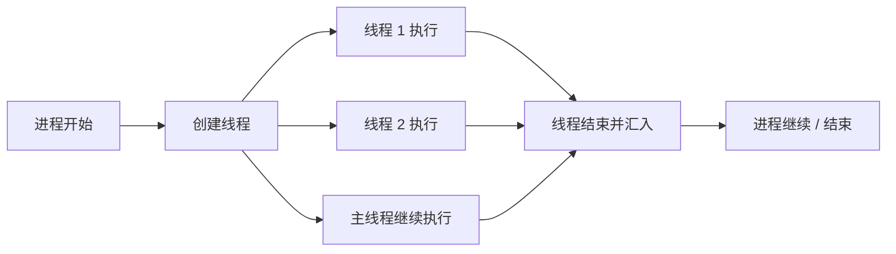

## 2.2 冯·诺依曼模型的改进

本节介绍三类改进：

- 缓存
- 虚拟内存
- 低级别并行性

### 2.2.1 缓存基础

### 缓存的作用

- 缓存用于缓解冯·诺依曼瓶颈。
- 思想：
  - 一次传输一块数据或指令，而不是单个数据项。
  - 把常用数据和指令放在更靠近 CPU 的高速存储中。

**CPU 缓存**：CPU 能以比访问主存更快速度访问的一组内存位置。缓存速度快，但容量通常远小于主存。

### 局部性

| 类型 | 含义 | 例子 |
|---|---|---|
| 时间局部性 | 最近访问过的内容，近期可能再次访问 | 循环中反复使用变量 |
| 空间局部性 | 访问某位置后，附近位置可能很快被访问 | 顺序遍历数组 |

数组例子：

```c
float z[1000];
sum = 0.0;
for (i = 0; i < 1000; i++)
    sum += z[i];
```

数组连续存储，访问 `z[i]` 后通常接着访问 `z[i+1]`，符合空间局部性。

### 缓存行

- **缓存行 / 缓存块**：内存和缓存之间传输的基本单位。
- 一次缓存缺失通常会把包含目标数据的一整行读入缓存。
- 如果一个缓存行保存 `z[0]` 到 `z[15]`，那么第一次访问 `z[0]` 后，后续访问 `z[1]` 到 `z[15]` 可能直接命中。

### 多级缓存

| 层级 | 特点 |
|---|---|
| L1 | 最小、最快、最接近 CPU |
| L2 | 比 L1 大，速度较慢 |
| L3 | 更大，通常更慢 |

CPU 访问数据时通常按 `L1 -> L2 -> L3 -> 主存` 的顺序查找。

### 缓存命中与缺失

| 概念 | 含义 |
|---|---|
| 缓存命中 hit | 所需数据或指令在缓存中 |
| 缓存缺失 miss | 所需数据或指令不在缓存中，需要访问更慢层级 |

例子：`L1` 缺失但 `L2` 命中。

缓存缺失可能导致 CPU 暂停，等待数据从主存或低层缓存取回。

### 写策略

| 策略 | 做法 | 特点 |
|---|---|---|
| 写直达 | 写缓存时同时写主存 | 主存更新及时，写入开销较大 |
| 写回 | 先只写缓存并标记为脏，替换时再写回主存 | 写入较快，但需要维护脏数据 |

### 2.2.2 缓存映射

**缓存映射问题**：主存中的一个数据块被读入缓存时，应该放在缓存的哪个位置？

### 三种映射方式

| 方式 | 含义 | 特点 |
|---|---|---|
| 全相联缓存 | 主存块可放入缓存任意位置 | 灵活，硬件复杂 |
| 直接映射缓存 | 每个主存块只能放入唯一缓存行 | 简单，但冲突多 |
| n 路组相联缓存 | 每个主存块可放入某组中的 n 个位置之一 | 折中方案 |

### 直接映射例子

主存有 16 个块，缓存有 4 行：

```text
缓存行索引 = 主存块索引 mod 4
```

映射：

- `0, 4, 8, 12 -> 0`
- `1, 5, 9, 13 -> 1`
- `2, 6, 10, 14 -> 2`
- `3, 7, 11, 15 -> 3`

### 两路组相联例子

缓存 4 行，分成两组：

- 组 0：缓存行 `0`、`1`
- 组 1：缓存行 `2`、`3`

```text
组索引 = 主存块索引 mod 2
```

映射：

- 偶数主存块：可放入缓存行 `0` 或 `1`
- 奇数主存块：可放入缓存行 `2` 或 `3`

### 表 2.1：16 个主存块分配到 4 个缓存行

| 主存索引 | 全相联 | 直接映射 | 两路组相联 |
|---:|---|---:|---|
| 0 | 0、1、2 或 3 | 0 | 0 或 1 |
| 1 | 0、1、2 或 3 | 1 | 2 或 3 |
| 2 | 0、1、2 或 3 | 2 | 0 或 1 |
| 3 | 0、1、2 或 3 | 3 | 2 或 3 |
| 4 | 0、1、2 或 3 | 0 | 0 或 1 |
| 5 | 0、1、2 或 3 | 1 | 2 或 3 |
| 6 | 0、1、2 或 3 | 2 | 0 或 1 |
| 7 | 0、1、2 或 3 | 3 | 2 或 3 |
| 8 | 0、1、2 或 3 | 0 | 0 或 1 |
| 9 | 0、1、2 或 3 | 1 | 2 或 3 |
| 10 | 0、1、2 或 3 | 2 | 0 或 1 |
| 11 | 0、1、2 或 3 | 3 | 2 或 3 |
| 12 | 0、1、2 或 3 | 0 | 0 或 1 |
| 13 | 0、1、2 或 3 | 1 | 2 或 3 |
| 14 | 0、1、2 或 3 | 2 | 0 或 1 |
| 15 | 0、1、2 或 3 | 3 | 2 或 3 |

### 缓存替换策略

- 当多个主存块可映射到多个缓存位置时，需要决定替换哪一行。
- **LRU**：Least Recently Used，最近最少使用。
- 思想：优先逐出最久没有被访问的缓存行。

### 2.2.3 缓存和程序：示例

### 核心结论

- CPU 缓存由硬件控制，程序员不能直接决定缓存内容。
- 但程序员可以利用局部性写出更缓存友好的代码。
- C 语言二维数组按**行优先**存储，因此按行访问通常比按列访问快。

### 行优先存储

`A[4][4]` 在内存中按行连续存储：

| 缓存行 | A 的元素 |
|---:|---|
| 0 | `A[0][0]` `A[0][1]` `A[0][2]` `A[0][3]` |
| 1 | `A[1][0]` `A[1][1]` `A[1][2]` `A[1][3]` |
| 2 | `A[2][0]` `A[2][1]` `A[2][2]` `A[2][3]` |
| 3 | `A[3][0]` `A[3][1]` `A[3][2]` `A[3][3]` |

### 两种循环顺序

按行访问，缓存友好：

```c
for (i = 0; i < MAX; i++)
    for (j = 0; j < MAX; j++)
        y[i] += A[i][j] * x[j];
```

按列访问，缓存不友好：

```c
for (j = 0; j < MAX; j++)
    for (i = 0; i < MAX; i++)
        y[i] += A[i][j] * x[j];
```

原因：

- 第一种访问顺序类似：`A[0][0], A[0][1], A[0][2], A[0][3]`，连续。
- 第二种访问顺序类似：`A[0][0], A[1][0], A[2][0], A[3][0]`，不连续。

### 缓存缺失分析

假设：

- `MAX = 4`
- 一个缓存行保存 4 个 `double`
- 缓存只能保存两行 `A`
- 循环开始时 `A` 不在缓存中

结果：

- 按行访问：每行第一次访问缺失，之后同一行命中；约 4 次缺失。
- 按列访问：频繁跨行访问，缓存行容易被替换；缺失更多。

结论：对 C 的二维数组，优先按行遍历，能更好利用空间局部性。

### 2.2.4 虚拟内存

### 核心概念

- **虚拟内存**：让程序使用虚拟地址，由系统映射到实际物理地址。
- **页**：虚拟内存和物理内存管理的基本块。
- **页表**：记录虚拟页到物理页的映射关系。

### TLB

- **TLB**：Translation Lookaside Buffer，旁路转换缓冲区。
- 作用：缓存少量页表项，加速虚拟地址到物理地址的转换。
- 常见大小：几十到几百个条目。

| 概念 | 含义 |
|---|---|
| TLB 命中 | 虚拟页号在 TLB 中，地址转换较快 |
| TLB 缺失 | 虚拟页号不在 TLB 中，需要访问页表 |
| 页面错误 | 要访问的页不在主存中，只在磁盘上，需要从磁盘调入 |

### 虚拟内存与缓存的区别

| 对比 | CPU 缓存 | 虚拟内存 |
|---|---|---|
| 主要控制者 | 硬件 | 硬件 + 操作系统 |
| 慢速后备存储 | 主存 | 磁盘 |
| 写策略 | 可写直达或写回 | 通常使用写回，避免频繁访问磁盘 |

### 2.2.5 指令级并行

**指令级并行**（Instruction-Level Parallelism，ILP）：通过让多个处理器组件或功能单元同时执行指令来提高处理器性能。

ILP 的两种主要方法：

| 方法 | 核心思想 |
|---|---|
| 流水线 | 把功能单元分成多个阶段，多个指令在不同阶段重叠执行 |
| 多发射 | 复制功能单元，同时启动多条可并行执行的指令 |

几乎所有现代 CPU 都会使用流水线和多发射。

### 流水线

流水线类似工厂装配线：不同阶段同时处理不同任务。

浮点加法可拆成多个阶段：

1. 获取操作数
2. 比较指数
3. 移位一个操作数
4. 相加
5. 标准化结果
6. 四舍五入
7. 存储结果

如果每个阶段需要 `1 ns`，单个浮点加法仍需 `7 ns`。但在循环中，不同加法可以同时处于不同阶段：

```c
for (i = 0; i < 1000; i++)
    z[i] = x[i] + y[i];
```

效果：

- 非流水线：1000 次加法约需 `7000 ns`。
- 7 阶段流水线：理想情况下约需 `1006 ns`。
- 原因：流水线填满后，几乎每 `1 ns` 产生一个结果。

注意：`k` 阶段流水线通常无法获得严格 `k` 倍加速。

限制：

- 阶段速度受最慢功能单元限制。
- 等待操作数、分支等延迟可能导致流水线暂停。

### 多发射

**多发射处理器**：复制功能单元，尝试同时执行程序中的多条不同指令。

例子：

```c
for (i = 0; i < 1000; i++)
    z[i] = x[i] + y[i];
```

如果有两个浮点加法器：

- 第一个加法器计算 `z[0]` 时，第二个可以计算 `z[1]`。
- 第一个计算 `z[2]` 时，第二个可以计算 `z[3]`。

多发射分类：

| 类型 | 调度时机 | 说明 |
|---|---|---|
| 静态多发射 | 编译时 | 编译器安排哪些指令同时执行 |
| 动态多发射 | 运行时 | 处理器运行时安排，也称超标量处理器 |

### 前瞻执行

**前瞻执行**（speculation）：编译器或处理器预测后续执行路径，并提前执行相关指令。

分支预测例子：

```c
z = x + y;
if (z > 0)
    w = x;
else
    w = y;
```

系统可能预测 `z > 0`，于是提前执行 `w = x`。

指针别名预测例子：

```c
z = x + y;
w = *a_p;
```

系统可能预测 `a_p` 不指向 `z`，于是尝试同时执行两个赋值。

前瞻执行的关键：

- 如果预测正确，保留结果。
- 如果预测错误，丢弃预测结果并重新执行正确路径。
- 硬件通常会把预测执行结果先放在缓冲区中，确认正确后再提交到寄存器或内存。

### 指令重排

- 动态多发射系统可以无序执行指令。
- 现代处理器通常仍按顺序加载指令，并按程序顺序提交结果。
- 优化编译器也可能重排指令。
- 指令重排会影响共享内存编程，后续需要注意内存可见性和同步问题。

### 2.2.6 硬件多线程

### ILP 的局限

ILP 很难利用长依赖链程序中的并行性。

例子：直接计算斐波那契数列。

```c
f[0] = f[1] = 1;
for (i = 2; i <= n; i++)
    f[i] = f[i-1] + f[i-2];
```

每一项依赖前两项，几乎没有可以同时执行的指令。

### 线程级并行

**线程级并行**（Thread-Level Parallelism，TLP）：通过同时执行不同线程来提供并行性。

特点：

- 比 ILP 粒度更粗。
- 并行单位是线程，而不是单条指令。
- 当当前线程因为等待内存等原因暂停时，可以切换去执行另一个线程。

### 硬件多线程

**硬件多线程**：处理器支持线程之间的快速切换，使系统在一个线程暂停时继续执行其他线程。

分类：

| 类型     | 做法                   | 特点                      |
| ------ | -------------------- | ----------------------- |
| 细粒度多线程 | 每条指令后都可在线程间切换，跳过暂停线程 | 可减少暂停浪费，但单个活跃线程也可能被频繁打断 |
| 粗粒度多线程 | 只有线程因耗时操作暂停时才切换      | 切换次数较少，但遇到暂停前可能仍会浪费周期   |

## 2.3 并行硬件

### 2.3.2 SIMD 系统

### 基本特点

- **SIMD**：Single Instruction Multiple Data，单指令流多数据流。
- 一个控制单元向多个数据通路广播同一条指令。
- 各数据通路对自己的数据执行相同指令，或者在不适用时空闲。

抽象 SIMD 系统：

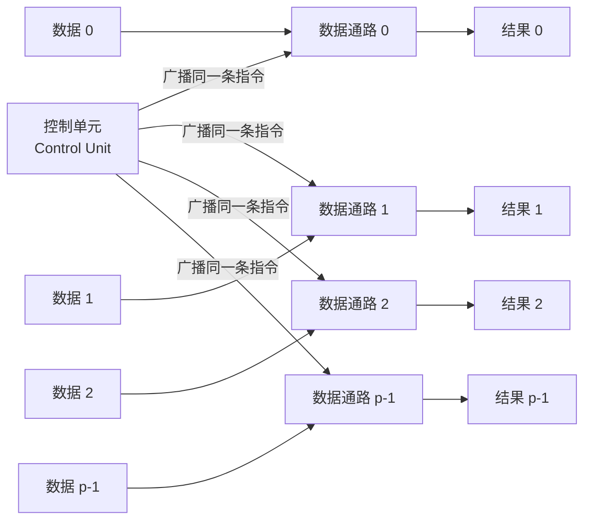

### 条件分支带来的问题

SIMD 要求所有数据通路执行相同指令或空闲，这可能降低整体性能。

例子：

```c
for (i = 0; i < n; i++)
    if (y[i] > 0.0)
        x[i] += y[i];
```

执行过程：

- 每个数据通路都要加载对应的 `y[i]` 并判断是否为正。
- 若 `y[i] > 0`，该通路执行加法。
- 若 `y[i] <= 0`，该通路在其他通路执行加法时只能空闲。

### 同步执行约束

- 经典 SIMD 系统中，各数据通路必须**同步运行**。
- 每个数据通路必须等待下一条指令广播后才能继续。
- 数据通路通常没有自己的指令存储区，不能把指令保存起来延迟执行。

### 数据并行性

**数据并行性**：把数据划分给多个处理器或数据通路，并让它们对各自的数据子集执行相同或相似的指令。

SIMD 系统主要利用的就是数据并行性。

### GPU 不是纯 SIMD

- 图形处理 API 通常用点、线、三角形表示对象表面，再通过图形处理流水线生成屏幕像素。
- 流水线中的可编程阶段由**着色器函数**指定。
- 着色器函数通常很短，并且可以应用到图形流中的大量元素，因此天然具有隐式并行性。
- GPU 每个处理核心通常包含大量数据通路，可用 SIMD 并行提高吞吐量。
- GPU 处理图像时数据量很大，需要很高的数据传输速率，因此严重依赖硬件多线程来隐藏内存访问暂停。
- GPU 在小问题上可能表现较差，因为需要大量线程才能让数据通路保持忙碌。
- GPU 会使用 SIMD 式的数据并行，但不是纯 SIMD 系统。
- 给定核心上的多个数据通路可以执行 SIMD 并行。
- 当代 GPU 的单个核心也可以运行多个指令流。
- 典型 GPU 有几十个核心，这些核心也能执行相互独立的指令流。
- 因此，GPU 既不是纯 SIMD，也不是纯 MIMD，而是混合了多种并行特征。

### GPU 的内存特征

- GPU 可以使用共享内存，也可以使用分布式内存。
- 大型 GPU 系统可能同时包含两种特征：
  - 一些核心访问共同的共享内存块。
  - 其他核心访问不同的共享内存块。
  - 访问不同内存块的核心可以通过网络通信。
- 本书后续主要讨论使用共享内存的 GPU。

### 2.3.3 MIMD 系统

### 基本特点

- **MIMD**：Multiple Instruction Multiple Data，多指令流多数据流。
- 支持多个并行指令流运行在多个数据流上。
- 通常由多个独立处理单元或核心组成。
- 每个处理单元通常有自己的控制单元和数据通路。

抽象 MIMD 系统：

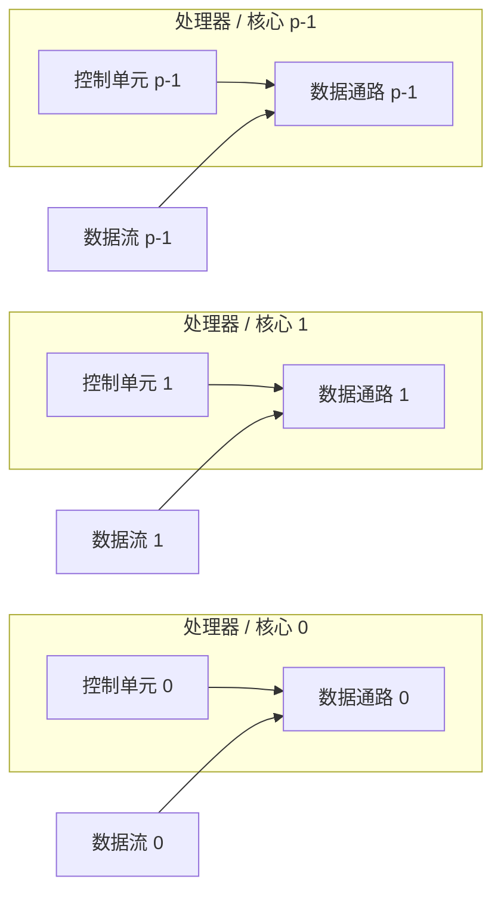

### 异步执行

- MIMD 系统通常是**异步**的。
- 各处理器可以按自己的速度运行。
- 许多 MIMD 系统没有全局时钟。
- 即使多个处理器执行相同指令序列，在任意时刻也可能处于不同语句。
- 如果需要让处理器在某些点对齐，程序员必须显式同步。

### MIMD 的两类内存系统

| 类型 | 特点 | 通信方式 |
|---|---|---|
| 共享内存系统 | 多个处理器通过互连网络连接到同一内存系统，每个处理器可访问每个内存位置 | 通过共享数据结构隐式通信 |
| 分布式内存系统 | 每个处理器和自己的私有内存配对，处理器-内存对通过网络连接 | 通过消息或函数访问显式通信 |

共享内存系统：

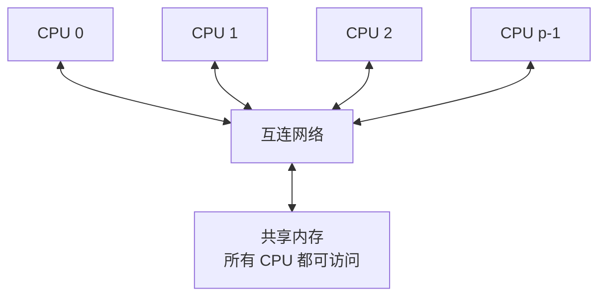

分布式内存系统：

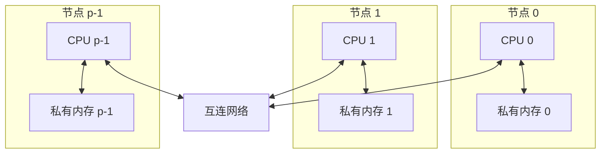

### 共享内存系统

- 最常见的共享内存系统使用一个或多个多核处理器。
- 多核处理器在单个芯片上包含多个 CPU 或核心。
- 核心通常有私有 `L1` 缓存，其他缓存可能共享，也可能不共享。

共享内存多核系统分为：

| 类型 | 全称 | 特点 |
|---|---|---|
| UMA | Uniform Memory Access，统一内存访问 | 所有核心访问所有内存位置的时间相同，编程较容易 |
| NUMA | Non-Uniform Memory Access，非统一内存访问 | 访问本地内存更快，访问其他芯片连接的内存更慢 |

UMA 多核系统：

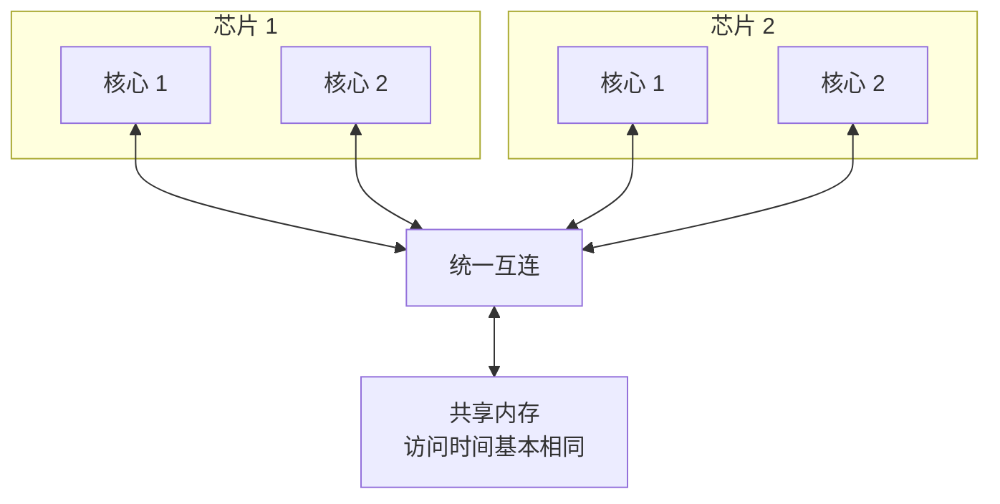

NUMA 多核系统：

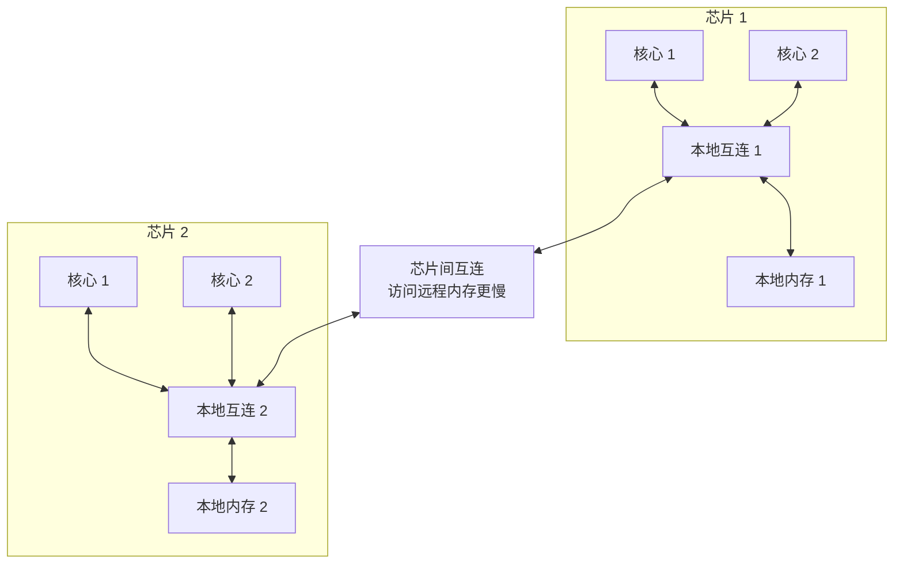

### 分布式内存系统

- 最常见的分布式内存系统称为**集群**。
- 集群通常由一系列商用系统组成，例如通过以太网连接的 PC。
- 集群中的**节点**是通过通信网络连接在一起的计算单元。
- 现代集群节点通常本身就是共享内存系统，并带有一个或多个多核处理器。
- 为了区别于纯分布式内存系统，这类系统有时称为**混合系统**。
- 现在通常默认集群具有共享内存节点。

### 网格

- **网格**提供基础设施，把地理上分布的大型计算机网络组织成统一的分布式内存系统。
- 网格通常是**异构**系统：不同节点可能由不同类型的硬件构成。

### 2.3.5 缓存一致性

### 缓存一致性问题

在共享内存多核系统中，多个核心的缓存可能保存同一个变量的副本。

问题：

- 核心 0 更新变量 `x` 后，核心 1 缓存中的 `x` 可能仍是旧值。
- 写直达会更新主存，但不一定更新其他核心缓存中的副本。
- 写回甚至可能暂时只更新核心 0 的缓存，主存和其他核心都看不到新值。

**缓存一致性问题**：当多个处理器缓存同一变量或同一缓存行时，需要保证一个处理器的更新能被其他处理器正确看到。

### 监听缓存一致性

**监听缓存一致性**（snooping cache coherence）：各核心监听互连网络上的更新广播。

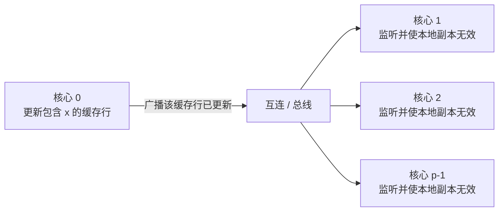

要点：

- 广播通常针对**缓存行**，不是单个变量。
- 互连不一定必须是总线，但必须支持从一个处理器向其他处理器广播。
- 监听可用于写直达缓存，也可用于写回缓存。
- 写回缓存需要额外通信，因为更新不会立刻写入主存。

### 基于目录的缓存一致性

监听协议需要频繁广播，在大规模系统中广播成本高，可扩展性差。

**基于目录的缓存一致性**：使用一个称为**目录**的数据结构记录每个缓存行的状态。

目录通常记录：

- 某缓存行当前在哪些核心的缓存中有副本。
- 缓存行是否被修改。
- 缓存行的有效/无效状态。

工作方式：

1. 某核心读取一个缓存行时，目录记录该核心拥有该行副本。
2. 某核心更新该缓存行时，先查询目录。
3. 系统只通知那些真正保存该缓存行副本的核心，使其副本失效。

优缺点：

| 方案 | 优点 | 缺点 |
|---|---|---|
| 监听协议 | 简单，适合小规模共享系统 | 广播成本高，不易扩展 |
| 目录协议 | 只通知相关核心，适合较大系统 | 目录需要额外存储和维护开销 |

### 伪共享

CPU 缓存由硬件实现，并且按**缓存行**工作，而不是按单个变量工作。这可能导致伪共享。

**伪共享**：多个核心访问的是不同变量，但这些变量位于同一个缓存行中，导致系统像它们共享同一变量一样不断失效缓存行。

串行例子：

```c
int i, j, m, n;
double y[m];

/* y 初始化为 0 */
for (i = 0; i < m; i++)
    for (j = 0; j < n; j++)
        y[i] += f(i, j);
```

可以把外层循环的迭代划分给多个核心。例如两个核心时：

```c
/* 私有变量 */
int i, j, iter_count;

/* 共享变量 */
int m, n, core_count;
double y[m];

iter_count = m / core_count;

/* 核心 0 */
for (i = 0; i < iter_count; i++)
    for (j = 0; j < n; j++)
        y[i] += f(i, j);

/* 核心 1 */
for (i = iter_count; i < 2 * iter_count; i++)
    for (j = 0; j < n; j++)
        y[i] += f(i, j);
```

关键假设：

- `m = 8`
- `double` 是 8 字节
- 缓存行是 64 字节
- `y[0]` 位于缓存行开头

于是一个缓存行正好能存下 8 个 `double`，即 `y[0]..y[7]` 全部位于同一个缓存行。

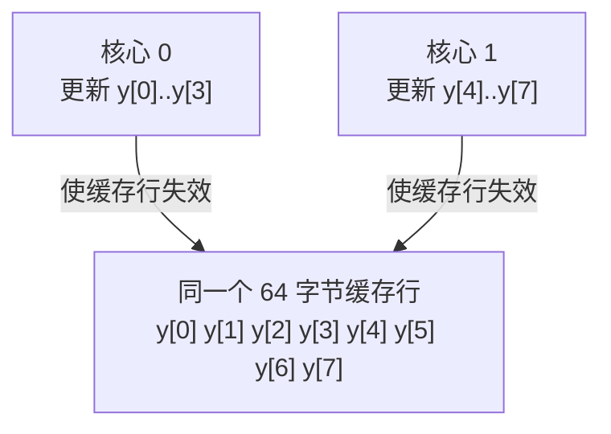

发生过程：

- 核心 0 更新 `y[0]..y[3]`。
- 核心 1 更新 `y[4]..y[7]`。
- 两个核心没有访问彼此的元素。
- 但这些元素属于同一个缓存行。
- 因此任一核心执行 `y[i] += f(i, j)` 时，都可能使另一个核心缓存中的同一行失效。
- 另一个核心下一次访问自己的 `y` 元素时，必须重新从内存取回该缓存行。

影响：

- 程序结果仍正确，但会产生大量不必要的内存访问，严重降低性能。
- 如果内层循环次数 `n` 很大，这种额外内存访问会非常频繁。

常见缓解方法：

- 使用线程或进程本地临时变量。
- 最后再把本地结果复制或归约到共享存储。
- 必要时通过填充、对齐或调整数据布局，避免不同线程频繁写同一缓存行。

### 2.3.6 共享内存与分布式内存

- 共享内存对程序员更直观：可以通过共享数据结构隐式协调处理器工作。
- 分布式内存需要显式发送消息，编程负担通常更重。
- 但硬件上，共享内存系统需要维护互连、缓存一致性和访问延迟，扩展到大规模系统更困难。
- 因此，大规模系统常采用分布式内存或混合结构。

## 2.4 并行软件

### 2.4.1 并行化、通信和同步

### 易并行示例

数组加法：

```c
double x[n], y[n];

for (int i = 0; i < n; i++)
    x[i] += y[i];
```

并行化方法：把数组元素划分给不同进程或线程。

例如有 `p` 个进程/线程：

- 进程/线程 0 负责 `0 ~ n/p - 1`
- 进程/线程 1 负责 `n/p ~ 2n/p - 1`
- 依此类推

### 并行化时需要做的事

1. 在进程/线程之间分配工作。
2. 保证每个进程/线程工作量大致相同，即**负载平衡**。
3. 尽量减少通信量。
4. 安排进程/线程之间的同步。
5. 安排进程/线程之间的通信。

通信与同步常常相关：

- 分布式内存程序通常通过进程间通信隐式同步。
- 共享内存程序通常通过线程同步来完成通信。

### 2.4.3 共享内存

### 共享变量与私有变量

在共享内存程序中：

| 变量类型 | 含义 |
|---|---|
| 共享变量 | 任意线程都可以读写 |
| 私有变量 | 只能由某一个线程访问 |

线程之间通常通过共享变量通信，因此通信是**隐式**的。

### 动态线程和静态线程

| 类型 | 做法 | 优点 | 缺点 |
|---|---|---|---|
| 动态线程 | 主线程等待请求，按需派生工作线程，完成后线程终止并加入主线程 | 资源只在线程实际运行时占用 | 频繁创建和连接线程可能耗时 |
| 静态线程 | 主线程完成设置后一次性派生所有线程，所有工作结束后再统一停止 | 避免频繁创建/销毁线程，性能可能更好；更接近分布式内存编程范式 | 空闲线程资源无法释放 |

本书后续经常使用静态线程范例。

### 非确定性

**非确定性**：同一个输入可能导致不同输出。

在异步执行的 MIMD 系统中，多个线程独立运行，每个线程完成语句的相对速度可能每次运行都不同，因此输出顺序或结果可能变化。

例子：

```c
printf("Thread %d > my_x = %d\n", my_rank, my_x);
```

两个线程的输出顺序可能不同：

```text
Thread 0 > my_x = 7
Thread 1 > my_x = 19
```

也可能是：

```text
Thread 1 > my_x = 19
Thread 0 > my_x = 7
```

如果只是输出顺序不同，通常问题不大；但在共享内存更新中，非确定性可能导致错误结果。

### 竞争条件

**竞争条件**：多个线程或进程同时访问共享资源，并且访问顺序会影响结果。

例子：

```c
my_val = Compute_val(my_rank);
x += my_val;
```

`x += my_val` 通常不是一条不可分割的操作，而是大致包含：

1. 把 `x` 加载到寄存器。
2. 把 `my_val` 加载到寄存器。
3. 相加。
4. 把结果写回 `x`。

如果两个线程交错执行，可能都先读到旧的 `x = 0`，最后一个写回的结果覆盖另一个线程的更新，导致结果错误。

### 原子性

**原子操作**：操作执行期间不会被其他线程打断或观察到中间状态。

对于共享变量更新，理想情况是每个线程的：

```c
x += my_val;
```

作为一个原子操作完成。

### 临界区

**临界区**：一次只能由一个线程执行的代码块。

如果一个线程正在执行临界区，其他线程必须被排除在外。这称为**互斥访问**。

### 互斥量

**互斥量**（mutex，也叫互斥锁、锁）：用于保证临界区互斥访问的同步对象。

使用方式：

```c
my_val = Compute_val(my_rank);
Lock(&add_my_val_lock);
x += my_val;
Unlock(&add_my_val_lock);
```

流程图：

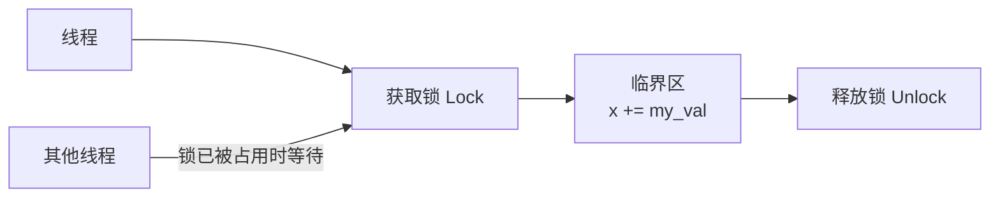

要点：

- 互斥量保证一次只有一个线程执行 `x += my_val`。
- 互斥量不规定哪个线程先执行。
- 临界区会被串行化，因此临界区应尽可能少、尽可能短。

### 忙等待

**忙等待**（busy-waiting）：线程进入循环，不断测试某个条件是否成立。

例子：保证线程 1 在线程 0 更新 `x` 之后再更新。

```c
my_val = Compute_val(my_rank);

if (my_rank == 1)
    while (!ok_for_1);  /* 忙等待循环 */

x += my_val;           /* 临界区 */

if (my_rank == 0)
    ok_for_1 = true;   /* 允许线程 1 更新 x */
```

特点：

- 优点：概念简单，容易理解。
- 缺点：等待线程会持续占用 CPU 资源，即使它暂时没有做有用工作。

### 信号量和监视器

- **信号量**：类似互斥量，也可用于线程同步，具体行为细节不同。
- **监视器**：更高级的互斥机制，是一个对象，其方法一次只能由一个线程执行。

### 线程安全

**线程安全**：函数或代码在多线程环境中被并发调用时，仍能得到正确结果，不会因为共享状态产生错误。

很多串行程序中的函数可以直接用于并行程序，但需要注意例外。

典型问题：函数内部使用**静态局部变量**。

- 普通局部变量位于线程自己的调用栈上，通常是私有的。
- 静态局部变量在函数调用结束后仍然存在。
- 如果多个线程同时调用该函数，就可能共享并覆盖同一个静态变量。

例子：`strtok` 一类函数不是线程安全的。

- 第一次调用时传入一个字符串。
- 后续调用依赖函数内部保存的静态状态继续分割字符串。
- 如果两个线程同时使用，后一个线程可能覆盖前一个线程的内部状态，导致结果错误。

结论：

- 多线程程序中要确认库函数是否线程安全。
- 避免在多个线程间隐式共享函数内部状态。
- 必要时使用线程安全版本的函数，或把状态显式放在线程私有存储中。

### 2.4.4 分布式内存

### 基本特点

- 在分布式内存程序中，每个核心或进程只能直接访问自己的私有内存。
- 进程之间不能直接读写对方变量。
- 通信通常通过**消息传递**完成。

### 消息传递

消息传递 API 至少提供两类函数：

| 函数 | 作用 |
|---|---|
| `Send` | 向另一个进程发送消息 |
| `Receive` | 从另一个进程接收消息 |

示意：

```mermaid
flowchart LR
    P1["进程 1<br/>私有内存 message"] -->|Send(message)| NET["互连网络"]
    NET -->|Receive(message)| P0["进程 0<br/>私有内存 message"]
```

### rank

- 消息传递程序通常用**序列号**或 **rank** 标识进程。
- 如果共有 `p` 个进程，rank 通常为 `0, 1, ..., p-1`。
- 发送和接收时需要指定通信对象的 rank。

### SPMD

**SPMD**：Single Program Multiple Data，单程序多数据。

含义：

- 多个进程运行同一个可执行文件。
- 每个进程根据自己的 `rank` 通过不同分支执行不同操作。
- 每个进程处理不同数据。

典型结构：

```c
my_rank = Get_rank();

if (my_rank == 1) {
    /* 进程 1 发送消息 */
    Send(message, MSG_CHAR, 100, 0);
} else if (my_rank == 0) {
    /* 进程 0 接收消息 */
    Receive(message, MSG_CHAR, 100, 1);
}
```

### 同名变量不共享

在分布式内存中，不同进程中的同名变量属于不同内存块。

例如两个进程中都声明：

```c
char message[100];
```

这不是同一块内存：

- 进程 0 的 `message` 位于进程 0 的私有内存。
- 进程 1 的 `message` 位于进程 1 的私有内存。
- 若要把进程 1 的 `message` 传给进程 0，必须显式发送消息。

核心区别：

| 模型 | 通信方式 |
|---|---|
| 共享内存 | 通过共享变量隐式通信 |
| 分布式内存 | 通过 `Send` / `Receive` 显式通信 |

## 2.5 输入和输出

### 2.5.1 MIMD 系统

这里的 MIMD 不是在讲“做计算的模型”本身，而是在讲：**多个独立进程/线程同时运行时，如何处理输入和输出**。

### 为什么 I/O 容易出问题

MIMD 程序中，多个进程/线程可能同时访问：

- `stdin`
- `stdout`
- `stderr`
- 同一个文件

问题：

- 输出顺序不确定，多个进程的输出可能交错。
- 输入分配不明确：不知道哪个进程应该读哪个输入。
- 多个进程同时写同一个文件，可能导致内容混乱或覆盖。

### 标准输入输出约定

为避免混乱，书中采用以下规则：

| 场景 | 约定 |
|---|---|
| 分布式内存程序 | 只有进程 0 访问 `stdin` |
| 共享内存程序 | 只有主线程或线程 0 访问 `stdin` |
| `stdout` / `stderr` | 所有进程/线程都可以访问 |
| 调试以外的正式输出 | 通常只让一个进程/线程输出最终结果 |
| 普通文件 | 通常只让一个进程/线程访问同一个文件 |

### 为什么通常让 0 号进程负责 I/O

- 进程 0 或线程 0 通常被当作“主控者”。
- 可以避免多个进程同时读输入造成不确定性。
- 可以先由 0 号进程读取输入，再通过消息传递或共享变量分发给其他进程/线程。

## 2.6 性能

并行程序的主要目标通常是提高性能。评价性能时，常用指标是**加速比**和**效率**。

### 2.6.1 MIMD 系统中的加速比和效率

### 理想情况

如果一个问题可以被平均分给 `p` 个核心，并且没有额外开销，那么：

```text
并行运行时间 = 串行运行时间 / p
```

这种理想情况称为**线性加速**。

### 线性加速比

**线性加速比**：使用 `p` 个核心时，加速比达到 `p`。

也就是：

$$
S = p
$$

含义：

- 用 2 个核心，理想上快 2 倍。
- 用 4 个核心，理想上快 4 倍。
- 用 `p` 个核心，理想上快 `p` 倍。

实际中很难完全达到线性加速，因为存在同步、通信、临界区、线程创建等开销。

### 加速比

**加速比**（speedup）定义为：

$$
S = \frac{T_{\text{serial}}}{T_{\text{parallel}}}
$$

其中：

| 符号 | 含义 |
|---|---|
| $T_{\text{serial}}$ | 串行程序运行时间 |
| $T_{\text{parallel}}$ | 并行程序运行时间 |
| $S$ | 并行程序相对串行程序快了多少倍 |

例子：

- 串行运行 `100s`
- 并行运行 `25s`

则：

$$
S = \frac{100}{25} = 4
$$

表示并行程序快了 4 倍。

### 效率

**效率**（efficiency）衡量核心是否被充分利用。

定义：

$$
E = \frac{S}{p}
$$

把加速比公式代入：

$$
E = \frac{T_{\text{serial}}}{p \cdot T_{\text{parallel}}}
$$

其中：

| 符号 | 含义 |
|---|---|
| $p$ | 使用的核心数或进程/线程数 |
| $S$ | 加速比 |
| $E$ | 效率 |

解释：

- $E = 1$：完全理想，所有核心都被充分利用。
- $E < 1$：存在开销，核心没有被完全利用。
- $E$ 越接近 1，说明并行化效果越好。

### 问题规模对性能的影响

一般来说：

- 增加问题规模时，加速比和效率可能增加。
- 减少问题规模时，加速比和效率可能降低。

原因：

- 并行程序通常有固定开销，例如线程创建、通信、同步、数据分发和结果收集。
- 问题规模较小时，固定开销占比大，并行收益容易被抵消。
- 问题规模较大时，计算量增加，固定开销被摊薄，核心更容易保持忙碌。

### 为什么实际加速比会低于线性加速

常见原因：

- 负载不均衡：有些核心先完成后等待。
- 通信开销：进程/线程之间需要交换数据。
- 同步开销：临界区、互斥锁、屏障等会让部分核心等待。
- 串行部分：程序中有些部分无法并行。
- 额外开销：线程创建、数据分发、结果收集等。

### 2.6.2 阿姆达尔定律

**阿姆达尔定律**（Amdahl's Law）：如果程序中有一部分必须串行执行，那么无论增加多少核心，整体加速比都会受到这部分串行代码的限制。

### 基本公式

设：

| 符号 | 含义 |
|---|---|
| $p$ | 核心数 |
| $r$ | 程序中必须串行执行的比例 |
| $1-r$ | 程序中可以并行执行的比例 |

并行运行时间近似为：

$$
T_{\text{parallel}} = rT_{\text{serial}} + \frac{(1-r)T_{\text{serial}}}{p}
$$

加速比为：

$$
S = \frac{1}{r + \frac{1-r}{p}}
$$

当核心数 $p$ 趋近无穷大时：

$$
S \leq \frac{1}{r}
$$

也就是说，**串行部分越大，最大加速比越低**。

### 例子：90% 可并行

假设：

- 串行运行时间 $T_{\text{serial}} = 20$
- 90% 可并行
- 10% 必须串行

则：

$$
T_{\text{parallel}} = 0.9 \times \frac{20}{p} + 0.1 \times 20 = \frac{18}{p} + 2
$$

加速比：

$$
S = \frac{20}{\frac{18}{p} + 2}
$$

当 $p$ 很大时，$\frac{18}{p}$ 接近 0，所以：

$$
S \leq \frac{20}{2} = 10
$$

结论：即使并行部分做得很好，甚至使用很多核心，只要 10% 不能并行，最大加速比也不会超过 10。

### 核心结论

- 阿姆达尔定律强调：优化并行程序时，不能只看可并行部分，也要关注串行瓶颈。
- 串行比例 $r$ 决定了理论最大加速比。
- 如果串行部分是 $1/100$，最大加速比也只能接近 100。
- 要获得更高加速比，需要减少串行部分，或增大问题规模，让并行部分占比更高。

### 注意

阿姆达尔定律通常假设问题规模固定。实际中，随着核心数增加，我们也可能处理更大的问题，此时加速表现可能比固定规模分析更好。

### 2.6.3 可扩展性

**可扩展性**：描述并行程序在增加处理器或核心数量时，性能能否持续提升的能力。

常用符号：

| 符号 | 含义 |
|---|---|
| $n$ | 问题规模，也可近似看作串行总工作量 |
| $P$ | 处理器、线程或进程数量 |
| $T_{\text{serial}}$ | 串行运行时间，近似为 $n$ |
| $T_{\text{parallel}}$ | 并行运行时间 |
| $T_{\text{overhead}}$ | 并行额外开销，如通信、同步、线程创建、数据分发等 |
| $E$ | 并行效率 |

并行时间可粗略写成：

$$
T_{\text{parallel}} = \frac{T_{\text{serial}}}{P} + T_{\text{overhead}}
$$

也就是：

```text
并行时间 = 理想分摊后的计算时间 + 并行额外开销
```

由于：

$$
E = \frac{S}{P}
$$

且：

$$
S = \frac{T_{\text{serial}}}{T_{\text{parallel}}}
$$

所以：

$$
E = \frac{T_{\text{serial}}}{P \cdot T_{\text{parallel}}}
$$

如果令 $T_{\text{serial}} = n$，并且：

$$
T_{\text{parallel}} = \frac{n}{P} + T_{\text{overhead}}
$$

则：

$$
E = \frac{n}{P(\frac{n}{P} + T_{\text{overhead}})}
  = \frac{n}{n + P T_{\text{overhead}}}
$$

这个公式说明：如果问题规模 $n$ 不变，只增加处理器数 $P$，那么分母中的 $P T_{\text{overhead}}$ 会变大，效率 $E$ 通常会下降。

可扩展性分为两类：

| 类型 | 含义 | 关注点 |
|---|---|---|
| 强扩展性 | 固定问题规模，增加核心数 $p$，效率仍能基本保持不变 | 同一个问题能否靠更多核心跑得更快 |
| 弱扩展性 | 增加核心数 $p$ 的同时，按相同规模增加问题规模，效率仍能基本保持不变 | 核心更多时，能否处理更大的问题 |

### 强扩展性

- 问题规模固定。
- 增加核心数 $P$。
- 如果效率 $E$ 能保持不变或下降很少，说明程序具有强扩展性。
- 只有通信、同步等并行开销很小时，才容易获得好的强扩展性。

例子：同样大小的矩阵乘法，从 4 个核心增加到 8 个核心，看运行时间是否接近减半。

理想情况下没有额外开销：

$$
T_{\text{parallel}} = \frac{T_{\text{serial}}}{P}
$$

此时效率：

$$
E = 1
$$

现实中通常有额外开销：

$$
E = \frac{n}{n + P T_{\text{overhead}}}
$$

因此当 $P$ 增大时，强扩展效率通常会下降。

### 弱扩展性

- 增加核心数 $P$。
- 同时按相同比例增加问题规模。
- 如果效率 $E$ 能保持不变或下降很少，说明程序具有弱扩展性。

例子：4 个核心处理 4GB 数据，8 个核心处理 8GB 数据。如果运行时间基本不变，说明弱扩展性较好。

如果：

```text
P -> aP
n -> bn
```

则效率近似变为：

$$
E = \frac{bn}{bn + aP T_{\text{overhead}}}
$$

如果 $a = b$，即核心数和问题规模按相同比例增加，那么效率有可能保持稳定。

### 对比

- 强扩展性问的是：**同一个问题，用更多核心能不能更快？**
- 弱扩展性问的是：**更多核心能不能处理更大的问题，同时保持效率？**
- 并行程序不是核心越多越好，因为 $P$ 变大时，通信、同步等额外开销也会被放大。

# 第 3 章 使用 MPI 进行分布式内存编程

## 3.1 MPI 概述

### 重点

本章重点：

- 通信
  - 点对点通信
  - 集合通信
- 发送和接收消息的语义
  - 是否阻塞
  - 消息匹配
  - 消息顺序

### MPI 是什么

- **MPI**：Message Passing Interface，消息传递接口。
- MPI 用于**分布式内存编程**。
- MPI 程序的基本执行单位通常是**进程**，不是线程。
- MPI 实际上是一个**函数库**，不是一门新的编程语言。
- 进程之间通过显式发送和接收消息来通信。

## 3.2 编译与执行

### 编译

使用 `mpicc` 编译 MPI 程序：

```bash
mpicc -o hello hello.c
```

### 执行

使用 `mpiexec` 启动多个 MPI 进程：

```bash
mpiexec -n 4 ./hello
```

含义：

- `-n 4`：启动 4 个进程。
- `./hello`：每个进程运行同一个可执行文件。

这体现了 MPI 常见的 **SPMD** 模型：多个进程运行同一个程序，但根据自己的 rank 执行不同逻辑。

## 3.3 MPI 初始化和结束

### MPI_Init

`MPI_Init` 必须在所有其他 MPI 函数调用之前执行。

作用：

- 初始化 MPI 运行环境。
- 建立通信环境。
- 通常可以理解为所有 MPI 进程进入 MPI 环境的起点。

函数原型：

```c
int MPI_Init(int *argc, char ***argv);
```

### MPI_Finalize

`MPI_Finalize` 用于关闭 MPI 环境并清理资源。

函数原型：

```c
int MPI_Finalize(void);
```

### 基本程序结构

```c
#include <mpi.h>

int main(int argc, char* argv[]) {
    MPI_Init(&argc, &argv);

    /* MPI 程序主体 */

    MPI_Finalize();
    return 0;
}
```

注意：实际函数名是 `MPI_Init` 和 `MPI_Finalize`，大小写要一致。

## 3.4 通信子、进程数和 rank

### 通信子

**通信子**（communicator）：一组可以互相发送消息的进程集合。

常用通信子：

```c
MPI_COMM_WORLD
```

含义：由 `MPI_Init` 创建，包含用户启动的所有 MPI 进程。

### MPI_Comm_size

获取通信子中的进程总数。

```c
int MPI_Comm_size(MPI_Comm comm, int *size);
```

示例：

```c
int size;
MPI_Comm_size(MPI_COMM_WORLD, &size);
```

### MPI_Comm_rank

获取当前进程在通信子中的编号，即 rank。

```c
int MPI_Comm_rank(MPI_Comm comm, int *rank);
```

示例：

```c
int rank;
MPI_Comm_rank(MPI_COMM_WORLD, &rank);
```

### rank 的作用

- rank 用于区分不同进程。
- rank 常用于决定每个进程执行什么任务。
- rank 也用于指定消息发送目标或消息来源。

## 3.5 MPI_Send

`MPI_Send` 用于点对点发送消息。

函数原型：

```c
int MPI_Send(
    void *buf,
    int count,
    MPI_Datatype datatype,
    int dest,
    int tag,
    MPI_Comm comm
);
```

参数：

| 参数 | 含义 |
|---|---|
| `buf` | 要发送的数据起始地址 |
| `count` | 要发送的数据项个数，不是字节数 |
| `datatype` | MPI 数据类型，如 `MPI_INT`、`MPI_FLOAT`、`MPI_CHAR` |
| `dest` | 目标进程的 rank |
| `tag` | 消息标签，用于区分不同消息 |
| `comm` | 通信子，常用 `MPI_COMM_WORLD` |

### tag 的作用

`tag` 用于区分同一对进程之间的不同消息。

例子：

- 一部分浮点数用于加法，使用 `tag = 0`。
- 一部分浮点数用于减法，使用 `tag = 1`。

接收方可以通过 tag 判断收到的消息应该如何处理。

## 3.6 MPI_Recv

`MPI_Recv` 用于点对点接收消息。

函数原型：

```c
int MPI_Recv(
    void *buf,
    int count,
    MPI_Datatype datatype,
    int source,
    int tag,
    MPI_Comm comm,
    MPI_Status *status
);
```

参数：

| 参数 | 含义 |
|---|---|
| `buf` | 接收缓冲区起始地址 |
| `count` | 最多接收的数据项数量，不是字节数 |
| `datatype` | MPI 数据类型，如 `MPI_INT`、`MPI_FLOAT` |
| `source` | 消息来源进程的 rank，可用 `MPI_ANY_SOURCE` |
| `tag` | 消息标签，可用 `MPI_ANY_TAG` |
| `comm` | 通信子，常用 `MPI_COMM_WORLD` |
| `status` | 返回消息状态，也可用 `MPI_STATUS_IGNORE` 忽略 |

### MPI_Status

`MPI_Status` 至少包含以下常用信息：

| 字段 | 含义 |
|---|---|
| `MPI_SOURCE` | 实际发送消息的进程 rank |
| `MPI_TAG` | 实际接收消息的 tag |
| `MPI_ERROR` | 错误码 |

如果接收方事先不知道实际收到了多少个数据项，可以用 `MPI_Get_count` 从 `status` 中查询。

```c
int MPI_Get_count(
    MPI_Status *status_p,
    MPI_Datatype datatype,
    int *count_p
);
```

含义：

- `status_p`：某次 `MPI_Recv` 返回的状态。
- `datatype`：接收时使用的数据类型。
- `count_p`：输出参数，保存实际接收到的数据项个数。

### 常用 MPI 数据类型

MPI 通信时必须说明数据类型。`count` 表示数据项个数，`datatype` 说明每个数据项是什么类型。

| MPI 类型 | C 类型 |
|---|---|
| `MPI_CHAR` | `char` |
| `MPI_SHORT` | `short` |
| `MPI_INT` | `int` |
| `MPI_LONG` | `long` |
| `MPI_LONG_LONG` | `long long` |
| `MPI_UNSIGNED` | `unsigned int` |
| `MPI_FLOAT` | `float` |
| `MPI_DOUBLE` | `double` |
| `MPI_LONG_DOUBLE` | `long double` |
| `MPI_BYTE` | 原始字节 |

## 3.7 消息匹配

一个 `MPI_Recv` 能否匹配某个 `MPI_Send`，主要看三项：

```text
source == 发送方 rank
recv_tag == send_tag
recv_comm == send_comm
```

还需要满足：

- 接收类型和发送类型匹配。
- 接收缓冲区足够大，即 `recv_buff_sz >= send_buff_sz`。

### 通配符

MPI 提供两个接收方通配符：

| 通配符 | 含义 |
|---|---|
| `MPI_ANY_SOURCE` | 接收任意来源进程的消息 |
| `MPI_ANY_TAG` | 接收任意 tag 的消息 |

注意：通配符只能在接收方使用。

## 3.8 MPI_Send 和 MPI_Recv 的阻塞语义

### MPI_Recv

`MPI_Recv` 一定是**阻塞**的。

含义：

- 如果匹配的消息还没到达，`MPI_Recv` 会一直等待。
- 除非出错或被取消，否则进程会挂起在接收调用上。

### MPI_Send

`MPI_Send` 是否阻塞取决于消息大小和 MPI 实现。

常见情况：

| 情况 | 行为 |
|---|---|
| 消息较小 | MPI 可能复制到内部缓冲区，然后立即返回 |
| 消息较大 | 如果接收方还没准备好，发送方可能阻塞 |

所以：`MPI_Send` 可能立即返回，也可能阻塞。

常见实现里有两种发送机制：

| 机制 | 典型场景 | 行为 |
|---|---|---|
| eager 模式 | 消息较小 | MPI 先把消息复制到内部缓冲区，`MPI_Send` 可能很快返回 |
| rendezvous 模式 | 消息较大 | 发送方通常要等接收方开始匹配接收，`MPI_Send` 可能阻塞 |

所以不能把普通 `MPI_Send` 简单理解为“一定阻塞”或“一定非阻塞”。它的返回行为和消息大小、MPI 实现、接收方状态都有关。

### 消息不可超越

MPI 要求同一发送进程连续发送给同一接收进程的消息不能乱序。

也就是说：

- 同一个进程连续发送的几条消息，必须按发送顺序到达。
- 不同发送进程之间的消息没有这个顺序保证。

例子：

```text
进程 1 连续发送 A、B 给进程 0
进程 0 不会先收到 B 再收到 A
```

但如果：

```text
进程 1 发送 A
进程 2 发送 B
```

进程 0 可能先收到 A，也可能先收到 B。

### MPI_Ssend

`MPI_Ssend` 是**同步发送**（synchronous send）。

额外的 `s` 表示 synchronous。它和 `MPI_Send` 的参数相同，但语义更严格：

- `MPI_Ssend` 保证阻塞。
- 只有当匹配的接收操作已经开始后，`MPI_Ssend` 才能返回。
- 它不会像普通 `MPI_Send` 那样因为消息较小、被复制到内部缓冲区就提前返回。

函数原型：

```c
int MPI_Ssend(
    void *msg_buf_p,
    int msg_size,
    MPI_Datatype msg_type,
    int dest,
    int tag,
    MPI_Comm communicator
);
```

和 `MPI_Send` 的关系：

| 函数 | 是否一定阻塞 | 返回条件 |
|---|---|---|
| `MPI_Send` | 不一定 | 可能复制到缓冲区后立即返回，也可能等待接收方 |
| `MPI_Ssend` | 是 | 必须等匹配接收开始后才能返回 |

用途：

- 可以用来检查程序通信顺序是否安全。
- 如果把 `MPI_Send` 换成 `MPI_Ssend` 后程序挂起或崩溃，说明原程序可能依赖了 MPI 的内部缓冲区。
- 若使用 `MPI_Ssend` 后程序仍能正常运行，通常说明原来的点对点通信顺序更安全。
- `MPI_Ssend` 的参数和 `MPI_Send` 相同，所以常见调试方式是直接把 `MPI_Send` 临时替换成 `MPI_Ssend`。

## 3.9 集合通信

集合通信是多个进程共同参与的通信操作。和点对点通信不同，集合通信通常要求通信子中的所有相关进程都调用同一个集合通信函数。

### MPI_Reduce

`MPI_Reduce` 用于把多个进程的数据按某种操作归约，并把结果存到指定的 root 进程。

常见用途：求和、求最大值、求最小值等。

示例：

```c
MPI_Reduce(
    &local_sum,     /* 每个进程提供的本地数据 */
    &total_sum,     /* 归约结果，只在 root 进程有效 */
    1,              /* 数据个数，这里是 1 个 double */
    MPI_DOUBLE,     /* 数据类型 */
    MPI_SUM,        /* 归约操作：求和 */
    0,              /* root 进程编号，结果放到 rank 0 */
    MPI_COMM_WORLD  /* 通信子 */
);
```

参数含义：

| 参数 | 含义 |
|---|---|
| `sendbuf` | 每个进程提供的本地数据地址 |
| `recvbuf` | 归约结果存放地址，只在 root 进程有效 |
| `count` | 数据项个数 |
| `datatype` | 数据类型，如 `MPI_DOUBLE` |
| `op` | 归约操作，如 `MPI_SUM` |
| `root` | 接收最终结果的进程 rank |
| `comm` | 通信子 |

### MPI 预定义归约算子

| 算子 | 含义 |
|---|---|
| `MPI_MAX` | 最大值 |
| `MPI_MIN` | 最小值 |
| `MPI_SUM` | 总和 |
| `MPI_PROD` | 乘积 |
| `MPI_LAND` | 逻辑与 |
| `MPI_BAND` | 按位与 |
| `MPI_LOR` | 逻辑或 |
| `MPI_BOR` | 按位或 |
| `MPI_LXOR` | 逻辑异或 |
| `MPI_BXOR` | 按位异或 |
| `MPI_MAXLOC` | 最大值以及最大值所在位置 |
| `MPI_MINLOC` | 最小值以及最小值所在位置 |

例子：4 个进程分别有：

```text
rank 0: local_sum = 1.5
rank 1: local_sum = 2.0
rank 2: local_sum = 3.5
rank 3: local_sum = 4.0
```

执行 `MPI_Reduce` 后，只有 `rank 0` 上：

```c
total_sum = 1.5 + 2.0 + 3.5 + 4.0;  /* 11.0 */
```

其他进程上的 `total_sum` 不保存最终归约结果。

### 树形结构通信

集合通信指的是**通信子中所有进程共同参与的通信函数**。`MPI_Send` 和 `MPI_Recv` 是点对点通信，不属于集合通信。

`MPI_Reduce` 内部通常不会简单地让所有进程都直接把结果发给 0 号进程，因为这样 root 进程需要接收和计算太多次。

如果 `comm_sz = 1024`：

- 简单集中到 0 号进程：0 号进程需要接收并计算 `1023` 次。
- 树形结构归约：大约只需要 `log2(1024) = 10` 轮通信和计算。

树形归约示意：

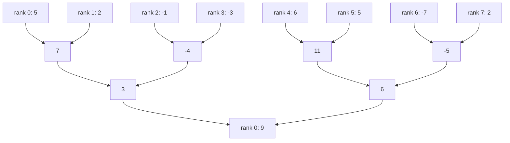

核心思想：

- 每一轮把相邻进程或局部结果两两合并。
- 合并后的部分和继续向上归约。
- 最终结果到达 root 进程。
- 这样能减少 root 进程的通信压力。

`Reduce` 和 `Scan` 的数据流对比：

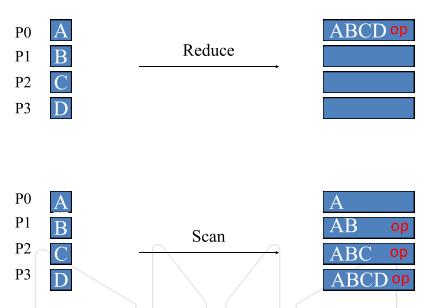

区别：

- `MPI_Reduce`：把所有进程的数据归约到一个 root 进程。
- `MPI_Scan`：做前缀归约，每个进程得到从 `rank 0` 到自己这一段的部分归约结果。

### 集合通信与点对点通信的区别

集合通信和点对点通信的调用规则不同，不能把它们当成一类操作来匹配。

#### 1. 所有进程必须调用同一个集合通信函数

通信子中的所有进程==必须调用相同的集合通信函数==。

错误例子：

```text
rank 0 调用 MPI_Reduce
rank 1 调用 MPI_Recv
```

这种程序是错误的，可能导致挂起或崩溃。

#### 2. 集合通信参数必须兼容

每个进程传给集合通信的关键参数必须一致或兼容。

以 `MPI_Reduce` 为例：

- 所有进程必须使用相同的通信子。
- 所有进程必须使用相同的归约操作。
- 所有进程必须指定相同的 root。
- 数据类型和数据个数必须匹配。

如果一个进程把 root 设为 `0`，另一个进程把 root 设为 `1`，程序就是错误的。

#### 3. 非 root 进程也要传入对应参数

在 `MPI_Reduce` 中，接收缓冲区 `recvbuf` 只在 root 进程上真正使用。

但所有进程仍然需要调用同一个函数，并传入对应位置的参数。非 root 进程上的 `recvbuf` 不保存最终结果，通常可以理解为无效或被忽略。

#### 4. 集合通信不靠 tag 匹配

点对点通信通过以下信息匹配：

```text
source
tag
comm
```

集合通信不使用 tag。它的匹配主要由以下因素决定：

- 通信子 `comm`
- 调用的集合函数类型
- 调用顺序

因此，如果同一个通信子里连续调用两次 `MPI_Reduce`，MPI 会把所有进程的第一次 `MPI_Reduce` 匹配在一起，把第二次 `MPI_Reduce` 匹配在一起。

### 多次 MPI_Reduce 调用示例

假设所有进程都执行两次 `MPI_Reduce`，并且通信子相同：

```c
MPI_Reduce(&a, &b, 1, MPI_INT, MPI_SUM, 0, comm);
MPI_Reduce(&c, &d, 1, MPI_INT, MPI_SUM, 0, comm);
```

则：

- 第一次调用只会和其他进程的第一次调用匹配。
- 第二次调用只会和其他进程的第二次调用匹配。
- 即使变量名不同，MPI 也不根据变量名匹配，只根据集合通信调用顺序匹配。

所以集合通信中，**所有进程必须以相同顺序调用相同的集合通信函数**。

### 不要混用输入和输出缓冲区

对于 `MPI_Reduce`，通常不应该把发送缓冲区和接收缓冲区写成同一个地址，例如：

```c
MPI_Reduce(&x, &x, 1, MPI_DOUBLE, MPI_SUM, 0, comm);
```

这种写法可能导致结果不可预测，甚至是非法的。

更安全的写法是：

```c
MPI_Reduce(&local_x, &global_x, 1, MPI_DOUBLE, MPI_SUM, 0, comm);
```

其中：

- `local_x`：每个进程自己的输入数据。
- `global_x`：root 进程保存归约结果。

### MPI_Bcast

`MPI_Bcast` 用于**广播**：把 root 进程上的一份数据发送给通信子中的所有进程。

它可以看作是树形归约通信方向的“反向操作”：归约是把多个进程的数据汇总到 root，广播是把 root 的数据分发给所有进程。

函数原型：

```c
int MPI_Bcast(
    void *data_p,
    int count,
    MPI_Datatype datatype,
    int source_proc,
    MPI_Comm comm
);
```

参数：

| 参数 | 含义 |
|---|---|
| `data_p` | 数据缓冲区；root 上是输入，其他进程上是输出 |
| `count` | 数据项个数 |
| `datatype` | 数据类型 |
| `source_proc` | root 进程 rank，即数据来源 |
| `comm` | 通信子 |

示例：

```c
MPI_Bcast(a_p, 1, MPI_DOUBLE, 0, MPI_COMM_WORLD);
MPI_Bcast(b_p, 1, MPI_DOUBLE, 0, MPI_COMM_WORLD);
MPI_Bcast(n_p, 1, MPI_INT,    0, MPI_COMM_WORLD);
```

含义：

- rank 0 上的 `a_p`、`b_p`、`n_p` 是源数据。
- 调用后，通信子中所有进程都得到相同的 `a`、`b`、`n`。

树形广播示意：

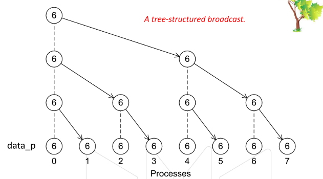

注意：

- `MPI_Bcast` 是集合通信，通信子中的所有进程都必须调用。
- 所有进程传入的 `count`、`datatype`、`source_proc`、`comm` 必须匹配。
- 与手写多次 `MPI_Send` 相比，`MPI_Bcast` 通常更简洁，也可能由 MPI 库用树形结构优化。

### MPI_Scatter

`MPI_Scatter` 用于**分散**：root 进程把一整块数据切成多段，分别发送给通信子中的各个进程。

可以理解为：

```text
root 上的大数组 -> 每个进程拿到其中一小段
```

典型用途：

- root 进程读入完整向量。
- 每个进程只处理自己负责的子向量。
- 避免把完整向量复制到所有进程，节省内存和通信量。

函数原型：

```c
int MPI_Scatter(
    void *send_buf_p,
    int send_count,
    MPI_Datatype send_type,
    void *recv_buf_p,
    int recv_count,
    MPI_Datatype recv_type,
    int src_proc,
    MPI_Comm comm
);
```

重点参数：

| 参数 | 含义 |
|---|---|
| `send_buf_p` | root 进程上的完整发送缓冲区 |
| `send_count` | 发送给**每个进程**的数据项个数 |
| `recv_buf_p` | 每个进程接收自己那一段数据的缓冲区 |
| `recv_count` | 每个进程实际接收的数据项个数 |
| `src_proc` | root 进程 rank |

注意：`send_count` 不是 `send_buf_p` 中的总数据量，而是**每个进程收到多少个元素**。

如果通信子中有 `comm_sz` 个进程，`MPI_Scatter` 会把 `send_buf_p` 指向的数据分成 `comm_sz` 个片段：

```text
第 1 个片段 -> rank 0
第 2 个片段 -> rank 1
第 3 个片段 -> rank 2
...
```

所以 root 上的发送缓冲区至少需要容纳：

```text
send_count * comm_sz
```

个元素。

例子：有 `comm_sz` 个进程，向量总长度为 `n`，则每个进程收到：

```text
local_n = n / comm_sz
```

调用时通常类似：

```c
MPI_Scatter(x, local_n, MPI_DOUBLE,
            local_x, local_n, MPI_DOUBLE,
            0, MPI_COMM_WORLD);
```

`MPI_Bcast`、`MPI_Scatter` 和 `MPI_Gather` 的数据方向对比：

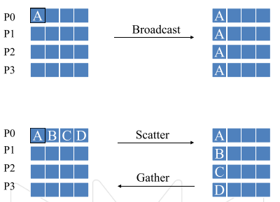

### MPI_Gather

`MPI_Gather` 用于**收集**：每个进程把自己的一段数据发送给 root，root 把这些片段按 rank 顺序拼成完整数据。

可以理解为：

```text
每个进程的一小段 -> root 上的大数组
```

它和 `MPI_Scatter` 方向相反：

| 函数 | 数据方向 |
|---|---|
| `MPI_Scatter` | root 分发给所有进程 |
| `MPI_Gather` | 所有进程收集到 root |

函数原型：

```c
int MPI_Gather(
    void *send_buf_p,
    int send_count,
    MPI_Datatype send_type,
    void *recv_buf_p,
    int recv_count,
    MPI_Datatype recv_type,
    int dest_proc,
    MPI_Comm comm
);
```

重点参数：

| 参数 | 含义 |
|---|---|
| `send_buf_p` | 每个进程要发送的本地数据 |
| `send_count` | 每个进程发送的数据项个数 |
| `recv_buf_p` | root 进程上的接收缓冲区，用来存放完整结果 |
| `recv_count` | root 从**每个进程**接收的数据项个数 |
| `dest_proc` | root 进程 rank，即结果收集到哪里 |

注意：`recv_count` 是从每个进程接收多少项，不是 root 最终接收到的总项数。最终总量通常是：

```text
recv_count * comm_sz
```

root 上的 `recv_buf_p` 会按进程 rank 顺序存放结果：

```text
rank 0 的数据 -> 第 1 块
rank 1 的数据 -> 第 2 块
rank 2 的数据 -> 第 3 块
...
```

`MPI_Gather` 和 `MPI_Scatter` 的重点都是 `count` 参数的含义：

- `MPI_Scatter` 的 `send_count`：root 发给**每个进程**多少个元素。
- `MPI_Gather` 的 `recv_count`：root 从**每个进程**收多少个元素。
- 它们都不是 root 缓冲区里的总元素数。

### MPI_Allgather

`MPI_Allgather` 用于**全局聚集**：每个进程发送一段数据，并且每个进程最终都得到所有进程的数据。

可以理解为：

```text
MPI_Allgather = MPI_Gather + MPI_Bcast
```

也就是说，它先把各进程的数据聚集成完整结果，再让所有进程都拥有这份完整结果。实际 MPI 实现不一定真的分两步执行，但语义上可以这样理解。

区别：

| 函数 | 谁得到完整结果 |
|---|---|
| `MPI_Gather` | 只有 root 进程 |
| `MPI_Allgather` | 所有进程 |

函数原型：

```c
int MPI_Allgather(
    void *send_buf_p,
    int send_count,
    MPI_Datatype send_type,
    void *recv_buf_p,
    int recv_count,
    MPI_Datatype recv_type,
    MPI_Comm comm
);
```

和 `MPI_Gather` 相比，`MPI_Allgather` **没有 root 参数**，因为所有进程都会得到完整结果。

例子：4 个进程中：

```c
int sendval = rank + 1;
int recvbuf[4];

MPI_Allgather(&sendval, 1, MPI_INT,
              recvbuf, 1, MPI_INT,
              MPI_COMM_WORLD);
```

执行后，每个进程的：

```text
recvbuf = [1, 2, 3, 4]
```

注意：

- 所有进程都要提供 `recvbuf`。
- `recvbuf` 大小通常至少是 `recv_count * comm_sz`。
- 和 `MPI_Gather` 不同，`MPI_Allgather` 没有 `dest_proc/root` 参数，因为结果不是只发给某一个进程，而是发给所有进程。

`MPI_Allgather` 和 `MPI_Alltoall` 的语义对比：

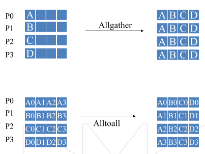

`MPI_Allgather` 的常见实现之一是**环算法**：

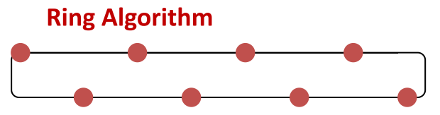

环算法的直观过程：

- 每个进程一开始有自己的本地数据。
- 第 0 轮发送自己的数据。
- 之后每一轮把上一轮收到的数据继续传给右侧进程，同时从左侧进程接收新数据。
- 经过 `p - 1` 轮后，每个进程都拥有所有进程的数据。

另一类实现是递归倍增/蝶式通信：

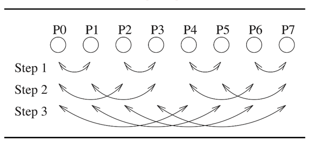

它每一轮和更远距离的伙伴进程交换已有数据，轮数约为 `log2(p)`。实际 MPI 库会根据消息大小、进程数和网络结构选择实现方式。

### MPI_Allreduce

`MPI_Allreduce` 会把归约结果发送给通信子中的所有进程。

如果希望所有进程都得到总和，应使用：

```c
MPI_Allreduce(
    &local_sum,
    &total_sum,
    1,
    MPI_DOUBLE,
    MPI_SUM,
    MPI_COMM_WORLD
);
```

区别：

| 函数 | 结果保存在哪些进程 |
|---|---|
| `MPI_Reduce` | 只保存在 root 进程 |
| `MPI_Allreduce` | 所有参与进程都得到结果 |

### 全局和的两种实现模式

全局和的目标是：每个进程一开始只有自己的局部值，最后所有进程都得到全局求和结果。

示例初始值：

```text
rank 0:  5
rank 1:  2
rank 2: -1
rank 3: -3
rank 4:  6
rank 5:  5
rank 6: -7
rank 7:  2
```

总和为：

```text
5 + 2 - 1 - 3 + 6 + 5 - 7 + 2 = 9
```

#### 模式一：先归约，再分发

第一阶段：树形归约，把所有值逐步加到 root 进程。

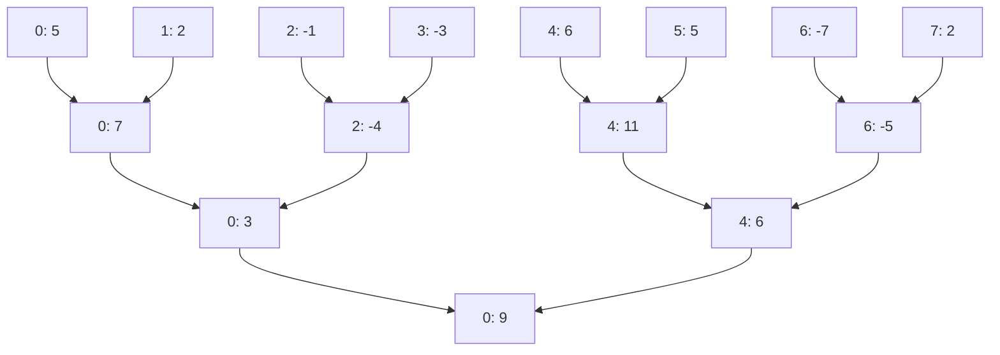

第二阶段：root 再把结果广播给所有进程。

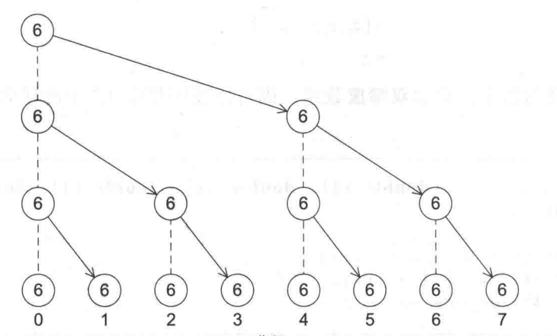

特点：

- 思路简单：先做 `Reduce`，再做 `Broadcast`。
- root 先得到最终结果，然后再分发给其他进程。
- 可理解为 `MPI_Allreduce = MPI_Reduce + MPI_Bcast` 的一种实现思路。

#### 模式二：蝶式模式

蝶式模式中，每一轮进程和一个“伙伴进程”交换当前部分和，交换后双方都更新自己的结果。

8 个进程需要 `log2(8) = 3` 轮：

```text
第 1 轮：距离 1 的进程交换
(0,1), (2,3), (4,5), (6,7)

第 2 轮：距离 2 的进程交换
(0,2), (1,3), (4,6), (5,7)

第 3 轮：距离 4 的进程交换
(0,4), (1,5), (2,6), (3,7)
```

图示：

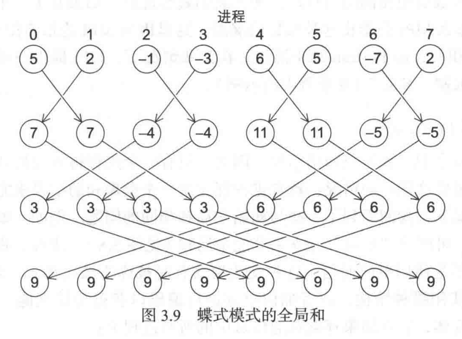

特点：

- 每一轮所有进程都参与交换和计算。
- 每个进程最终都直接得到全局结果。
- 不需要先集中到 root 再广播。
- 适合实现 `MPI_Allreduce` 这类所有进程都需要结果的集合通信。

## 3.10 MPI 程序中的 I/O 处理

### 基本规则

在 MPI 程序中：

- **输出**：所有进程都可以访问 `stdout`，但输出顺序不可预测。
- **输入**：通常只有 0 号进程访问 `stdin`。

因此常见做法是：

1. 0 号进程从标准输入读取数据。
2. 0 号进程把输入数据发送给其他进程。
3. 其他进程通过 `MPI_Recv` 接收这些数据。

### 示例：0 号进程读入并分发参数

```c
if (my_rank == 0) {
    printf("Enter a, b, and n\n");
    scanf("%lf %lf %d", a_p, b_p, n_p);

    for (dest = 1; dest < comm_sz; dest++) {
        MPI_Send(a_p, 1, MPI_DOUBLE, dest, 0, MPI_COMM_WORLD);
        MPI_Send(b_p, 1, MPI_DOUBLE, dest, 0, MPI_COMM_WORLD);
        MPI_Send(n_p, 1, MPI_INT,    dest, 0, MPI_COMM_WORLD);
    }
} else {
    MPI_Recv(a_p, 1, MPI_DOUBLE, 0, 0, MPI_COMM_WORLD,
             MPI_STATUS_IGNORE);
    MPI_Recv(b_p, 1, MPI_DOUBLE, 0, 0, MPI_COMM_WORLD,
             MPI_STATUS_IGNORE);
    MPI_Recv(n_p, 1, MPI_INT,    0, 0, MPI_COMM_WORLD,
             MPI_STATUS_IGNORE);
}
```

### 代码含义

- `my_rank == 0`：
  - 0 号进程负责提示用户输入。
  - 读取 `a`、`b`、`n`。
  - 通过循环把三个参数发送给 rank `1` 到 `comm_sz - 1` 的所有进程。
- `my_rank != 0`：
  - 非 0 号进程不访问 `stdin`。
  - 它们分别从 0 号进程接收 `a`、`b`、`n`。

### 图示

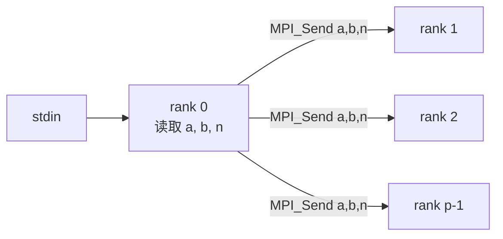

### 注意点

- `count` 是数据项个数，不是字节数。
- `a_p` 和 `b_p` 是 `double*`，所以使用 `MPI_DOUBLE`。
- `n_p` 是 `int*`，所以使用 `MPI_INT`。
- `MPI_STATUS_IGNORE` 表示忽略接收状态。
- 这里三条消息都使用 `tag = 0`，能够正确接收是因为同一发送方到同一接收方的消息不会乱序。

### 更简洁的替代方案

如果所有进程都需要同样的输入数据，更常见的写法是使用广播：

```c
MPI_Bcast(a_p, 1, MPI_DOUBLE, 0, MPI_COMM_WORLD);
MPI_Bcast(b_p, 1, MPI_DOUBLE, 0, MPI_COMM_WORLD);
MPI_Bcast(n_p, 1, MPI_INT,    0, MPI_COMM_WORLD);
```

`MPI_Bcast` 表示：root 进程把数据广播给通信子中的所有进程。

## 3.11 MPI 计时与同步

### MPI_Wtime

`MPI_Wtime` 用于获取当前进程的墙上时钟时间（wall time），单位是秒，返回值类型是 `double`。

它常用于测量某段 MPI 程序的运行时间：

```c
double start, end;

start = MPI_Wtime();

do_work();

end = MPI_Wtime();

printf("Elapsed time = %f seconds\n", end - start);
```

注意：

- `MPI_Wtime()` 返回的是当前进程看到的时间。
- 并行程序中各进程开始执行某段代码的时刻可能不同。
- 如果要测量一段并行计算的整体耗时，通常要先同步，再开始计时。

### MPI_Barrier

`MPI_Barrier` 是屏障同步函数：

```c
int MPI_Barrier(MPI_Comm comm);
```

含义：

- 通信子 `comm` 中的所有进程都必须到达这个调用点。
- 只有所有进程都到达后，大家才能继续往下执行。
- 如果有进程还没到，其他已经到达的进程会阻塞等待。

典型用途：同步后再测量并行区域时间。

```c
MPI_Barrier(MPI_COMM_WORLD);
double start = MPI_Wtime();

do_parallel_work();

MPI_Barrier(MPI_COMM_WORLD);
double end = MPI_Wtime();

if (rank == 0) {
    printf("Parallel section took %f seconds\n", end - start);
}
```

为什么前后都加 `MPI_Barrier`：

- 前面的 `MPI_Barrier`：保证所有进程都准备好后再开始计时。
- 后面的 `MPI_Barrier`：保证所有进程都完成并行段后再停止计时。
- 这样测到的时间更接近整个并行计算段的真实耗时。

## 3.12 MPI 派生数据类型

MPI 的基本数据类型只能描述连续的 `int`、`double`、`char` 等数据。实际程序里经常需要发送更复杂的内存布局，例如矩阵的一列、结构体中的几个字段，或者二维数组中的一个子块。

**派生数据类型**的作用是：告诉 MPI“我要发送的数据在内存中怎样分布”，让 MPI 直接按这个布局通信，而不需要程序员手动把数据打包到临时数组。

典型使用流程：

```c
MPI_Datatype new_type;

/* 1. 创建派生类型 */
/* MPI_Type_vector / MPI_Type_indexed / MPI_Type_create_struct 等 */

/* 2. 提交类型，之后才能用于通信 */
MPI_Type_commit(&new_type);

/* 3. 在 Send/Recv 或集合通信中使用 */
MPI_Send(buf, 1, new_type, dest, tag, comm);

/* 4. 不再使用后释放 */
MPI_Type_free(&new_type);
```

### `MPI_Type_contiguous`

`MPI_Type_contiguous` 用来描述一段连续的数据，相当于把多个相同类型的数据组合成一个新类型。

```c
int MPI_Type_contiguous(
    int count,
    MPI_Datatype old_type,
    MPI_Datatype *new_type_p
);
```

例子：把 4 个连续的 `MPI_DOUBLE` 看成一个新类型。

### `MPI_Type_vector`

`MPI_Type_vector` 用来描述“重复出现的等长块”，每个块之间有固定间隔。它常用于发送矩阵的一列。

```c
int MPI_Type_vector(
    int count,
    int blocklength,
    int stride,
    MPI_Datatype old_type,
    MPI_Datatype *new_type_p
);
```

参数含义：

| 参数 | 含义 |
|---|---|
| `count` | 有多少个块 |
| `blocklength` | 每个块包含多少个旧类型元素 |
| `stride` | 相邻块起点之间相隔多少个旧类型元素 |
| `old_type` | 原始 MPI 数据类型 |
| `new_type_p` | 输出的新派生类型 |

示意图：

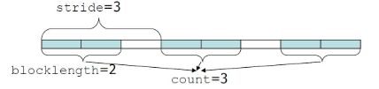

### `MPI_Type_indexed`

`MPI_Type_indexed` 比 `vector` 更灵活：每个块的长度和起始位置都可以不同。

```c
int MPI_Type_indexed(
    int count,
    int blocklengths[],
    int displacements[],
    MPI_Datatype old_type,
    MPI_Datatype *new_type_p
);
```

适合描述不规则位置的数据。

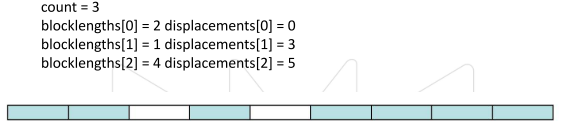

### `MPI_Type_create_subarray`

`MPI_Type_create_subarray` 用来描述多维数组中的一个子数组。它常用于矩阵块划分，例如从一个二维矩阵里发送某个矩形区域。

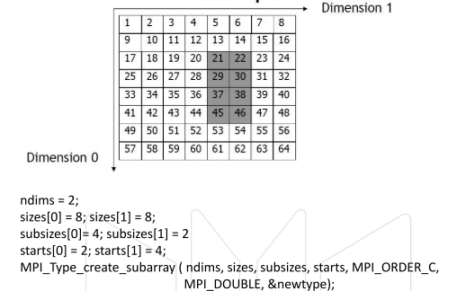

### `MPI_Type_create_struct`

`MPI_Type_create_struct` 用来描述由不同类型字段组成的数据布局。例如一个结构体里既有 `int`，也有 `double`，并且只想发送其中某些字段。

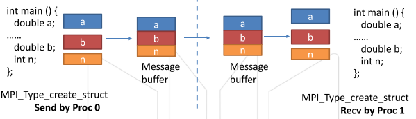

### 结构体填充和 `extent`

C 结构体中可能存在**内存对齐填充**。也就是说，字段之间或结构体末尾可能有一些程序员没有显式声明的空字节。

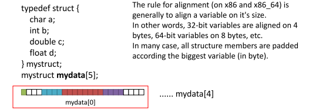

如果直接把结构体当成连续内存发送，可能会把不需要的填充字节或相邻字段一起发送出去。派生数据类型可以只描述真正需要通信的字段。

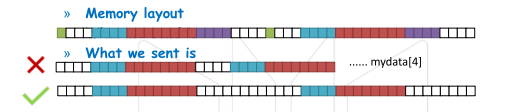

还有一个容易混淆的概念是 `extent`：它表示 MPI 在连续排列多个该类型对象时，相邻对象起点之间的跨度。结构体有填充时，`extent` 可能大于字段本身的有效数据长度。

必要时可以用 `MPI_Type_create_resized` 调整派生类型的 `extent`。

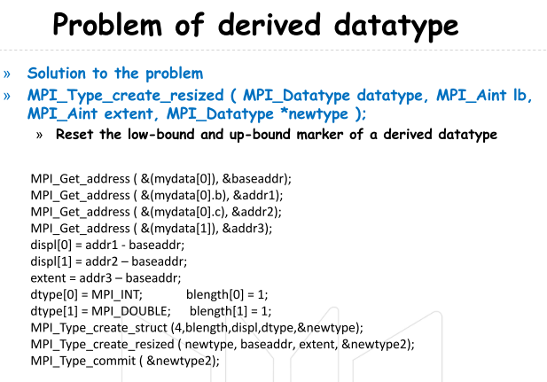

核心记忆：

- 派生数据类型描述的是**内存布局**，不是新建一份数据。
- 创建后必须 `MPI_Type_commit`，不用后要 `MPI_Type_free`。
- 发送非连续数据时，派生类型通常比手动打包更清晰，也更不容易出错。

## 3.13 MPI 死锁、`Sendrecv` 和非阻塞通信

### 点对点通信中的死锁

如果两个进程都先执行阻塞发送，再执行接收，就可能互相等待。

典型错误模式：

```text
rank 0: MPI_Send(... rank 1 ...); MPI_Recv(... rank 1 ...);
rank 1: MPI_Send(... rank 0 ...); MPI_Recv(... rank 0 ...);
```

当消息较大或使用同步发送时，两个进程都在等对方先接收，程序就可能卡住。


### 解决方式一：调整发送接收顺序

让一边先发送后接收，另一边先接收后发送，就能避免两边同时卡在发送上。

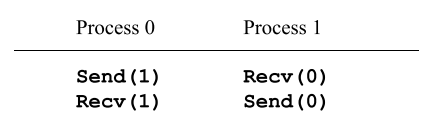

### 解决方式二：`MPI_Sendrecv`

`MPI_Sendrecv` 把一次发送和一次接收合成一个调用，适合相邻进程交换数据。

```c
int MPI_Sendrecv(
    const void *sendbuf,
    int sendcount,
    MPI_Datatype sendtype,
    int dest,
    int sendtag,
    void *recvbuf,
    int recvcount,
    MPI_Datatype recvtype,
    int source,
    int recvtag,
    MPI_Comm comm,
    MPI_Status *status
);
```

它的价值是：程序员不用手动安排“谁先发、谁先收”，MPI 会处理这个交换过程。

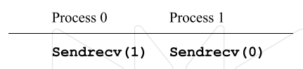

### 缓冲发送

`MPI_Bsend` 是缓冲发送。它依赖用户提供的缓冲区，发送数据可以先被拷贝到这个缓冲区中。

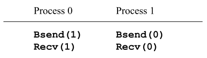

注意：缓冲发送不是首选的死锁解决方案。更常用的是重新安排通信顺序、使用 `MPI_Sendrecv`，或者使用非阻塞通信。

### 非阻塞通信

非阻塞通信的核心是：函数调用可以先返回，通信在后台继续进行。

常用函数：

```c
MPI_Isend(..., MPI_Request *request);
MPI_Irecv(..., MPI_Request *request);
```

`I` 表示 immediate。调用返回只表示“通信请求已经发起”，不表示通信已经完成。

因此必须配合等待或测试函数：

```c
MPI_Wait(&request, &status);
MPI_Test(&request, &flag, &status);
MPI_Waitall(count, requests, statuses);
```

最重要的规则：

- 对 `MPI_Isend`，在通信完成前，不要修改或释放发送缓冲区。
- 对 `MPI_Irecv`，在通信完成前，不要读取接收缓冲区中的结果。
- 是否完成要看 `MPI_Wait` / `MPI_Test` 等函数。

`MPI_Request` 可以理解成一次未完成通信的“句柄”：

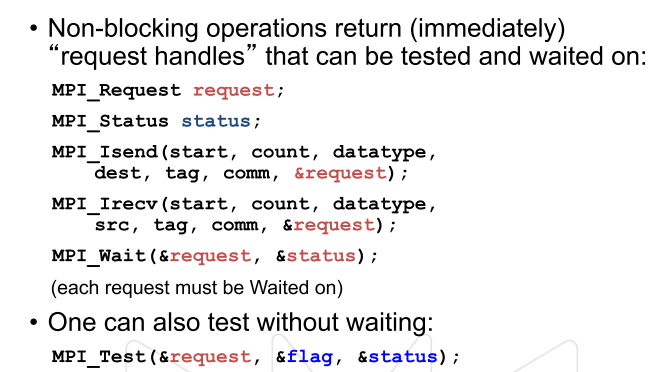

多个非阻塞通信可以一起等待：

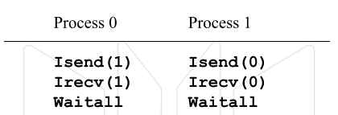

也可以等待其中任意一个或一部分完成：

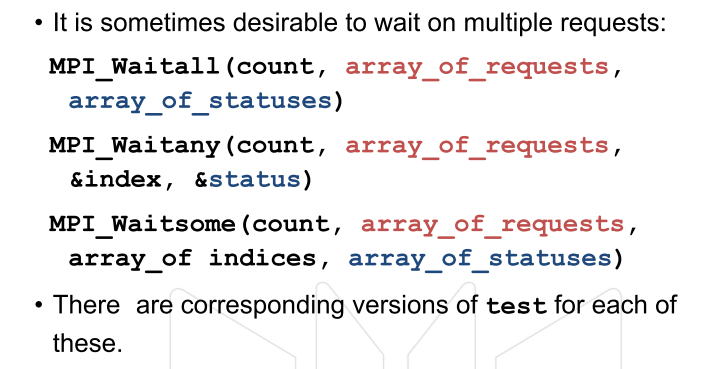

一句话总结：

```text
阻塞通信：调用返回时，相关通信条件已经满足。
非阻塞通信：调用先返回，但之后必须 wait/test，才能确认通信完成。
```

# 第 4 章 使用 Pthreads 进行共享内存编程

## 4.1 Pthreads 概述

### Pthreads 是什么

**Pthreads** 是 POSIX 线程库，用于在共享内存系统中编写多线程程序。

和 MPI 的主要区别：

| 对比项 | MPI | Pthreads |
|---|---|---|
| 所在章节 | 第 3 章 | 第 4 章 |
| 编程对象 | 进程 | 线程 |
| 内存模型 | 分布式内存 | 共享内存 |
| 数据是否默认共享 | 不共享；每个进程有自己的地址空间 | 共享；同一进程内线程可以访问共享变量 |
| 通信方式 | 显式消息传递 | 通过共享变量隐式通信 |
| 典型 API | `MPI_Send`、`MPI_Recv`、`MPI_Reduce`、`MPI_Bcast` | `pthread_create`、`pthread_join`、`pthread_mutex_lock`、`sem_wait` |
| 协调重点 | 发送/接收、集合通信、消息匹配、阻塞语义 | 临界区、互斥锁、信号量、条件变量、读写锁 |
| 常见问题 | 死锁、消息匹配错误、通信开销 | 数据竞争、伪共享、线程不安全、锁竞争 |
| 适合场景 | 多机器、集群、大规模分布式计算 | 单机多核、小到中等规模共享内存并行 |

核心区别：

```text
MPI：进程之间不共享内存，所以靠消息传递。
Pthreads：线程之间共享内存，所以靠同步保护。
```

MPI 中，每个进程像独立的执行单元，有自己的内存。要交换数据，必须显式调用：

```c
MPI_Send(...);
MPI_Recv(...);
```

Pthreads 中，多个线程在同一个进程内运行，可以直接访问同一个共享变量。因此重点不是发送消息，而是防止多个线程同时乱改共享数据：

```c
pthread_mutex_lock(&mutex);
/* 临界区 */
pthread_mutex_unlock(&mutex);
```

性能瓶颈也不同：

| 模型 | 常见性能瓶颈 |
|---|---|
| MPI | 通信次数、消息大小、网络延迟、集合通信效率 |
| Pthreads | 锁竞争、临界区太长、缓存一致性开销、伪共享、线程调度 |

两者都可以使用 **SPMD** 思路：同一份程序由多个执行单元运行。区别是 MPI 通常用 `rank` 区分进程，Pthreads 通常用线程编号区分线程。

共享内存系统适合在同一台机器上使用多个线程，规模通常不会太大，因为多个核心访问共享内存时会受到内存带宽、总线、缓存一致性等因素限制。

### Pthreads 程序的核心问题

Pthreads 的重点不是“如何传消息”，而是：

- 线程之间如何通信：通过访问共享变量。
- 如何避免写写冲突：避免多个线程同时写同一个共享变量。
- 如何构造临界区：把一次只能由一个线程执行的代码包起来。
- 如何表达锁：使用互斥量 `pthread_mutex_t`。

Pthreads 程序也经常采用 **SPMD** 思路：所有线程运行同一个线程函数，但根据线程编号处理不同数据。

## 4.2 Hello World 示例

### 编译与运行

编译 Pthreads 程序时需要加 `-pthread`：

```bash
gcc -pthread hello_pthread.c -o hello_pthread
./hello_pthread
```

### 代码

```c
#include <stdio.h>
#include <pthread.h>

void* say_hello(void* arg) {
    int thread_id = *(int*)arg;
    printf("Hello from thread %d!\n", thread_id);
    return NULL;
}

int main() {
    const int NUM_THREADS = 4;
    pthread_t threads[NUM_THREADS];
    int ids[NUM_THREADS];

    for (int i = 0; i < NUM_THREADS; i++) {
        ids[i] = i;
        pthread_create(&threads[i], NULL, say_hello, (void*) &ids[i]);
    }

    for (int i = 0; i < NUM_THREADS; i++) {
        pthread_join(threads[i], NULL);
    }

    printf("All threads finished. Goodbye!\n");
    return 0;
}
```

如果线程数运行时才确定，可以动态分配线程对象数组：

```c
pthread_t* threads = malloc(num_threads * sizeof(pthread_t));
```

## 4.3 pthread_create：启动线程

在启动线程前，需要先创建线程对象：

```c
pthread_t thread;
```

每个线程对应一个 `pthread_t` 对象。创建线程使用：

```c
int pthread_create(
    pthread_t* thread,
    const pthread_attr_t* attr,
    void* (*start_routine)(void*),
    void* arg
);
```

参数：

| 参数              | 含义                     |
| --------------- | ---------------------- |
| `thread`        | 指向线程对象的指针，创建成功后保存线程 ID |
| `attr`          | 线程属性，通常传 `NULL`        |
| `start_routine` | 线程要执行的函数               |
| `arg`           | 传给线程函数的参数              |

线程函数的固定形式通常是：

```c
void* thread_func(void* arg);
```

如果要传多个参数，常见做法是定义结构体，把结构体指针作为 `arg` 传入。

## 4.4 pthread_join：等待线程结束

`pthread_join` 用来等待一个线程结束：

```c
int pthread_join(pthread_t thread, void** retval);
```

重点：

- `pthread_join` **不会主动停止线程**。
- 它会阻塞调用它的线程，直到目标线程正常返回。
- 常用于主线程等待所有子线程执行完毕。

典型写法：

```c
for (int i = 0; i < NUM_THREADS; i++) {
    pthread_join(threads[i], NULL);
}
```

如果主线程不等待子线程，主线程可能先结束，导致整个进程退出，子线程还没来得及完成。

## 4.5 共享变量、冲突和临界区

### 线程如何通信

Pthreads 中，同一个进程内的多个线程共享地址空间，因此线程可以直接访问同一批全局变量、堆内存和静态变量。

也就是说，线程之间的通信通常是隐式的：

```text
线程 A 写共享变量
线程 B 读共享变量
```

这比 MPI 的显式发送和接收更方便，但也更容易出错。

### 写写冲突

如果多个线程同时写同一个共享变量，就可能出现写写冲突。

例子：

```c
sum += my_val;
```

这行代码看起来是一条语句，但底层通常包含：

1. 从内存读取 `sum`。
2. 加上 `my_val`。
3. 把结果写回 `sum`。

如果两个线程同时执行，就可能都读到旧值，最后其中一个写入覆盖另一个写入，导致结果错误。

### 竞争条件

**竞争条件**：多个线程同时访问某个共享资源，并且程序结果依赖于线程执行的先后顺序。

例子：共享变量 `x` 初始值为 `0`，两个线程几乎同时执行：

```c
y = compute();   /* Thread 0: y = 1; Thread 1: y = 2 */
x = x + y;
```

理想情况下，最终应该得到：

```text
x = 1 + 2 = 3
```

但实际执行可能是：

1. 线程 0 读到 `x = 0`，准备加 `y = 1`。
2. 线程 1 也读到 `x = 0`，准备加 `y = 2`。
3. 线程 0 写回 `x = 1`。
4. 线程 1 写回 `x = 2`，覆盖线程 0 的结果。

最终得到 `x = 2`，而不是 `x = 3`。这说明 `x = x + y` 不是原子操作。

### 临界区

**临界区**：一次只能允许一个线程执行的代码区域。

通常，临界区里面放的是更新共享变量的操作。

对于共享变量更新，常见做法是把更新语句放进临界区：

```c
lock();
sum += my_val;
unlock();
```

临界区越大，串行化越严重；临界区越小，程序通常越容易保持并行性能。

临界区要解决的问题是：让多个线程对共享变量的访问变成互斥访问，从而避免多个线程同时修改同一个共享变量。

### 互斥锁

忙等待会持续占用 CPU，因此更常用的方式是使用**互斥锁**和信号量。

**互斥锁**（mutex）是一种线程同步机制，用来保证同一时刻只有一个线程可以进入临界区。

Pthreads 使用 `pthread_mutex_t` 表示互斥量：

```c
pthread_mutex_t mutex;
```

#### 初始化

使用互斥锁前需要初始化：

```c
int pthread_mutex_init(
    pthread_mutex_t* mutex_p,
    const pthread_mutexattr_t* attr_p
);
```

一般情况下，属性参数传 `NULL`：

```c
pthread_mutex_init(&lock, NULL);
```

#### 上锁

进入临界区前调用：

```c
int pthread_mutex_lock(pthread_mutex_t* mutex_p);
```

含义：

- 如果锁空闲，当前线程获得锁并继续执行。
- 如果锁已被其他线程持有，当前线程阻塞等待。

#### 解锁

离开临界区后调用：

```c
int pthread_mutex_unlock(pthread_mutex_t* mutex_p);
```

含义：释放锁，让其他等待线程有机会进入临界区。

#### 销毁

互斥锁不再使用时，应销毁：

```c
int pthread_mutex_destroy(pthread_mutex_t* mutex_p);
```

#### 典型使用方式

```c
pthread_mutex_t lock;
pthread_mutex_init(&lock, NULL);

pthread_mutex_lock(&lock);

/* 临界区 */
sum += my_val;

pthread_mutex_unlock(&lock);

pthread_mutex_destroy(&lock);
```

使用锁的目的不是提高速度，而是保证共享变量更新的正确性。

### 互斥锁的局限：不能保证执行顺序

互斥锁只能保证：

```text
同一时刻只有一个线程进入临界区
```

但它不能保证：

```text
线程按照指定顺序进入临界区
```

所以，如果临界区里的操作对顺序敏感，仅使用互斥锁仍然可能得到不同结果。

典型例子：多个线程各自生成一个矩阵，然后把它乘到共享结果矩阵 `product_mat` 上。

```c
void* Thread_work(void* rank) {
    long my_rank = (long) rank;
    matrix_t my_mat = Allocate_matrix(n);
    Generate_matrix(my_mat);

    pthread_mutex_lock(&mutex);
    Multiply_matrix(product_mat, my_mat);
    pthread_mutex_unlock(&mutex);

    Free_matrix(&my_mat);
    return NULL;
}
```

互斥锁可以保证一次只有一个线程执行：

```c
Multiply_matrix(product_mat, my_mat);
```

但问题是：不同线程进入临界区的顺序由操作系统调度决定。

矩阵乘法不满足交换律：

```text
A * B * C != C * B * A
```

因此，线程执行乘法的顺序不同，最终的 `product_mat` 可能不同。

结论：互斥锁适合保护共享变量，避免同时写；但如果操作本身对顺序敏感，还需要额外机制规定线程执行顺序。

### 信号量

有些同步模式不是简单的“只能一个线程进临界区”，而是“一个线程要等另一个线程完成某些操作后才能继续”。这种情况更适合使用**信号量**。

使用信号量需要引入：

```c
#include <semaphore.h>
```

信号量和互斥锁最大的区别：

| 对比项 | 互斥锁 | 信号量 |
|---|---|---|
| 核心含义 | 保护同一段临界区，避免多个线程同时进入 | 表达“某件事已经发生，另一个线程可以继续了” |
| 所属关系 | 谁 `lock`，通常谁 `unlock` | 没有所有权，任何线程都可以 `post` |
| 典型用途 | 互斥访问共享变量 | 控制线程之间的先后顺序 |
| 顺序控制 | 不保证线程进入顺序 | 可用于让线程等待某个事件发生 |

对于当前学习目的，最关键的区别是：**信号量没有所有权**。

一句话记忆：

- `mutex`：谁 `lock`，通常谁 `unlock`；重点是保护同一段临界区。
- `semaphore`：任何线程都可以 `post`；重点是通知另一个线程可以继续。

也就是说：

- 主线程可以把所有信号量初始化为 `0`，表示这些事件一开始都尚未发生。
- 任意线程都可以对任意信号量执行 `sem_wait`。
- 任意线程也可以对任意信号量执行 `sem_post`。
- 因此，一个线程可以通过 `sem_post` 唤醒另一个正在等待该信号量的线程。

更准确地说，信号量的重点不是“加锁”，而是表达：

```text
某个事件已经发生，等待这个事件的线程可以继续了
```

这和互斥锁不同：互斥锁通常强调“==谁加锁，谁解锁==”。信号量更像一个可被不同线程共同操作的通知器或计数器。

#### sem_init：初始化

```c
int sem_init(
    sem_t* semaphore_p,
    int shared,
    unsigned initial_val
);
```

参数：

- `semaphore_p`：信号量对象地址。
- `shared`：是否用于进程间共享。通常写 `0`，表示用于同一进程内的线程之间。
- `initial_val`：信号量初值。常见地，`0` 表示事件尚未发生，等待线程需要阻塞。

例子：

```c
sem_t sem;
sem_init(&sem, 0, 0);
```

当 `initial_val = 0` 时，先执行 `sem_wait` 的线程会阻塞，直到其他线程执行 `sem_post`。

#### sem_wait：等待

```c
int sem_wait(sem_t* semaphore_p);
```

含义：

- 如果信号量值 `> 0`，将其减 1，然后线程继续执行。
- 如果信号量值 `= 0`，线程阻塞，直到其他线程执行 `sem_post` 发出通知。

可以理解为：

```text
等待某个事件发生；如果还没发生，就睡眠等待
```

#### sem_post：通知/释放

```c
int sem_post(sem_t* semaphore_p);
```

含义：

- 将信号量值加 1。
- 如果有线程正在 `sem_wait` 中阻塞，可能唤醒其中一个。

可以理解为：

```text
宣布某个事件已经发生；如果有人在等，就叫醒一个
```

#### sem_destroy：销毁

```c
int sem_destroy(sem_t* semaphore_p);
```

信号量不再使用时，应调用 `sem_destroy` 销毁。

#### 典型用法：控制线程先后顺序

```c
sem_t sem;
sem_init(&sem, 0, 0);

/* 线程 A */
sem_wait(&sem);
do_after_B();

/* 线程 B */
do_something();
sem_post(&sem);

/* 不再使用时 */
sem_destroy(&sem);
```

总结：

- 信号量的重点是表达“事件发生了，可以继续”。
- 它比互斥锁更适合控制线程之间的先后顺序。
- 初值为 `0` 时，表示事件还没发生，等待线程会阻塞。
- `sem_post` 可以由另一个线程调用，用来通知等待线程继续执行。
- 初值为 `1` 的二进制信号量可以模拟互斥锁，但这不是这里最重要的用法。

### 忙等待、互斥锁和信号量对比

这三者都可以用于协调线程，但解决问题的重点不同。

本节最重要的主线不是“这三个工具分别叫什么”，而是：

```text
它们能不能控制线程之间的执行顺序？
```

如果只是避免多个线程同时进入临界区，用互斥锁通常就够了；如果要求线程 A 做完后线程 B 才能继续，就需要能表达先后关系的机制。

| 机制 | 核心思想 | 能否控制执行顺序 | 等待时是否占用 CPU | 是否有所有权 | 适合解决的问题 | 主要风险 |
|---|---|---|---|---|---|---|
| 忙等待 | 用共享标志变量和空循环反复检查条件 | 可以，但方式低效 | 占用 CPU，一直空转 | 没有明确所有权 | 简单地强制线程按某个顺序执行 | 浪费 CPU；线程数多于核心数时可能严重变慢；还可能受编译器优化影响 |
| 互斥锁 | 把一段临界区锁起来，一次只允许一个线程进入 | 不能精确控制，只保证互斥 | 通常阻塞，不持续空转 | 有所有权，谁 `lock` 通常谁 `unlock` | 保护共享变量或共享数据结构，避免同时写 | 不保证进入临界区的顺序；临界区太大会导致串行化 |
| 信号量 | 用计数器表达资源数量或事件是否发生 | 可以，用 `wait/post` 表达先后关系 | 信号量为 0 时阻塞 | 没有所有权，任何线程都可以 `post` | 控制线程先后顺序、生产者-消费者同步，也可模拟互斥锁 | 用法更灵活，也更容易把 `wait/post` 顺序写错 |

一句话记忆：

```text
忙等待：一直问“轮到我了吗？”
互斥锁：保护“这段代码一次只能一个线程执行”。
信号量：通知“某件事发生了，等待者可以继续”。
```

最终记忆：

```text
互斥锁解决“不能同时执行”的问题；
信号量更适合解决“必须按某个顺序执行”的问题；
忙等待也能做顺序控制，但代价是一直占用 CPU。
```

### 栅栏

**栅栏**（barrier）是一个同步点：所有线程都必须到达这里，任何线程才允许继续往后执行。

可以把栅栏理解成“阶段分界线”：

```text
线程 0: 做 A --- 到达栅栏 | 等待 | 做 B
线程 1: 做 A --------- 到达栅栏 | 做 B
线程 2: 做 A -- 到达栅栏  | 等待 | 做 B
```

只有最后一个线程也到达栅栏后，所有线程才一起越过栅栏，进入下一阶段。

常见用途：

| 用途 | 说明 |
|---|---|
| 更准确计时 | 先让所有线程在栅栏处集合，再一起开始计时，避免有的线程先开始、有的线程晚开始。 |
| 调试并行程序 | 在某个位置放栅栏，然后让 0 号线程打印，表示所有线程都已经运行到这个点。 |
| 阶段同步 | 保证上一阶段所有线程都完成后，才能进入下一阶段。 |

和互斥锁的区别：

| 机制 | 重点 |
|---|---|
| `mutex` | 防止多个线程同时进入同一段临界区。 |
| `barrier` | 要求多个线程都到达同一个位置后再一起继续。 |

重要风险：如果某个线程永远到不了栅栏，其他线程会一直等在那里，程序就会卡住。因此，栅栏适合用于“所有线程都会执行到这里”的阶段同步。

### 条件变量

**条件变量**（condition variable）用于让线程在某个条件尚未满足时睡眠等待，等其他线程改变条件后再被唤醒。

典型调用：

```c
pthread_cond_wait(&cond_var, &mutex);
```

它不是“拿着锁睡觉”。这个函数会在内部原子地完成几件事：

1. 把当前线程放进 `cond_var` 的等待队列。
2. ==释放 `mutex`==，让其他线程有机会修改共享状态。
3. 让当前线程睡眠，不再占用 CPU 忙等。
4. 被唤醒后，返回之前会重新获得 `mutex`。

为什么必须释放 `mutex`：如果等待线程一直拿着锁睡眠，其他线程就无法进入临界区修改条件，也就无法唤醒它。

通常写法：

```c
pthread_mutex_lock(&mutex);
while (!condition_is_true) {
    pthread_cond_wait(&cond_var, &mutex);
}
/* 条件已经满足，继续处理共享数据 */
pthread_mutex_unlock(&mutex);
```

注意：这里通常用 `while`，不是 `if`。因为线程被唤醒后，条件不一定仍然成立，需要重新检查。

### 读写锁

**读写锁**（read-write lock）适合读多写少的共享资源。

它允许多个线程同时读共享资源，但只允许一个线程写；并且写操作进行时，其他线程不能读也不能写。

锁状态：

| 锁状态 | 其他线程能否同时操作 |
|---|---|
| 无锁 | 所有线程都可以竞争加锁 |
| 读锁（共享） | 其他线程可以继续加读锁 |
| 写锁（独占） | 不允许其他线程加读锁或写锁 |

初始化和销毁：

```c
pthread_rwlock_t rwlock;

pthread_rwlock_init(&rwlock, NULL);
pthread_rwlock_destroy(&rwlock);
```

加读锁：

```c
pthread_rwlock_rdlock(&rwlock);
```

- 如果当前没有写锁，就可以成功加读锁。
- 多个线程可以同时持有读锁。

加写锁：

```c
pthread_rwlock_wrlock(&rwlock);
```

- 只有当前没有其他线程持有读锁或写锁时，才会成功。
- 写锁是独占访问。

解锁：

```c
pthread_rwlock_unlock(&rwlock);
```

读锁和写锁都用同一个 `pthread_rwlock_unlock` 解锁。

一句话记忆：

```text
读读可以并发，写写不能并发，读写也不能并发。
```

### 多线程链表操作

链表的主要操作可以分为两类：

- 读操作：查找、遍历，不修改链表结构。
- 写操作：插入、删除，会修改指针。

因为不能让多个线程同时修改同一个指针，所以链表并发访问需要同步。

常见加锁方式：

| 方法 | 思路 | 特点 |
|---|---|---|
| 整个链表加锁 | 所有读写操作都先拿同一把锁 | 最简单，但并发度最低 |
| 每个节点加锁 | 每个节点都有自己的锁 | 并发度更高，但实现复杂、空间开销大，通常最慢 |
| 读写锁 | 读操作共享，写操作独占 | 读多写少时效果最好 |

使用读写锁时：

- 多个查找线程可以同时持有读锁，一起读链表。
- 插入或删除线程需要写锁，写锁期间不允许其他线程读或写。

效率结论：

- 当读操作很多、写操作较少时，读写锁通常比“整个链表加一把互斥锁”更高效。
- 当写操作较多时，读写锁的优势会变小，通常只比整个链表加锁快一点。
- 每个节点单独加锁看起来更细粒度，但锁操作太多，而且每个节点都要额外存锁，通常代价最大。

### 线程安全性

**线程安全**：一段代码或一个函数在多线程环境中被并发调用时，仍然能得到正确结果，不会因为共享状态被互相覆盖而出错。

判断线程安全时，不能只看自己写的代码，还要看调用的库函数是否线程安全。

例子：多个线程共同读取文本，每个线程读一行，再把这一行拆成单词。

读输入可以用信号量保护：

```c
sem_wait(&sems[my_rank]);
fg_rv = fgets(my_line, MAX, stdin);
sem_post(&sems[next]);
```

这样可以避免多个线程同时读 `stdin`。但是，后面如果使用 `strtok` 拆单词，程序仍然可能线程不安全：

```c
my_string = strtok(my_line, " \t\n");
while (my_string != NULL) {
    my_string = strtok(NULL, " \t\n");
}
```

原因是 `strtok(NULL, ...)` 需要知道“上一次拆到哪里了”。`strtok` 会把这个位置保存在函数内部的静态状态中，类似：

```c
static char* saved_position;
```

单线程中这没有问题；但多线程中，线程 0 正在拆自己的字符串时，线程 1 也调用 `strtok`，就可能覆盖这个内部位置。于是线程 0 下一次调用 `strtok(NULL, ...)` 时，可能继续拆线程 1 的字符串。

注意：问题不在 `my_line`。`my_line` 是线程自己的局部数组，通常位于各自栈上。真正的问题是 `strtok` 内部隐藏了共享状态。

解决办法是使用可重入版本 `strtok_r`：

```c
char* saveptr;
char* my_string;

my_string = strtok_r(my_line, " \t\n", &saveptr);
while (my_string != NULL) {
    printf("%s\n", my_string);
    my_string = strtok_r(NULL, " \t\n", &saveptr);
}
```

`strtok_r` 把“拆到哪里了”这个状态放到调用者提供的 `saveptr` 中。如果每个线程都有自己的 `saveptr`，线程之间就不会互相覆盖解析位置。

保证线程安全的常见方法：

- 避免共享可变状态，尽量使用局部变量或线程私有变量。
- 如果必须共享状态，就用互斥锁、信号量、读写锁等同步机制保护。
- 使用线程安全或可重入的库函数，例如用 `strtok_r` 替代 `strtok`。
- 检查整个代码块，包括它调用的函数；只要其中某个函数内部有未保护的共享状态，整体就可能线程不安全。

### 忙等待

**忙等待**（busy-waiting）：一个线程反复测试某个条件是否成立，在条件成立前不做其他有用工作。

例子：用共享变量 `flag` 控制线程进入临界区的顺序。

```c
y = Compute(my_rank);
while (flag != my_rank);
x = x + y;
flag++;
```

核心理解：

- `while (flag != my_rank);` 的循环体是空的，只是在反复检查条件。
- 条件不满足时，线程会一直占用 CPU 等待。
- 可以用来强制线程按某种顺序进入临界区，但效率通常不好。
- 如果编译器优化或硬件重排改变了语句顺序，可能破坏程序正确性。
- 它依赖共享变量可见性，实际编程中要非常谨慎。

### 忙等待的关键问题：轮到的线程可能没被调度

忙等待最重要的问题是：**如果 `flag` 已经轮到某个线程，但操作系统恰好没有把 CPU 分配给这个线程，那么其他线程即使在运行，也只能卡在忙等待里空转。**

假设有 2 个核心、5 个线程，并用 `flag` 控制线程按编号进入临界区：

```c
while (flag != my_rank);
/* 临界区 */
flag++;
```

表 4.2：带有忙等待的可能事件序列。

| 时间 | `flag` | 线程 0 | 线程 1 | 线程 2 | 线程 3 | 线程 4 |
|---:|---:|---|---|---|---|---|
| 0 | 0 | <span style="color:#2f9e44;font-weight:600">临界区</span> | <span style="color:#e67700;font-weight:600">忙等待</span> | <span style="color:#868e96">暂停</span> | <span style="color:#868e96">暂停</span> | <span style="color:#868e96">暂停</span> |
| 1 | 1 | <span style="color:#495057">终止</span> | <span style="color:#2f9e44;font-weight:600">临界区</span> | <span style="color:#868e96">暂停</span> | <span style="color:#e67700;font-weight:600">忙等待</span> | <span style="color:#868e96">暂停</span> |
| 2 | 2 | — | <span style="color:#495057">终止</span> | <span style="color:#d6336c;font-weight:600">暂停：轮到它但没被调度</span> | <span style="color:#e67700;font-weight:600">忙等待</span> | <span style="color:#e67700;font-weight:600">忙等待</span> |
| ... | 2 | — | — | <span style="color:#d6336c;font-weight:600">仍未调度</span> | <span style="color:#e67700;font-weight:600">空转</span> | <span style="color:#e67700;font-weight:600">空转</span> |
| ? | 2 | — | — | <span style="color:#2f9e44;font-weight:600">临界区</span> | <span style="color:#868e96">暂停</span> | <span style="color:#e67700;font-weight:600">忙等待</span> |

关键点：

- 当 `flag = 2` 时，只有线程 2 能进入临界区。
- 如果线程 2 没有被操作系统调度，线程 3 和线程 4 即使在运行，也只能反复检查条件。
- 线程 3、4 不能修改 `flag`，所以程序没有任何有效进展。
- 直到操作系统重新调度线程 2，程序才会继续推进。

所以，当线程数多于核心数时，忙等待可能让 CPU 时间浪费在“不能推进程序的线程”上，性能会显著下降。

一句话对比：

| 机制 | 操作系统调度后会发生什么 | 临界区执行顺序 |
|---|---|---|
| 忙等待 | 随机调度到某个线程运行；如果没有选中 `flag` 对应的线程，被调度的线程只能空转 | 可以通过 `flag` 人为规定顺序 |
| 互斥量 | 等待锁的线程会被阻塞，操作系统不会让它们一直空转；能获得锁的线程运行后可以推进程序 | 不能确定顺序，由操作系统和锁竞争结果决定 |

因此：

- 忙等待虽然浪费 CPU，但可以用 `flag` 强行规定线程进入临界区的顺序。
- 互斥量不浪费 CPU 空转，但不保证哪个线程先进入临界区。
- 当线程数多于核心数时，忙等待最怕“轮到的线程没有被调度”，因为其他线程运行也无法推进。

### 互斥锁与忙等待的性能对比

互斥锁和忙等待都可以用来保护临界区，但行为不同。

互斥锁的特点：

- 第一个成功调用 `pthread_mutex_lock` 的线程会先进入临界区。
- 后续哪个线程获得锁由系统调度决定，Pthreads 不保证按调用顺序获得锁。
- 有限数量的线程尝试获取锁时，最终都会有机会获得锁。
- 等待锁的线程通常会被阻塞，不会像忙等待那样持续占用 CPU。

忙等待的特点：

- 线程会反复检查条件。
- 当线程数不超过核心数时，忙等待和互斥锁版本的运行时间可能接近。
- 当线程数超过核心数时，忙等待线程会占用核心空转，影响真正能进入临界区的线程运行，性能会明显下降。

如果线程数不超过核心数，理想情况下加速比可以接近线程数：

```text
T_serial / T_parallel ≈ thread_count
```

也就是达到近似线性加速。

表 4.1：在两个四核处理器系统上，使用 `n = 10^8` 项的 π 程序运行时间，单位为秒。

| 线程数 | 忙等待版本 | 互斥锁版本 |
|---:|---:|---:|
| 1 | 2.90 | 2.90 |
| 2 | 1.45 | 1.45 |
| 4 | 0.73 | 0.73 |
| 8 | 0.38 | 0.38 |
| 16 | 0.50 | 0.38 |
| 32 | 0.80 | 0.40 |
| 64 | 3.56 | 0.38 |

结论：

- 在线程数 `<= 8` 时，两种方法差异不明显。
- 线程数超过核心数后，忙等待版本变慢。
- 互斥锁版本更稳定，因为等待线程不会一直占用 CPU。

## 4.6 矩阵-向量乘法

### 问题

给定矩阵 `A[m][n]` 和向量 `x[n]`，计算结果向量 `y[m]`：

```text
y[i] = A[i][0] * x[0] + A[i][1] * x[1] + ... + A[i][n-1] * x[n-1]
```

### 并行思路：按行划分

矩阵-向量乘法适合按行划分：

- 每个线程负责若干行。
- 线程只写自己负责的 `y[i]`。
- `A` 和 `x` 对所有线程共享，只读。
- `y` 是共享数组，但不同线程写不同位置。

因此，如果划分得当，通常不需要对 `y[i]` 加锁。

示意：

```text
线程 0：计算 y[0 .. local_m-1]
线程 1：计算 y[local_m .. 2*local_m-1]
线程 2：计算 y[2*local_m .. 3*local_m-1]
...
```

线程函数大致如下：

```c
void* Pth_mat_vect(void* rank) {
    long my_rank = (long) rank;
    int local_m = m / thread_count;
    int my_first_row = my_rank * local_m;
    int my_last_row = (my_rank + 1) * local_m - 1;

    for (int i = my_first_row; i <= my_last_row; i++) {
        y[i] = 0.0;
        for (int j = 0; j < n; j++) {
            y[i] += A[i][j] * x[j];
        }
    }

    return NULL;
}
```

### 为什么没有数据竞争

在这种按行划分中：

- `A`：所有线程只读。
- `x`：所有线程只读。
- `y[i]`：每个元素只由一个线程写。

所以线程之间不会同时写同一个 `y[i]`，一般不会产生写写冲突。

### 伪共享风险

虽然不同线程写的是不同的 `y[i]`，但仍然可能发生**伪共享**。原因是 CPU 缓存按**缓存行**工作，而不是按单个变量工作。

如果一个缓存行是 `64` 字节，一个 `double` 是 `8` 字节，那么一个缓存行可以放：

```text
64 / 8 = 8 个 double
```

也就是说，`y[0]` 到 `y[7]` 很可能在同一个 cache line 里。不同线程写不同的 `y[i]`，逻辑上没有写同一个变量，但硬件缓存一致性协议会把整条 cache line 当成同步单位。

结果：

- 程序结果通常仍然正确。
- 但 cache line 会在多个核心之间反复失效和重新获取，性能可能明显下降。

### 同样运算量不代表同样快

矩阵-向量乘法的一个重要现象是：**算术运算次数相同，不代表运行时间和并行效率相同**。

例如下面三种矩阵规模：

```text
8,000,000 x 8
8,000 x 8,000
8 x 8,000,000
```

它们都有：

```text
m * n = 64,000,000
```

所以内层乘加次数一样。按纯算法复杂度看，它们应该差不多；但实际运行时间可能差很多，原因主要是缓存行为不同。

这段代码的核心访问模式是：

```c
for (int i = my_first_row; i <= my_last_row; i++) {
    y[i] = 0.0;                  /* 写 y */
    for (int j = 0; j < n; j++) {
        y[i] += A[i][j] * x[j];  /* 读 A，读 x，读写 y */
    }
}
```

这里有两个重要概念：

| 概念 | 含义 |
|---|---|
| 写缺失（write miss） | 写 `y[i]` 时，包含 `y[i]` 的 cache line 不在当前核心缓存里 |
| 读缺失（read miss） | 读 `x[j]` 时，包含 `x[j]` 的 cache line 不在当前核心缓存里 |

注意：CPU 不是只搬一个 `double`，而是把包含该元素的整条 cache line 搬进缓存。

#### 情况一：`8,000,000 x 8`，主要问题是 `y` 的写缺失

矩阵形状是：

```text
A: 8M x 8
x: 8 x 1
y: 8M x 1
```

`x` 只有 8 个元素，很容易长期留在 cache 中。但 `y` 有 800 万个元素，每算一行就要写一个新的 `y[i]`。

如果 `y[i]` 所在的 cache line 不在当前核心缓存里，CPU 要先把这一整条 cache line 读进来，再修改它。这就是写缺失，也常叫写分配缺失。

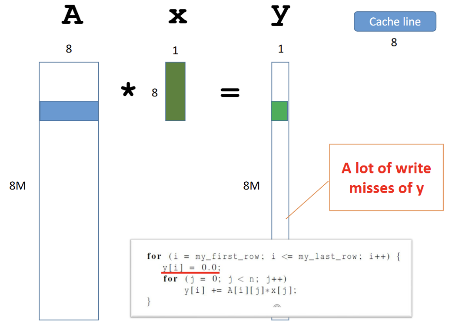

直观理解：

```text
y 太长，每次写到新的 y 位置，缓存里往往还没有这块数据，
于是频繁发生 y 的写缺失。
```

#### 情况二：`8 x 8,000,000`，主要问题是 `x` 的读缺失，同时 `y` 可能伪共享

矩阵形状是：

```text
A: 8 x 8M
x: 8M x 1
y: 8 x 1
```

这时 `y` 很短，但每一行都要扫完整个 `x`：

```c
for (int j = 0; j < n; j++) {
    y[i] += A[i][j] * x[j];
}
```

`x` 有 800 万个元素，远远大于 cache。访问 `x[j]` 时，经常发现对应 cache line 不在缓存里，于是发生大量读缺失。

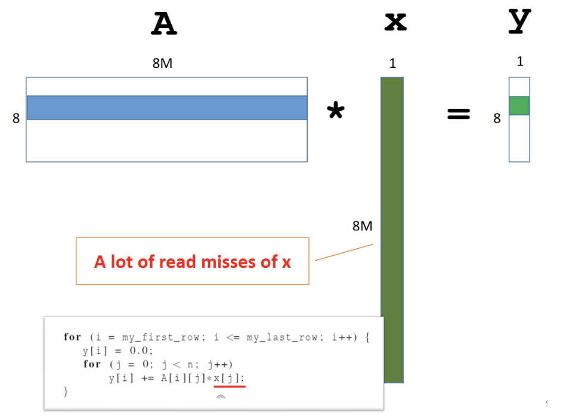

直观理解：

```text
x 太长，每次读 x[j] 都可能要从内存重新搬一条 cache line，
于是频繁发生 x 的读缺失。
```

这个形状还有一个并行性能问题：`y` 只有 8 个元素，多个线程很容易写入同一条 cache line。

对于 `8 x 8,000,000`，`m = 8`。如果用 4 个线程：

```text
线程 0：y[0], y[1]
线程 1：y[2], y[3]
线程 2：y[4], y[5]
线程 3：y[6], y[7]
```

假设 `y[0]` 从一个缓存行开头开始，那么一个缓存行正好容纳 8 个 `double`：

| 同一个 cache line（64B） |  |  |  |  |  |  |  |
|---|---|---|---|---|---|---|---|
| `y[0]` | `y[1]` | `y[2]` | `y[3]` | `y[4]` | `y[5]` | `y[6]` | `y[7]` |
| 线程 0 写 | 线程 0 写 | 线程 1 写 | 线程 1 写 | 线程 2 写 | 线程 2 写 | 线程 3 写 | 线程 3 写 |

缓存一致性看到的是整条 cache line，而不是单个 `y[i]`：

```text
线程 0 写 y[0] 或 y[1]  -> 其他核心中这整条 cache line 失效
线程 1 写 y[2] 或 y[3]  -> 线程 0 所在核心中的同一条 cache line 又失效
线程 2 / 线程 3 写入    -> 继续让这条 cache line 在核心之间来回抢占
```

逻辑上每个线程写不同的 `y[i]`，没有普通数据竞争；但这些 `y[i]` 可能都在同一个缓存行里。一个线程写入时，会让其他核心缓存中的整行失效，这就是伪共享。

更严重的是，原始写法会在内层循环中反复写 `y[i]`：

```c
y[i] += A[i][j] * x[j];
```

如果 `n = 8,000,000`，每个 `y[i]` 会被更新 800 万次，伪共享会被放大。

所以 `8 x 8,000,000` 的性能差，通常有两层原因：

- `x` 很长，导致大量读缺失。
- `y` 很短，多个线程写的 `y[i]` 可能挤在同一条 cache line 中，导致伪共享。

#### 情况三：`8,000 x 8,000`，缓存压力更均衡

矩阵形状是：

```text
A: 8K x 8K
x: 8K x 1
y: 8K x 1
```

它的总运算量同样是 `64,000,000`，但 `x` 和 `y` 都没有达到 800 万那么极端。

因此：

- `x` 没有特别长，读缺失相对少一些。
- `y` 也没有特别长，写缺失相对少一些。
- 不同线程写 `y` 的区间较大，伪共享通常只可能出现在分界处附近。

所以它虽然算术运算量一样，但缓存表现更平衡，实际运行时间可能更好。

#### 改进思路

更好的写法是先用线程私有变量累加，最后只写一次共享数组：

```c
double temp = 0.0;

for (int j = 0; j < n; j++) {
    temp += A[i][j] * x[j];
}

y[i] = temp;
```

这样可以减少对 `y[i]` 的反复写入，也能明显降低伪共享的影响。

一句话记忆：

```text
8M x 8：y 很长，主要是写缺失。
8 x 8M：x 很长，主要是读缺失；y 很短，还可能伪共享。
8K x 8K：x、y 都没那么极端，缓存表现更平衡。
```

核心结论：共享内存程序中，线程即使写不同变量，也可能因为这些变量位于同一个缓存行而互相拖慢；这个问题从算法复杂度里看不出来，必须结合缓存行、内存布局和线程划分分析。

# 第 5 章 使用 OpenMP 进行共享内存编程

## 5.1 OpenMP 概述

本章重点：

- 如何创建线程。
- 如何隐式创建线程。
- 如何使用 `schedule` 调度循环迭代。
- 如何用 OpenMP 修饰原本已有的 `for` 循环。
- 如何通过调度实现负载均衡。
- OpenMP 变量的作用域规则。

### OpenMP 是什么

**OpenMP** 是用于共享内存并行编程的 API。它和 Pthreads 一样面向共享内存系统，但编程方式更高层。

核心区别：

- **Pthreads**：程序员显式创建线程，并明确指定每个线程要执行什么。
- **OpenMP**：程序员通常只需要声明某个代码块可以并行执行；具体任务如何分配、哪个线程执行哪部分，主要交给编译器和运行时系统。

也就是说：

```text
Pthreads：手动管理线程。
OpenMP：标注哪里可以并行，剩下交给编译器和运行时。
```

OpenMP 的抽象层次更高，甚至可以看作是为了把已有串行程序逐步改造成并行程序而设计的。

### OpenMP 和 Pthreads 的区别

| 对比项 | Pthreads | OpenMP |
|---|---|---|
| 编程方式 | 显式线程编程 | 通过编译指令声明并行区域 |
| 线程行为 | 程序员明确写出每个线程做什么 | 编译器和运行时决定任务如何分配 |
| 代码形式 | 调用线程库函数，如 `pthread_create` | 使用编译指令，如 `#pragma omp parallel` |
| 抽象层次 | 更底层，控制更细 | 更高层，代码更简洁 |
| 编译要求 | 只要能链接 Pthreads 库，普通 C 编译器一般即可 | 需要编译器支持 OpenMP |
| 适合场景 | 需要精细控制线程行为 | 循环并行、规则任务划分、快速并行化 |

## 5.2 第一个 OpenMP 程序

### `parallel` 基本块

OpenMP 的编译指令总是以 `#pragma omp` 开始。最基本的并行指令是：

```c
#pragma omp parallel
```

OpenMP 中最基本的并行结构是：

```c
#pragma omp parallel
{
    /* 多个线程都会执行这里的代码 */
}
```

如果使用 `num_threads(thread_count)`，就可以指定并行区域中要创建多少个线程：

```c
#pragma omp parallel num_threads(thread_count)
Hello();
```

这里的意思是：创建 `thread_count` 个线程，并让每个线程都执行一次 `Hello()`。

如果不写 `num_threads`，线程数通常由 OpenMP 运行时系统决定，常见情况是按机器上的核心数来设置。

### 程序运行到 `parallel` 时发生什么

在 `parallel` 指令之前，程序只有一个线程在执行，也就是程序启动时的原始线程。

当程序运行到 `#pragma omp parallel` 时：

1. 原来的线程继续执行。
2. OpenMP 额外启动 `thread_count - 1` 个线程。
3. 原始线程和新启动的线程组成一个**线程组**。
4. 线程组中的每个线程都会执行 `parallel` 后面的代码块。
5. 并行代码块结束处==有一个**隐式 barrier**==。
6. 所有线程都完成该代码块后，新启动的线程终止，原始线程继续执行后面的串行代码。

OpenMP 常见线程术语：

| 术语 | 含义 |
|---|---|
| 主线程 | 程序开始时的第一个执行线程，编号通常是 0 |
| 父线程 | 遇到 `parallel` 指令并启动一组线程的线程；很多情况下就是主线程 |
| 子线程 | 由父线程启动的额外线程 |
| 线程组 | 执行同一个 `parallel` 代码块的一组线程 |

可以把 `parallel` 理解成：

```text
串行代码
    |
    | 遇到 #pragma omp parallel
    v
创建线程组：线程 0, 线程 1, ..., 线程 p-1
    |
所有线程执行同一个并行代码块
    |
隐式 barrier：所有线程都到达后才能继续
    |
子线程结束，主线程继续执行后面的串行代码
```

这比 Pthreads 更高层：Pthreads 中通常需要手动保存每个线程的数据结构、用循环创建线程、再用循环等待线程结束；OpenMP 把这些线程创建和回收细节隐藏在 `parallel` 指令背后。

### Hello World 示例

```c
#include <stdio.h>
#include <stdlib.h>
#include <omp.h>

void Hello(void);

int main(int argc, char* argv[]) {
    int thread_count = strtol(argv[1], NULL, 10);

    #pragma omp parallel num_threads(thread_count)
    Hello();

    return 0;
}

void Hello(void) {
    int my_rank = omp_get_thread_num();
    int thread_count = omp_get_num_threads();

    printf("Hello from thread %d of %d\n", my_rank, thread_count);
}
```

几个重要函数：

| 函数 | 含义 |
|---|---|
| `omp_get_thread_num()` | 返回当前线程在线程组中的编号 |
| `omp_get_num_threads()` | 返回当前并行区域中的线程总数 |

### 输出顺序不确定

编译和运行：

```bash
gcc -fopenmp hello.c -o hello
./hello 4
```

可能输出：

```text
Hello from thread 0 of 4
Hello from thread 1 of 4
Hello from thread 2 of 4
Hello from thread 3 of 4
```

也可能输出：

```text
Hello from thread 3 of 4
Hello from thread 1 of 4
Hello from thread 2 of 4
Hello from thread 0 of 4
```

原因：多个线程并行执行，哪个线程先运行到 `printf` 是不确定的。

### 编译支持

Pthreads 本质上是一个函数库，可以链接到 C 程序中。因此只要系统有 Pthreads 库，普通 C 编译器通常就可以编译 Pthreads 程序。

OpenMP 不只是普通函数库调用，它依赖编译器识别和处理 `#pragma omp ...` 这类编译指令。因此，如果 C 编译器不支持 OpenMP，就可能无法把 OpenMP 程序编译成真正的并行程序。

`#pragma` 是 C/C++ 的预处理器指令，用来给编译器提供“建议”或“指示”。如果编译器完全不认识某个 `#pragma`，通常会忽略它而不是报错；但是如果程序调用了 `omp_get_thread_num()` 这类 OpenMP 函数，仍然需要 OpenMP 头文件和运行时库支持。

## 5.3 OpenMP 的变量作用域

在 `#pragma omp parallel` 中，变量作用域非常重要。

基本规则：

- 在并行基本块外声明的变量，默认是**共享变量**。
- 在并行基本块内声明的变量，默认是**私有变量**。

例如：

```c
int x = 0;  /* 默认共享 */

#pragma omp parallel
{
    int my_rank = omp_get_thread_num();  /* 每个线程各有一份 */
    x += my_rank;                        /* 多个线程共享同一个 x */
}
```

注意：共享变量如果被多个线程同时更新，仍然可能产生竞争条件。OpenMP 虽然比 Pthreads 写法更简单，但它仍然是共享内存并行，线程安全问题不会自动消失。

## 5.4 `schedule` 子句

### `schedule` 用来做什么

`schedule` 子句用于控制 `parallel for` 中循环迭代如何分配给线程。

如果不显式写 `schedule`，OpenMP 会使用默认调度方式。想指定循环调度方式，可以在 `parallel for` 指令中加入 `schedule` 子句。

没有显式调度：

```c
sum = 0.0;

#pragma omp parallel for num_threads(thread_count) \
    reduction(+:sum)
for (int i = 0; i <= n; i++) {
    sum += f(i);
}
```

加入 `schedule`：

```c
sum = 0.0;

#pragma omp parallel for num_threads(thread_count) \
    reduction(+:sum) schedule(static, 1)
for (int i = 0; i <= n; i++) {
    sum += f(i);
}
```

这里 `schedule(static, 1)` 表示：采用静态调度，并且每个迭代块的大小是 `1`。

### 基本形式

```text
schedule(<type>[, <chunksize>])
```

其中：

- `type` 表示调度方式。
- `chunksize` 表示每个迭代块中包含多少次连续迭代。

在 OpenMP 中，一个**迭代块**（chunk）指的是从**串行 `for` 循环的迭代编号空间**里切出来的一段连续编号区间。块大小就是这个区间中包含的迭代次数。

### 常见调度类型

| 类型 | 分配时机 | 核心含义 | 适合场景 |
|---|---|---|---|
| `static` | 循环开始前 | 先把迭代分好，再交给各线程 | 每次迭代工作量差不多 |
| `dynamic` | 循环运行时 | 线程完成当前块后，再向运行时系统请求新块 | 每次迭代工作量不均匀 |
| `guided` | 循环运行时 | 类似动态调度，但块大小通常逐渐变小 | 工作量不均匀，同时想减少调度开销 |
| `auto` | 编译器或运行时决定 | 调度方式交给系统选择 | 不想手动指定策略 |
| `runtime` | 运行时决定 | 根据环境变量决定调度方式 | 想运行时切换调度策略 |

只有 `static`、`dynamic` 和 `guided` 可以显式指定 `chunksize`。

### `static` 调度类型

`static` 调度会在循环开始前把迭代块分配给线程。分配完成后，循环运行期间不再动态调整。

假设有 12 个迭代，编号为 `0` 到 `11`，并且有 3 个线程。

使用 `schedule(static, 1)`：

```text
schedule(static, 1)

线程 0：0, 3, 6, 9
线程 1：1, 4, 7, 10
线程 2：2, 5, 8, 11
```

因为块大小是 `1`，所以每个 chunk 只有 1 次迭代，然后按轮流方式分给线程。

使用 `schedule(static, 2)`：

```text
线程 0：0, 1, 6, 7
线程 1：2, 3, 8, 9
线程 2：4, 5, 10, 11
```

使用 `schedule(static, 4)`：

```text
线程 0：0, 1, 2, 3
线程 1：4, 5, 6, 7
线程 2：8, 9, 10, 11
```

如果省略 chunk size，默认调度由具体 OpenMP 实现决定；大多数情况下近似于：

```text
schedule(static, total_iterations / thread_count)
```

也就是每个线程拿到一段较大的连续迭代范围。

`static` 的优点是调度开销小。如果每次迭代的工作量差不多，它通常是不错的选择。它还有一个好处：后续循环如果使用相同迭代次数，线程通常会被分配到相同范围，这对缓存局部性和 NUMA 系统可能有帮助。

### 调度图的正确读法

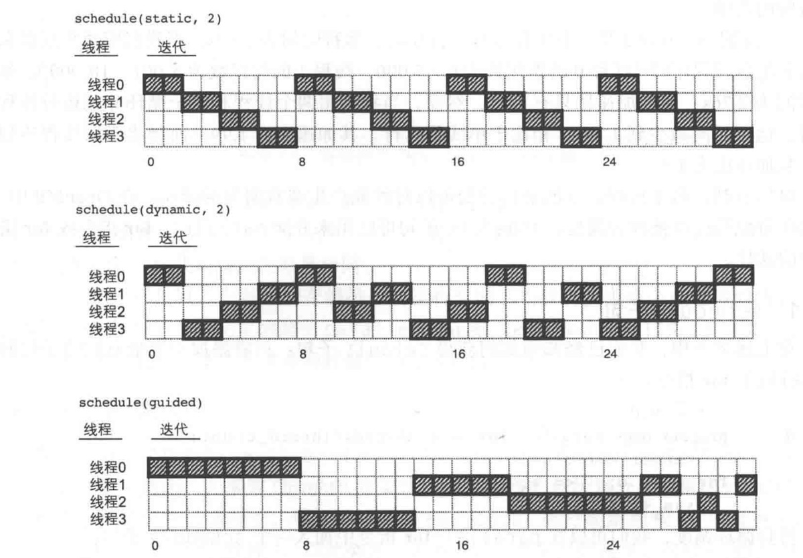

这张图主要画的是：**哪些串行迭代编号被分配给哪个线程**。

需要注意：

- 图中的横向位置表示串行循环的迭代编号，例如 `0, 1, 2, ...`，不是实际时间轴。
- chunk 是按“串行循环的迭代编号空间”切出来的连续区间。
- 图没有体现真实执行时多个线程同时运行的并行性。
- `dynamic` 和 `guided` 的具体分配会受运行时调度影响，所以图中只是可能的调度结果之一。

例如 `schedule(static, 2)` 中，一个 chunk 可以是：

```text
迭代 0, 1
迭代 2, 3
迭代 4, 5
...
```

这些 chunk 会被分配给不同线程。图画的是“编号区间归属”，不是“哪个线程在某个时间点正在执行”。

### `dynamic` 调度类型

`dynamic` 调度会把迭代分解成固定大小的连续 chunk，但这些 chunk 不会在循环开始前全部固定分给线程。

执行过程是：

```text
线程完成一个 chunk -> 向运行时系统请求下一个 chunk -> 直到所有迭代完成
```

例如：

```c
#pragma omp parallel for schedule(dynamic, 2)
for (int i = 0; i < n; i++) {
    work(i);
}
```

这里每个线程每次领取 2 个连续迭代。哪个线程先完成，就先领取下一个 chunk。

如果省略 chunk size：

```c
#pragma omp parallel for schedule(dynamic)
```

默认 chunk size 通常为 `1`。

`static` 和 `dynamic` 的关键区别：

- `static`：循环开始前就固定分配。
- `dynamic`：运行时先到先得地领取 chunk。

`dynamic` 适合每次迭代耗时不一致的循环。例如后面的迭代计算量更大时，先完成的线程可以继续领取任务，负载更均衡。

代价是：每次领取 chunk 都要和运行时系统交互，所以会产生调度开销。增大 chunk size 可以减少领取次数，在负载均衡和调度开销之间折中。

### `guided` 调度类型

`guided` 和 `dynamic` 类似，也是线程完成一个 chunk 后，再向运行时系统请求下一个 chunk。

区别在于 chunk 大小：

```text
dynamic, 2：每次都领 2 个迭代
guided, 2：一开始领大块，后面逐渐变小，最小通常不低于 2
```

`guided` 的直观理解：

```text
刚开始剩余任务多 -> 分配较大的 chunk，减少调度次数
后面剩余任务少 -> 分配较小的 chunk，方便线程平均收尾
```

例如：

```c
#pragma omp parallel for schedule(guided, 2)
for (int i = 0; i < 100; i++) {
    work(i);
}
```

可能的分配趋势：

```text
前期：0-24, 25-43, 44-57, ...
中期：69-76, 77-82, 83-87, ...
后期：88-89, 90-91, 92-93, ...
```

这里的 `2` 是最小 chunk size。后面 chunk 会越来越小，但通常不会小于 `2`，最后剩余不足时除外。

`guided` 适合这种情况：每个迭代耗时不完全一样，但又不想像 `dynamic, 1` 那样产生太多调度开销。

### 三种调度的记忆方式

```text
static：提前固定分。
dynamic：运行时按固定小块抢任务。
guided：运行时抢任务，但块大小从大到小。
```

一句话总结：`schedule` 控制的是“循环迭代怎么分给线程”。如果每次迭代工作量接近，`static` 通常开销小；如果工作量不均匀，`dynamic` 或 `guided` 更容易负载均衡，其中 `guided` 试图在动态负载均衡和调度开销之间折中。

## 5.5 OpenMP 同步：`atomic`、`critical` 和锁

### `atomic` 指令

如果只是保护==一个共享变量==的**单一更新操作**，可以使用：

```c
#pragma omp atomic
x += 1;
```

`atomic` 比 `critical` 更窄，只能保护紧接着的一条特定 C 语句，通常用于对一个共享变量进行简单更新。

可以使用 `atomic` 的例子：

```c
#pragma omp atomic
x += 1;

#pragma omp atomic
x++;

#pragma omp atomic
x = y;      /* 原子写 */

#pragma omp atomic
x *= 2;
```

不适合使用 `atomic` 的例子：

```c
#pragma omp atomic
x += y++;   /* 同时修改 x 和 y，不是单一共享变量更新 */
```

一句话记忆：

```text
atomic：保护一个共享变量的一次简单更新。
critical：保护一整段临界区代码。
```

### `critical` 临界区

如果要保护一段代码，可以使用 `critical`：

```c
#pragma omp critical
{
    /* 临界区代码 */
}
```

默认情况下，所有没有名字的 `critical` 区域共享同一把全局锁。也就是说，任何线程都不能同时执行任意一个未命名的 `critical` 区域，即使这些区域保护的是完全无关的数据。

如果不同临界区保护的是不同资源，可以给临界区命名：

```c
#pragma omp critical(queue0)
{
    /* 只和 queue0 这个名字对应的临界区互斥 */
}
```

这样 OpenMP 只会对同名的 `critical(queue0)` 加锁，不同名字的临界区可以并行执行。

### OpenMP 锁函数

OpenMP 也提供显式锁函数：

```c
omp_init_lock(&lock);
omp_set_lock(&lock);
omp_unset_lock(&lock);
omp_test_lock(&lock);
```

含义：

| 函数 | 含义 |
|---|---|
| `omp_init_lock` | 初始化锁 |
| `omp_set_lock` | 获取锁；如果锁不可用就等待 |
| `omp_unset_lock` | 释放锁 |
| `omp_test_lock` | 尝试获取锁；不一定阻塞 |

显式锁更灵活，但也更容易写出死锁。简单场景下，优先考虑 `critical` 或 `atomic`。

### 嵌套 `critical` 和死锁

如果嵌套使用未命名 `critical`，可能死锁：

```c
#pragma omp critical
{
    /* 临界区 A */

    #pragma omp critical
    {
        /* 临界区 B */
    }
}
```

原因：外层已经拿到默认 `critical` 的全局锁，内层又试图获取同一把锁，线程会卡在自己已经持有的锁上。

给临界区命名也不能完全避免死锁。如果两个线程按相反顺序获取两把不同的锁，也可能互相等待：

```c
#pragma omp critical(one)
{
    #pragma omp critical(two)
    {
        /* 线程 u：先 one 后 two */
    }
}

#pragma omp critical(two)
{
    #pragma omp critical(one)
    {
        /* 线程 v：先 two 后 one */
    }
}
```

可能发生：

| 时间 | 线程 u | 线程 v |
|---|---|---|
| 0 | 进入临界区 `one` | 进入临界区 `two` |
| 1 | 等待临界区 `two` | 等待临界区 `one` |
| 2 | 阻塞 | 阻塞 |

这就是死锁。

### `atomic` 和 `critical` 的区别

| 对比项 | `atomic` | `critical` |
|---|---|---|
| 保护范围 | 一条简单更新语句 | 一段代码块 |
| 适合场景 | `x++`、`x += value` 这类单变量更新 | 多条语句、复杂数据结构更新 |
| 开销 | 通常更小 | 通常更大 |
| 灵活性 | 较低 | 较高 |
| 是否能替代锁 | 只能替代很简单的锁场景 | 更接近互斥锁 |

如果临界区只有特定的赋值或更新语句，优先考虑 `atomic`。如果不能用 `atomic` 表达，再使用 `critical`。

注意：`atomic` 和 `critical` 不是同一把锁。下面代码的输出仍然是不确定的：

```c
#pragma omp atomic
x += 1;

#pragma omp critical
x = 1;
```

原因：`atomic` 只保证自己的原子更新，`critical` 只保证进入临界区的互斥；它们之间没有自动建立同一个互斥关系。

一句话总结：OpenMP 的核心思想是“用编译指令标注并行结构”，比 Pthreads 更高层；但只要多个线程访问共享变量，仍然需要考虑作用域、调度和同步。简单单变量更新用 `atomic`，复杂临界区用 `critical` 或显式锁。
